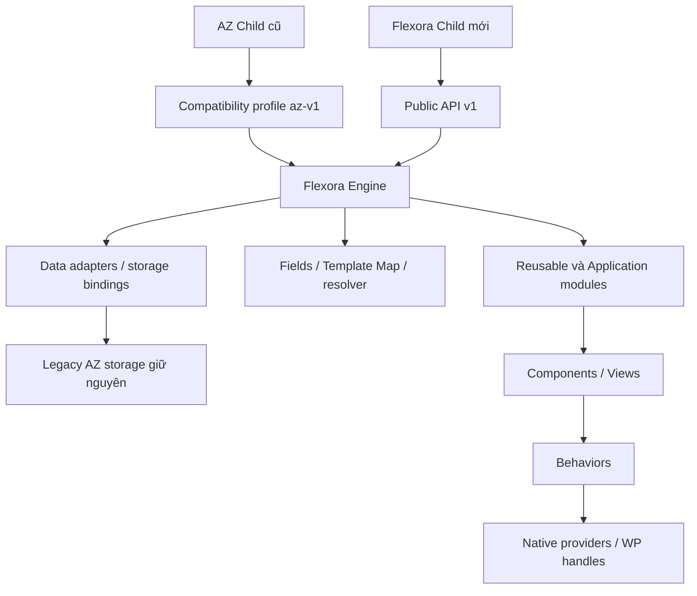

# Flexora — Architecture baseline 1.0.0

Ngày: 27/10/2026. Author sản phẩm: **Tunlamweb**. Trạng thái: **Design frozen for review**. “Chốt” trong bộ tài liệu nghĩa là contract thiết kế đã chọn, không phải đã có runtime hoặc đã được người dùng phê duyệt triển khai. Thay quyết định chốt phải có ADR thay thế; không tự viết implementation.

## Đầu vào và phạm vi

Đã đọc đầy đủ [audit chính](../audit-phase-01/FLEXORA-PHASE-01-AUDIT.md), [Parent–Child contract](../audit-phase-01/PARENT-CHILD-CONTRACT.md), [Data Compatibility](../audit-phase-01/DATA-COMPATIBILITY.md). Bằng chứng Phase 01 là baseline; các diagram/class bên dưới là thiết kế tương lai. Không sửa 435 source file, Phase 01 hay DB. Không tạo thư mục runtime `flexora/`.

## Kiến trúc chính thức

Flexora là **WordPress Website Framework trong Parent Theme**. Parent cung cấp reusable engine; Child là một website với branding, templates, styles, maps và nghiệp vụ riêng. Leads/SMTP/Auth/Analytics cũng có thể nằm Parent, dưới module có boundary/lifecycle rõ. Không bắt buộc tách plugin. Khi có provider plugin hiện hữu, module giải quyết ownership, không boot trùng.



### Namespace, trách nhiệm và dependency direction

| Namespace concept | Nội dung | Surface |
|---|---|---|
| `Flexora\Contracts\V1` | Immutable public DTO/spec/result, interface cho renderer/provider/field/storage extension | Public, versioned; không chứa bootstrap/service locator |
| `Flexora\Core` | Kernel, request context, boot coordinator, hook ledger, diagnostics | Internal |
| `Flexora\Data` | Storage adapters, legacy bindings, presence/patch/revision, snapshot coordinator | Internal; extension interfaces public qua Contracts |
| `Flexora\Fields` | Type registry, normalization/validation, WP editor/media integration, admin renderer | Internal; đăng ký type qua public registration façade |
| `Flexora\Templates` | Template registry, resolver, maps, render context, page instances | Internal |
| `Flexora\Assets` | Asset/provider registry, dependency resolver, usage collector, WP enqueue bridge | Internal |
| `Flexora\Components` | Component definitions, variants, view resolver, behavior contracts | Internal; Child chỉ dùng definition DTO/public functions |
| `Flexora\Modules` | Module descriptors và boot implementations theo ID | Optional modules; implementation internal |
| `Flexora\Compatibility\AzV1` | Global functions/classes/file-path bridges, callbacks/handles/DOM/storage semantics cũ | Legacy surface có contract riêng |
| `Flexora\Support` | Image/URL/icon/a11y/responsive primitives, deterministic utilities | Internal; chức năng cần Child gọi được expose qua API v1 |

Core không phụ thuộc Woo/Leads/Google hay site SOVIBAN. Module phụ thuộc core/public contracts; component khai dependency behavior/provider; Child chỉ phụ thuộc public façade + WordPress APIs được hỗ trợ. Không cấp `container->get(InternalClass)` cho Child. “PHP public method” không tự là Public API.

### Cấu trúc gói Parent tương lai (chỉ specification)

```text
functions.php / inc/bootstrap.php   # bridge entrypoints được giữ khi dùng az-v1
src/{Core,Data,Fields,Templates,Assets,Components,Modules,Compatibility,Support}/
contracts/v1/                     # documented public extension contracts
modules/<module-id>/              # descriptor + implementation + assets
components/<component-id>/        # definition + views + component CSS
assets/{core,behaviors,providers,fonts,admin}/
compatibility/az-v1/               # manifests và adapters; không copy engine lần hai
views/                            # generic template fallbacks
tests/ docs/
```

Không di chuyển file theo cây này trong Phase 02. Khi triển khai, path shim cũ là phần của gói compatibility, được chuyển từng seam có test.

## Hai delivery profile và vấn đề slug

**Chốt:** branding Flexora không buộc đổi slug lưu trữ. Cần phân biệt:

| Profile package tương lai | Physical Parent slug | Child Template header | Mục đích |
|---|---|---|---|
| `az-bridge` | `az-theme` | Child cũ giữ `Template: az-theme`; Child mới trong môi trường bridge cũng dùng slug này | Nâng engine tại chỗ với az-v1, không yêu cầu sửa Child cũ để WordPress tìm Parent |
| `flexora-native` | `flexora` | `Template: flexora` | Cài mới hoặc site đã chuyển package theo migration riêng |

Hai profile build từ cùng engine/version; **không kích hoạt hai engine**, không chain theme ba tầng, không trông chờ PHP alias sửa được WordPress theme resolution. `az-bridge` là kế hoạch package tương lai, chưa phải yêu cầu thay AZ hiện tại. Chuyển physical slug là operation explicit có snapshot mods/custom CSS/menu/widget/config và rollback; không chạy chỉ vì update branding. API/data adapters dùng scope identity độc lập slug.

Không bảo đảm “zero-edit Child cũ với Parent slug flexora”: core WordPress phải resolve Template trước khi chạy PHP. Native profile chỉ nhận Child đã chuyển có chủ đích. Release bridge phải giữ cả path mà Child require sớm; xem [legacy plan](LEGACY-COMPATIBILITY-PLAN.md).

## Lifecycle cố định

1. WordPress nạp Child trước. Child mới chỉ khai báo WordPress hook để register sau; không gọi Flexora service tức thì khi chưa có Parent. Child cũ vẫn được dùng early file bridge.
2. Parent load minimal public declarations + compatibility declarations; dựng descriptors/legacy mutable registry, chưa boot feature side effects.
3. Trong admin, az-v1 registry sẵn trước `after_setup_theme:20/25`; không đổi thời điểm Child cũ sửa fields. Priority 0 legacy restriction removal được bảo toàn.
4. `after_setup_theme:30`: event `flexora/register` cho Child mới, args public Registrar v1. Đây là nơi đăng ký map/component/view/asset/module extension; WordPress query chưa sẵn nên không query trang ở bước này.
5. Priority 40: validate/seal registries, resolve module dependency graph. Callback late registration bị từ chối có diagnostic, không silently ignore. Migration-specific deferred registry là API riêng nếu sau này cần.
6. Scope boot: admin tại `admin_init` với screen checks; frontend tại `wp`; AJAX/REST/cron chỉ boot module sở hữu endpoint/job theo descriptor. Endpoint definitions phải register trước hook dispatch tương ứng; không đợi `wp` cho REST/AJAX. Modules không được register post types quá muộn sau `init`.
7. Render usage preflight → enqueue assets → render views → footer init. Các API read không tạo Page, schedule job, seed default hoặc ghi DB.

Chi tiết scheduling init/REST/menu nằm [MODULE-SYSTEM.md](MODULE-SYSTEM.md); priority trên là compatibility boundary phải được integration-test trước refactor bootstrap.

## Mapping AZ foundation → target

| Foundation thật | Target / đường kế thừa | Điều kiện |
|---|---|---|
| `inc/bootstrap.php`, static load guard | Core lifecycle + az-v1 ordering adapter | Không rewrite toàn bootstrap một lần |
| `helpers/options.php`, registry/sanitizer/Advanced merge | Data binding + Field types + reusable admin | Giữ missing/empty legacy khác new semantics |
| `AZ_Dynamic_CSS`, local fonts, container styles | Tokens/core styling + font provider | Alias variables; không đổi breakpoint legacy âm thầm |
| Header/footer helpers, mobile/sticky/contact | UI/navigation modules + component primitives | Giữ DOM/callback identity cho legacy |
| `home-products.php` shared card | Product component + Woo module | Không đưa category price policy vào presentation core |
| shared-banner + Child steel carousel | Native carousel provider/behavior, banner/hero variants | Giữ cả legacy DOM adapters trước hợp nhất |
| Product/gallery lightbox/tabs inline | Modal/gallery/tabs behaviors | Bổ sung a11y theo contract mới, snapshot legacy riêng |
| Homepage Child typed data/save patterns | Template Map + instance storage | SOVIBAN layout/schema vẫn Child, không làm default Parent |
| Neutral/About WP hierarchy | Template resolver generic editorial fallback | Filename tương thích giữ nguyên |
| Leads/SMTP/Auth/Analytics/License | Modules riêng + data/route adapters | Không tự disable nghiệp vụ site cũ; security release gate |
| Flatsome preview/import + installer | Migration coordinator + packaging tools | Backup verified/explicit selection; không tự import |
| Child product permalink module | Site routing feature; reusable candidate opt-in | Không bật toàn site mới; giữ redirects/collision policy |

## Version policy chốt

| Version | Ví dụ minh họa | Quyền thay đổi |
|---|---|---|
| Parent package | `1.4.2` | SemVer của package; tương thích API/modules cần constraints |
| Child | `2.1.0` | Independent, khai supported Parent/API/module ranges |
| Public API | `1.0.0`, façade major v1 | Breaking thay major, deprecate có horizon rõ |
| Module | `navigation@1.2.0` | Behavior/API riêng, required engine range |
| Map schema | `site.about@1.3.0` | SemVer; đổi type/rename ID/storage meaning cần migration kể cả code nhỏ |
| Data migration | `site.about:1.2.0-to-2.0.0` + immutable revision/checksum | Ordered ledger; không dùng Parent version làm “đã migrate” |
| Content Pack format | `1.0.0` | Parser rejects unsupported major; minor additions capability-negotiated |

Version của blueprint **không phải** release Parent runtime. Minor release không được đổi default/fallback/DOM documented hoặc silently thêm data mutation. Adding field required không có safe default là breaking schema. Code rollback không đủ khi data schema đã đổi.

## Decision chốt và phần còn mở

Chốt: Parent framework modular; public façade v1; az-v1 adapters đầy đủ; legacy keys giữ; instance data + stable field/item IDs; WP handle registry; native-first provider; opt-in application modules; Content Pack selective; snapshot/conflict-aware rollback; SemVer độc lập. ADR 001–010 ghi context/tradeoffs.

Chưa chốt **implementation/release gate**, không phải bỏ trống contract: min WP/PHP/Woo và browser matrix; native carousel variant được chọn sau parity test; provider secret encryption/key management; route hardening protocol với Content AI client; snapshot backend hỗ trợ host/DB; perf budgets theo benchmark; bridge support end-date. Default trước khi xác nhận: không triển khai operation phụ thuộc, không thêm vendor, không migration dữ liệu, không drop legacy.

## Bộ tài liệu và thứ tự đọc

1. [Public API](PUBLIC-API-CONTRACT.md)
2. [Legacy compatibility](LEGACY-COMPATIBILITY-PLAN.md)
3. [Module system](MODULE-SYSTEM.md)
4. [Asset/library](ASSET-LIBRARY-ARCHITECTURE.md)
5. [Template Map + Field Engine](TEMPLATE-MAP-ARCHITECTURE.md)
6. [Child contract và promotion](CHILD-THEME-CONTRACT.md)
7. [Data migration/snapshot](DATA-MIGRATION-STRATEGY.md)
8. [Content Pack](CONTENT-PACK-SPEC.md)
9. [AI coding rules](AI-CODING-RULES.md)
10. [ADRs](ADR/README.md)
11. [Review summary và integrity](PHASE-02-REVIEW.md)

**PHASE 02 ARCHITECTURE COMPLETED — NO RUNTIME SOURCE CHANGES MADE**
