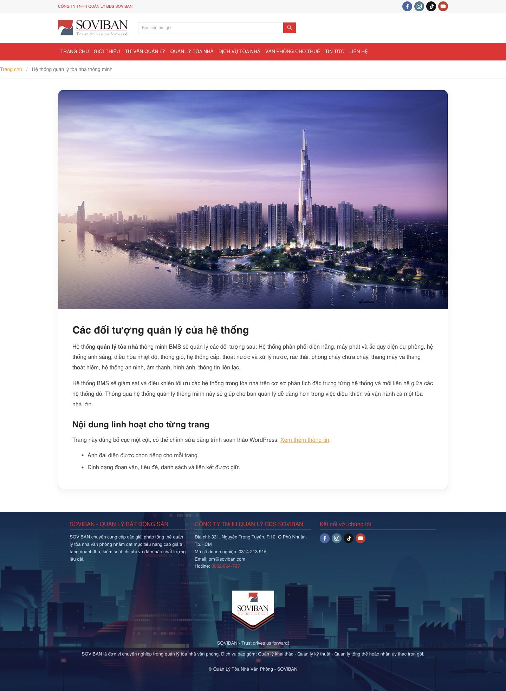
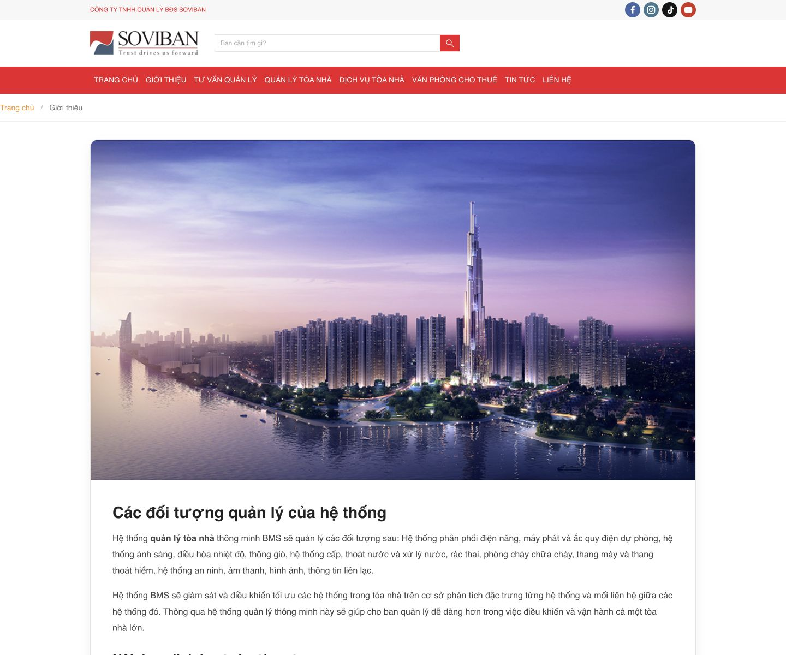

# Trang Nội Dung Trung Tính — kế thừa parent

Mẫu đã được chuyển sang **az-theme** ngày 13/10/2026. Hướng dẫn quản trị, API/assets và contracts xem [tài liệu dùng chung của parent](../../az-theme/docs/NEUTRAL-PAGE.md).

Child SOVIBAN không còn `page-neutral.php`, `inc/neutral-page.php` hoặc `css/neutral-page.css`; `functions.php` không nạp module riêng nữa. WordPress tự chọn template parent với cùng filename `page-neutral.php`. Các Page đã chọn mẫu tiếp tục dùng được, không đổi dữ liệu hoặc cấu hình. Header/footer vẫn lấy từ child; font/màu/container đọc tokens parent và cấu hình đã lưu.

Các classes hiện dùng `.az-neutral-page` / `.az-neutral-page__*`; hàm asset là `az_neutral_page_assets()`, handle `az-neutral-page`. Fixture `tests/neutral-page.php` dùng source parent để kiểm tra thừa kế. Rule chuẩn hóa wrapper copy từ chat cũng nằm trong CSS parent và tiếp tục giữ nội dung/ảnh/link đã lưu.

Kiểm tra parent độc lập 21 ca, child kế thừa 14 ca và admin cleanup 10 ca đạt. Browser fixture kiểm tra desktop/mobile và wrapper cũ; chưa lưu qua wp-admin/database thật. Ảnh dưới đây dùng dữ liệu minh họa, không phải website production.

Mẫu **Trang Giới Thiệu** trong parent hiện cũng dùng chung bố cục và nội dung từ editor WordPress. Form riêng sáu nhóm Giới thiệu/Lợi thế/Tầm nhìn/Sứ mệnh/Giá trị cốt lõi/Hợp tác đã gỡ khỏi parent, không còn được bật theo slug `gioi-thieu`. Chọn ảnh đại diện và format nội dung ở editor chính, rồi Cập nhật.

