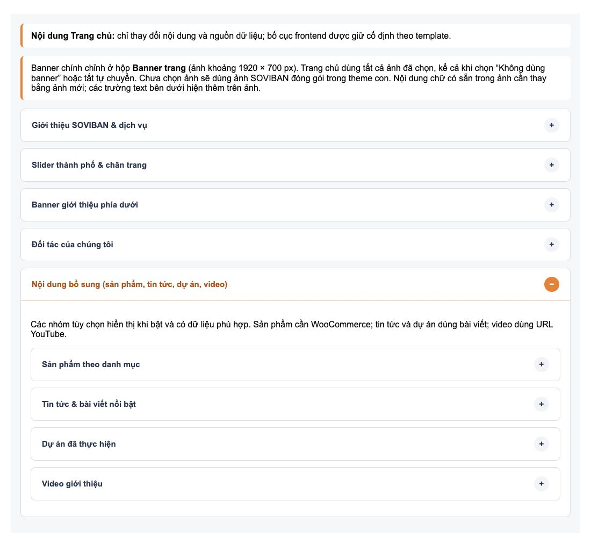
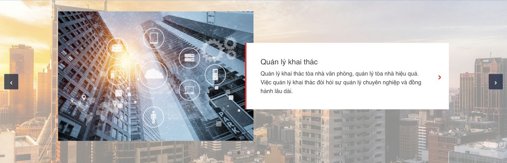
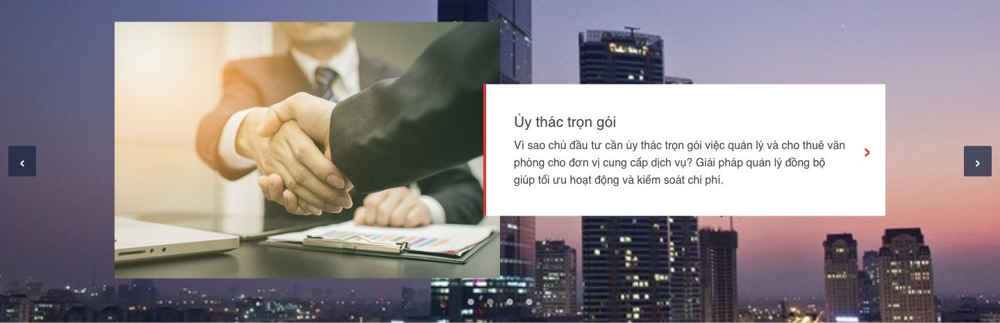
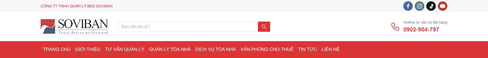
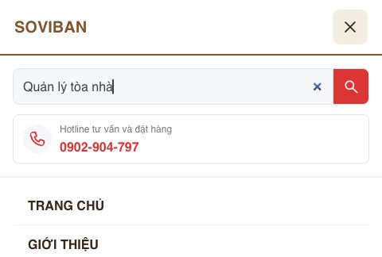

# Trang chủ SOVIBAN — bàn giao 13/10/2026

Triển khai theo ảnh tham chiếu của nhiệm vụ: header trắng/menu đỏ, banner chính toàn chiều rộng, giới thiệu + ba dịch vụ, slider thành phố, banner tư vấn, năm logo đối tác và footer nền thành phố xanh đậm. Header/footer dùng chung trên các entrypoint của child. Giữ `Template: az-theme`; không sửa parent/core/plugins/dependencies hoặc chạy WordPress/database.

Ảnh preview [desktop](soviban-homepage-desktop.jpg) dùng PHP fixture với các template thật và CSS parent/child. Số điện thoại, email, địa chỉ và liên kết mạng xã hội trong **fixture** là dữ liệu minh họa. Frontend thật đọc cấu hình General/Social đang lưu. Preview không chứng minh trạng thái website production.

## Quản trị nội dung

Vào **Trang → Trang chủ → Sửa → Nội dung Trang chủ**, sửa nội dung và nhấn **Cập nhật**.

| Phần frontend | Nơi chỉnh | Nguồn dữ liệu |
| --- | --- | --- |
| Banner chính, chữ bổ sung, nút, chiều cao, lớp phủ, ảnh/thứ tự ảnh, autoplay, header overlay | Metabox **Banner trang** hiện có | `_az_shared_banner`, helper/sanitizer/editor của parent |
| Tiêu đề, mô tả giới thiệu, bật/tắt giới thiệu, ảnh/tên/liên kết dịch vụ | **Giới thiệu SOVIBAN & dịch vụ** | `_az_home_page_data.soviban` |
| Dải hotline/email dưới banner chính | Công tắc trong nhóm giới thiệu; dữ liệu tại General | `soviban.contact_band` + dữ liệu liên hệ chung |
| Ảnh trái / nội dung phải khác nhau theo từng slide | **Slider thành phố & chân trang → từng Slide thành phố → Nguồn nội dung của slide** | `soviban.skyline_items[].feature_source/feature_image/feature_title/feature_description` + `url` |
| Dải ảnh thành phố, bật/tắt, thứ tự, thêm/xóa ảnh, link, tự chuyển | **Slider thành phố & chân trang** | `soviban.skyline_items`, `skyline_enabled`, `skyline_autoplay` |
| Banner tư vấn bất động sản | **Banner giới thiệu phía dưới** | Nhánh cũ `steel.promos` được tái sử dụng |
| Tiêu đề/bật/tắt/logo đối tác | **Đối tác của chúng tôi** | Nhánh cũ `partners`; giữ gallery chọn nhiều ảnh và attachment IDs |
| Tiêu đề/mô tả cột giới thiệu footer, nền, logo footer, khẩu hiệu, ghi chú | **Slider thành phố & chân trang** | Nhánh `soviban`; footer mọi trang đọc Page được đặt làm trang chủ |
| Tên công ty, địa chỉ, hotline, email, mã số doanh nghiệp, bản quyền, hồ sơ, chính sách, Maps | **AZ Theme → Advanced → General** | Dữ liệu chung hiện có, không tạo bản sao trong Page |
| Các tài khoản mạng xã hội | **Advanced → Social** | Helper mạng xã hội của parent |
| Logo header, kích thước logo, H1/SEO | **Advanced → Branding** | Helpers logo/SEO của parent |
| Header, search, công tắc mạng xã hội thanh trên, phạm vi tìm kiếm | **Advanced → Header** | Settings chung; thêm `child_top_social` và `child_search_scope` |
| Điều hướng chính, top menu, menu mobile/sticky | **Giao diện → Menu**, **Advanced → Header** | Menu ID/location sẵn có; không tạo hoặc thay assignment trong database |
| Màu, font, container | **Advanced → Colors / Typography / Layout** | Settings và tokens `--az-*` hiện có |
| Sản phẩm, tin tức, dự án, video bổ sung | **Nội dung bổ sung** trong Nội dung Trang chủ | Giữ các nhánh `products/blog/projects/video` và công tắc đã lưu |

Nhóm chân trang có nút truy cập nhanh đến General/Social/Branding/Header/Menu. Lưu trang trước khi chuyển sang màn hình khác.

Ảnh gốc có chữ thiết kế sẵn (banner “ĐẢM BẢO CHẤT LƯỢNG LÂU DÀI”, banner tư vấn và logo). Muốn đổi chữ trong ảnh, thay ảnh qua Media; trường chữ Banner trang hiện thêm chữ trên ảnh, không sửa bitmap. Thư viện ảnh SOVIBAN được đóng gói trong child từ uploads có sẵn, không import/ghi Media database. Admin vẫn chọn ảnh Media mới như trước.

Liên kết dịch vụ/banner mặc định là `/tu-van-quan-ly/`, `/quan-ly-toa-nha/`, `/dich-vu-toa-nha/`. Cần kiểm tra các trang đích trên website thật và chỉnh URL trong metabox nếu permalink khác. Menu chính dùng menu WordPress thực tế, không phát menu mẫu. Để hiển thị mặc định như preview, website phải dùng child này và có Page trang chủ/menu phù hợp; nhiệm vụ không kích hoạt theme hoặc đổi Reading settings.

## Dọn nhóm quản trị Nội dung Trang chủ

Đã đối chiếu metabox với `front-page.php` → `template-parts/home-storefront.php`, `soviban-home-extras.php` và footer chung. Chỉ xóa nhóm không còn được frontend sử dụng; nhóm đang tắt vẫn giữ nếu có renderer hoạt động.

- Gỡ **Danh mục giải pháp & cam kết dịch vụ**: danh mục solar, bốn cam kết, ID bài nổi bật và mô tả dự án cũ. Xóa module `inc/home-reference-layout.php`, callback lưu priority 20, hai script `home-reference-admin.js` / `home-reference-layout.js`, include/enqueue trong `functions.php`, và suite `tests/home-categories.php` của module đã bỏ.
- Gỡ editor ẩn **Sản phẩm nổi bật (bố cục cũ)**, parser lưu `deal`, cùng media field `steel.featured_image`. Thay media picker ẩn của mỗi nhóm sản phẩm bằng hidden input tương thích để giữ giá trị ảnh cũ theo dòng.
- Còn 5 nhóm chính: giới thiệu/dịch vụ; slider/chân trang; banner phía dưới; đối tác; **Nội dung bổ sung (sản phẩm, tin tức, dự án, video)**. Bốn nhóm bổ sung đều thu gọn, giữ công tắc, dữ liệu và renderer hiện có. Banner chính tiếp tục chỉnh ở **Banner trang** do parent quản lý. Bấm tên nhóm để mở, sửa rồi **Cập nhật** như trước.
- Đối tác được đặt sau banner trong editor theo thứ tự frontend. Mô tả dự án đổi thành thẻ ảnh/nội dung để khớp renderer. Dấu cộng/trừ chỉ theo trạng thái của chính nhóm, kể cả khi lồng trong nhóm bổ sung.
- Dữ liệu `_az_home_page_data.reference`, `deal`, `steel.featured_image` và các key không chỉnh vẫn giữ nguyên khi lưu, gồm `false`, `0`, chuỗi rỗng và danh sách rỗng. Không có migration hoặc xóa database. Giữ `template-parts/home-reference.php` vì parent dùng nó để nhận diện homepage child và tránh thêm màn hình/banner mặc định trùng lặp. `deal` defaults/getter còn giữ tương thích với template legacy; không còn editor/save handler cho nhánh đó.
- **Nội dung cũ dự phòng cho slide đầu** vẫn được giữ thu gọn vì helper slider còn dùng khi slide đầu ở chế độ tự động chưa có URL; không coi phần này là code dư.

Tái sử dụng loader homepage `locate_template()` của parent, metabox **Banner trang**, các API WordPress nonce/quyền/save; không thêm schema hoặc phụ thuộc mới. Các nhóm giữ lại tiếp tục dùng helpers child `az_home_page_get_data()`, media picker, SOVIBAN admin và gallery đối tác; sản phẩm frontend vẫn dùng parent `az_render_product_card()`.

File sửa: `functions.php`, `inc/modules/homepage/page-fields.php`, `tests/soviban-home.php`, `README.md`, tài liệu này. File thêm: `tests/home-admin.php` và `docs/home-admin-cleanup-preview.png`. Bốn file xóa được liệt kê ở trên.

Kiểm tra lần dọn: 11 suite PHP cô lập, **497 checks**, gồm 23 regressions editor/lưu/bảo toàn dữ liệu; PHP lint 47 file và `node --check` 5 file JS đạt. Browser fixture 1100px xác nhận 5 nhóm chính, mở/đóng nhóm lồng đúng, thêm/xóa sản phẩm và video, không có lỗi JavaScript; 390px không tràn ngang. `git diff --check` đạt, chỉ thay đổi trong child. Chưa kiểm tra Media modal, selectWoo với danh mục thật hoặc lưu/reload trong wp-admin/database thật.

## Hành vi và bảo toàn dữ liệu

- Giá trị admin đã lưu ưu tiên hơn mặc định child. Không seed/migrate options/meta. Vì vậy site có màu, menu, banner hoặc nhóm bổ sung đã cấu hình có thể khác preview mặc định; đổi các trường liên quan trong quản trị để khớp mẫu.
- Nhánh `soviban` có callback lưu riêng priority 40; nonce `az_home_page_save`, quyền `edit_post`, chặn autosave/revision. Callback đọc dữ liệu cũ, sửa nhánh của mình, giữ các nhánh và keys khác.
- Save của các nhóm cũ được bổ sung kiểm tra sự hiện diện: submit riêng nhóm SOVIBAN không reset `steel/products/blog/projects/video`; `deal/reference` cũ không còn có callback ghi từ editor. Xóa toàn bộ sản phẩm vẫn lưu danh sách rỗng nhờ marker `az_home_products_present`.
- Các danh sách `services`, `skyline_items`, `partners.items`, `steel.promos` thay toàn collection. Danh sách rỗng sau khi xóa không làm ảnh/default cũ xuất hiện lại. Tiêu đề đối tác để trống được giữ trống. URL dịch vụ/footer mới chỉ nhận HTTP(S) và đường dẫn nội bộ được resolve qua WordPress.
- Các dữ liệu `deal/reference` cũ vẫn được giữ trong metadata; giao diện quản trị và callback lưu cũ đã gỡ vì frontend SOVIBAN không dùng. Khối danh mục/cam kết solar cũ không xuất hiện trong bố cục SOVIBAN mới. Sản phẩm/tin tức/dự án/video có thể bật thêm; mặc định các nhóm bổ sung này tắt ở trang chưa từng lưu cấu hình. Các công tắc đã lưu được giữ.
- Banner chính dùng toàn bộ ảnh hợp lệ theo thứ tự, kể cả `layout=none` hoặc autoplay tắt. `layout=none` tiếp tục tắt renderer banner chung của parent; ngoại lệ trang chủ nằm trong component child.
- Không có ảnh hợp lệ: dùng ảnh hero SOVIBAN đóng gói trong child, không chạy timer. Một ảnh: không có nút/chấm/pause. Từ hai ảnh: trước/sau, chấm chọn, bàn phím; autoplay mỗi 3000ms khi bật. Tái sử dụng các trạng thái hover/focus/tab ẩn/reduced motion và pause của JS child hiện có; thêm guard tránh khởi tạo trùng.
- Overlay chỉ khi banner có media và `transparent` bật; CSS áp dụng ở ≥783px, ở ≤782px header ở trong luồng. Không lấy global `header.transparent` để quyết định overlay của trang chủ.
- Slider đầu trang và slider thành phố có state độc lập; không cài slider library. Các hook `wp_head`, `wp_body_open`, `wp_footer`, logo variants, mobile/sticky và shop delegates được giữ. Cách phát `az_after_site_header` giữ như child cũ: chỉ phát ngoài context trang chủ để tránh banner/breadcrumb kép. Parent chưa có filter tổng quát để loại riêng renderer closure trên hook này; callback mới đăng ký vào hook đó không chạy ở homepage của child.

## Nội dung động theo từng slide thành phố

Vào **Nội dung Trang chủ → Slider thành phố & chân trang**. Mỗi **Slide thành phố** có ảnh nền và liên kết riêng. Trong **Nguồn nội dung của slide**, chọn:

1. **Tự lấy từ bài viết theo liên kết**: dùng URL bài viết/trang nội bộ ở trường **Liên kết bài viết / xem chi tiết**. Frontend lấy ảnh đại diện, tiêu đề và tối đa 45 từ tóm tắt của bài đã publish, công khai và không có mật khẩu. Ví dụ: slide 1 `/quan-ly-khai-thac/`, slide 2 `/uy-thac-tron-goi/`. Các slide cũ chưa có trường nguồn mặc định dùng chế độ này, nên liên kết đã lưu tiếp tục được dùng.
2. **Nhập ảnh và nội dung riêng**: chọn **Ảnh bên trái của slide**, nhập **Tiêu đề riêng của slide**, **Mô tả riêng của slide**. Mô tả nhận HTML an toàn. Liên kết chi tiết dùng URL trong chính slide đó; để trống sẽ ẩn liên kết tiêu đề và mũi tên. Các giá trị rỗng đã lưu được giữ, không lấy nội dung từ bài viết trong chế độ này.
3. **Chỉ hiện ảnh nền**: không hiện khối ảnh/chữ cho slide đó.

Nhấn **Cập nhật** để lưu. Có thể thêm/xóa slide bằng nút hiện có. Mỗi dòng lưu các key `image/title/url` cũ và thêm `feature_source`, `feature_image`, `feature_title`, `feature_description` trong `_az_home_page_data.soviban.skyline_items`. Danh sách rỗng vẫn được giữ. Các field mới không submit trong form cũ/partial giữ giá trị trước đó; callback không thay các nhánh metadata khác.

Công tắc **Hiển thị ảnh và nội dung riêng theo từng slide** là công tắc chung. Nội dung cố định cũ vẫn được lưu trong nhóm thu gọn **Nội dung cũ dự phòng cho slide đầu**, chỉ dùng cho slide đầu ở chế độ tự động khi chưa nhập URL; không lặp lại trên các slide khác. Khi URL tự động không trỏ đến nội dung công khai phù hợp, slide chỉ hiện nền; hãy sửa URL hoặc chọn nhập nội dung riêng. Không đọc nội dung từ website ngoài, bài private/draft hay bài có mật khẩu.

Nút trước/sau, chấm chọn, bàn phím và autoplay dùng cùng state của carousel hiện có. Các khối foreground được đánh chỉ số `data-az-steel-feature` tương ứng với danh sách nền đã lọc; JS cập nhật `hidden` cho nền và foreground đồng thời. Chỉ một cụm ảnh/chữ được hiển thị. Trạng thái pause/hover/focus/tab ẩn/reduced motion giữ cơ chế cũ; không thêm timer hoặc thư viện slider. Desktop/tablet giữ bố cục ảnh trái/chữ phải; mobile xếp dọc. Hero banner và header container không thay đổi bởi lần sửa này.

Đã đối chiếu và dùng APIs WordPress thật: `url_to_postid()`, `get_post()`, `is_post_publicly_viewable()`, `get_the_post_thumbnail_url()`, `get_the_title()`, `get_the_excerpt()`, `wp_trim_words()`. Kết quả truy vấn bài theo URL được cache trong request. Tái sử dụng media picker, nonce/quyền/save callback của child và tokens của parent; không sửa parent hoặc ghi migration vào database khi render.

Các file của lần sửa: `inc/soviban-home.php`, `template-parts/home-storefront.php`, `template-parts/soviban-carousel.php`, `js/steel-storefront.js`, `tests/soviban-home.php`, tài liệu này và hai ảnh preview bên dưới. Các ảnh/chữ trong preview là fixture, không phải kết quả đọc database production.

Kiểm tra: đổi nền/ảnh/tiêu đề/mô tả/link theo nút, chấm và bàn phím; autoplay 3 giây chuyển sang nội dung khác; pause vẫn giữ khi chuyển thủ công. Preview mobile không tràn ngang và chỉ có một foreground đang hiện. Admin fixture có nguồn riêng trong cả bốn dòng; chọn custom, sửa chữ và thêm/xóa dòng được kiểm tra. Chưa kiểm tra modal Media, save/reload và URL → post resolution trên WordPress thật.

## Đồng bộ container header với Advanced → Layout

Top bar, hàng logo/tìm kiếm/hotline, menu chính và các hàng sticky dùng một quy tắc chiều rộng trong `css/header-storefront.css`:

- Desktop: `--az-container` từ **Container Width**, gutter mỗi bên lấy `--az-gutter` từ **Grid Gutter**.
- Tablet ≤960px: `--az-container-tablet` từ **Tablet Container Width**.
- Mobile ≤640px: gutter mỗi bên lấy `--az-mobile-gutter` từ **Mobile Padding**; giá trị 0 được giữ.

Đã bỏ giới hạn 81% trong CSS SOVIBAN và các gutter cố định 48/28px của header. Tái sử dụng CSS variables do parent sinh từ `az_theme_options.layout`; không thêm settings hoặc sửa dữ liệu. Chiều rộng tối đa luôn là giá trị cấu hình, đồng thời giới hạn theo viewport trừ gutter để tránh tràn. Nền top bar/menu vẫn trải toàn chiều rộng; phần nội dung bên trong được căn giữa.

Browser fixture với desktop 1200px, tablet 680px, Grid Gutter 32px, Mobile Padding 20px: ở viewport 1440/820/390px, header đo được 1200/680/350px và cùng mép trái cho các hàng đang hiển thị, kể cả sticky. Trang chủ và trang trong đều nhận 1200px ở desktop. Mobile Padding 0 cho chiều rộng 390px, mép trái 0. Không tràn ngang ở các kích thước đã đo. Chưa kiểm tra database/admin thật.

Các file của lần sửa: `css/header-storefront.css`, `css/soviban.css`, fixture `tests/soviban-home.php`, tài liệu này và `docs/header-container-preview.jpg`. Các thay đổi khối slider đang có trong working tree được giữ.

## Cụm search và hotline trong menu mobile

CSS ở `css/header-storefront.css` được bổ sung trong breakpoint ≤782px và chỉ scope `.az-mobile-menu .az-child-mobile-controls` của hai menu thương hiệu (kiểu 4/5). Ô tìm kiếm và hotline phủ đều phần nội dung panel, cùng mép trái/phải; nút search 44 × 44px dùng màu chủ đạo. Hotline nằm dưới trong thẻ trắng, icon tròn, nhãn 12px và số 16px. Text dài có thể xuống dòng; khi tắt toàn bộ controls, phần trống được ẩn. Không đổi renderer, menu IDs, field `s`, số điện thoại hay settings; tiếp tục dùng các công tắc Header hiện có.

Preview fixture của brand_dropdown ở 480/390/320px đo search/hotline lần lượt 448/358/288px, cùng mép trái 16px và không tràn ngang. Brand_right ở 390px có search/hotline cùng mép và cùng chiều rộng trong drawer. Đã nhập thử vào ô tìm kiếm; không submit vào WordPress thật hoặc gọi hotline. Không thấy lỗi JavaScript. Chưa kiểm tra trên WordPress/thiết bị Android thật.

Files: `css/header-storefront.css`, `tests/soviban-home.php` (thêm tham số preview mobile và stylesheet parent của kiểu dropdown), tài liệu này và `docs/mobile-search-hotline-preview.jpg`.

## API/components parent đã tái sử dụng

- `az_get_option()` / `az_get_options()` và tokens CSS màu/font/container/gutter; schema `Header/Colors/Branding/Typography/General/Social` hiện có.
- `az_shared_banner_get()`; parent tiếp tục sở hữu metabox, sanitizer, nonce và luồng lưu `_az_shared_banner`. Không gọi API banner giả định hoặc thay nghĩa `az_shared_banner_active()`.
- `az_header_options()`, `az_header_menu_id()`, `az_get_logo_id()`, `az_render_header_logo()`, `az_render_header_action()`, `az_mobile_menu_markup()`, `az_render_mobile_menu()`; các child adapters menu/search/sticky dùng lại.
- `az_footer_options()`, `az_get_contact_items()`, `az_get_social_links()` qua child footer/social adapters.
- `AZ_Theme_Options::add_field()` và `AZ_Options_Registry::get()/add_section()`, trong `after_setup_theme` priority 25, sau registry parent/child đã đăng ký. Thêm field không trùng và giữ fields cũ khi đổi schema defaults.
- `az_get_home_h1()` và H1 trên `wp_body_open`; phần SEO của parent giữ nguyên.
- `az_render_product_card()` cho nhóm sản phẩm tùy chọn; giữ policy giá/mua của parent. Không viết lại logic giá/discount.

Tái sử dụng riêng child: `az_home_page_get_data()`, `az_home_page_media_field()`, `az_child_home_partners_*`, `az_child_footer_data()`, `az_child_steel_social_links()`, helper query bài viết/sản phẩm và parser YouTube. Các hàm này không được coi là API parent.

## File thay đổi

Sửa file có sẵn:

- `functions.php`, `header.php`.
- `inc/header-colors.php`, `inc/header-storefront.php`, `inc/home-partners.php`.
- `inc/modules/homepage/page-fields.php`.
- `js/steel-storefront.js`.
- `template-parts/home-storefront.php`, `template-parts/home-partners.php`, `template-parts/footer-reference.php`.
- `tests/header-settings.php`, `README.md`.

Thêm:

- `inc/soviban-home.php`: data/defaults, admin UI, save guards, shared assets/schema defaults.
- `css/soviban.css`, `js/soviban-admin.js`.
- `template-parts/soviban-carousel.php`, `template-parts/soviban-home-extras.php`, `template-parts/footer-soviban.php`.
- `tests/soviban-home.php`: fixture cô lập và regressions.
- `assets/images/soviban/`: 18 ảnh có sẵn từ uploads, gồm hero, logo, ba dịch vụ, bốn ảnh thành phố, ảnh quản lý khai thác, banner tư vấn, nền/footer logo và năm đối tác.
- Tài liệu này và `docs/soviban-homepage-desktop.jpg`.

## Kiểm tra và giới hạn

Đã chạy:

- PHP lint 45 file child và `node --check` 7 file JS: đạt.
- Các suite PHP cô lập của lần triển khai đầu: `soviban-home.php` (63 checks), `header-settings.php` (150), `footer-sync.php` (36), `home-partners.php` (20), `header-mega-menu.php` (22): đạt. Suite mới dùng helpers parent thật với WordPress stubs; kiểm tra defaults/rỗng, sanitize/nonce/quyền/revision, save một panel không mất các nhánh khác, banner 0/1/≥2 ảnh và bốn tổ hợp transparent/autoplay, footer chung và dependencies trang trong.
- Browser preview bằng fixture: 1440px, 820px, 390px không tràn ngang; breakpoint overlay 783/782px đúng. Đã thử trước/sau, ArrowLeft/ArrowRight, chấm chọn, pause vẫn giữ khi chuyển thủ công, continue và tự chuyển sau 3.3 giây. Hai slider có renderer/state riêng; một ảnh không có controls.
- Browser metabox fixture: thêm/xóa dịch vụ, sửa tiêu đề, gallery/nội dung slider/footer và nút đi đến settings có mặt; không thấy lỗi JavaScript trong các lượt kiểm tra.
- Các ảnh đang hiển thị tải thành công trong preview. Diff cuối chỉ nằm trong child; `git diff --check` đạt.

Chưa chạy WordPress/database thật, modal Media thật, save/reload qua wp-admin thật, kiểm tra menu/permalink đích, toàn bộ nhóm trang WooCommerce, SEO plugins và browser khác. Các suite legacy chạy nhánh tương thích của chúng; không thay thế kiểm thử tích hợp layout SOVIBAN trên staging. Các trạng thái hover/tab ẩn/reduced motion giữ source hiện có; chưa ép đầy đủ các trạng thái này trong browser ở nhiệm vụ này. Ảnh preview dùng dữ liệu giả lập; không tuyên bố website đang chạy đã được triển khai/đạt kiểm thử.

Không có thay đổi parent. Parent cập nhật cần đối chiếu chữ ký helpers/registry, các handles, DOM contracts mobile/sticky/logo và banner; các yêu cầu chuẩn hóa parent trong tài liệu kiến trúc vẫn là đề xuất, không được gọi như API hiện hữu.
