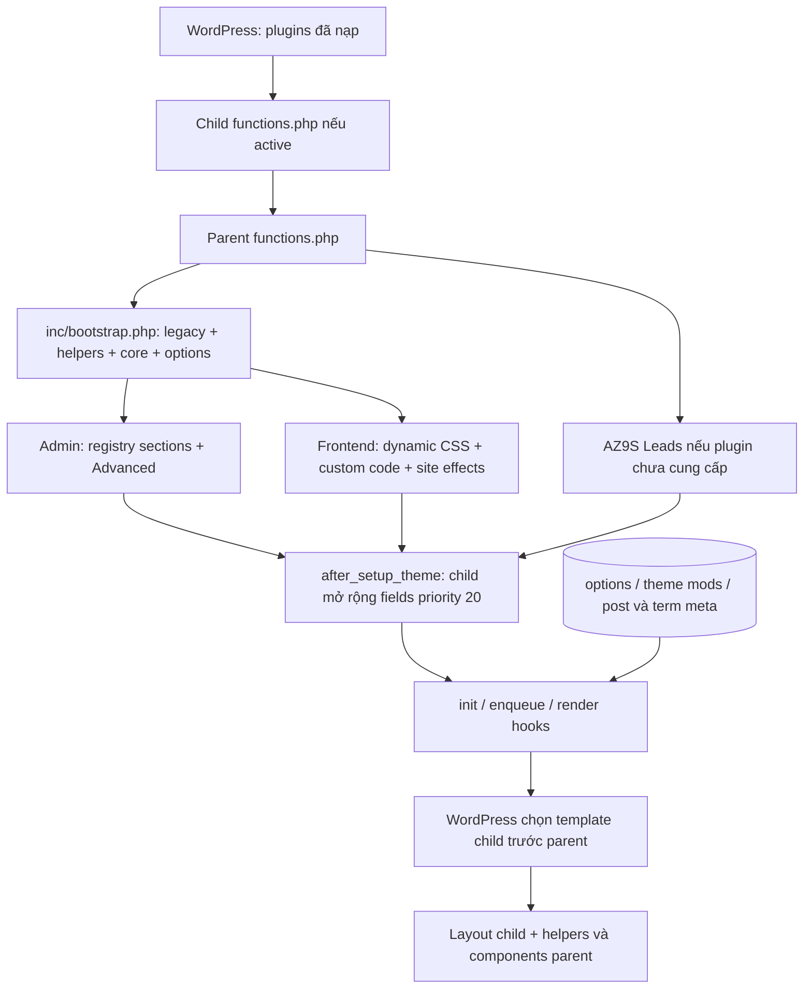
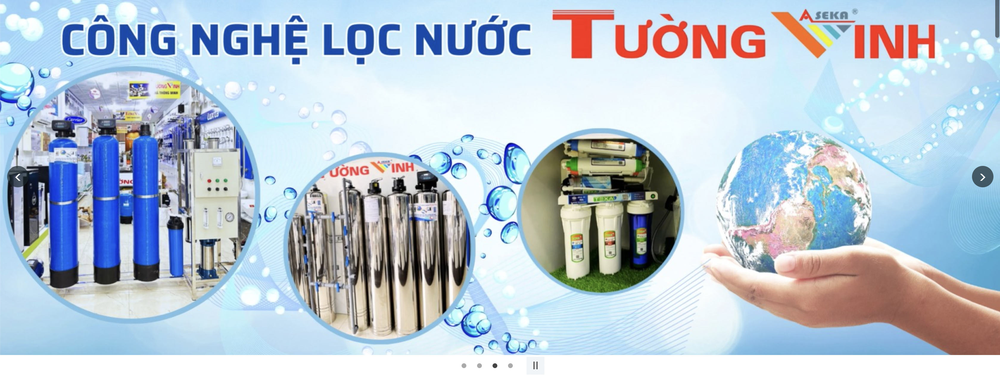

# AZ Theme — Kiến trúc và quy chuẩn phát triển parent/child

Ngày đối chiếu mã nguồn: **09/10/2026**. Baseline Git: `1259c4cc17c1299a53cf0ab6440f004acaecb156`. Tài liệu nằm trong `az-theme/docs/` để được phân phối cùng theme nền tảng. Slug thư mục là `az-theme`, tên hiển thị trong header stylesheet hiện là **TN Digi Solution**; child có `Template: az-theme`. Không dùng tên hiển thị làm định danh phụ thuộc.

## Cách đọc và phạm vi bằng chứng

Bổ sung ngày **12/10/2026**: [hợp đồng giao diện trang chủ và khung giao diện dùng chung (§7.4)](#74-hợp-đồng-giao-diện-trang-chủ-và-khung-giao-diện-dùng-chung), hai ảnh tham chiếu và dẫn chiếu kiểm tra. Phần bổ sung phân biệt nguồn hiện tại với yêu cầu triển khai sau; không thay baseline khảo sát ban đầu hoặc hành vi website.

- **[Hiện trạng]**: được xác minh bằng đọc mã nguồn tại baseline này. Không đồng nghĩa đã kiểm thử trên WordPress đang chạy hoặc đã đọc giá trị database.
- **[Quy chuẩn]**: hợp đồng phát triển cần tuân thủ cho code mới. Ngoại lệ legacy được nêu riêng; tài liệu này không thay đổi hành vi hiện hữu.
- **[Đề xuất]**: chưa được triển khai hoặc cần một nhiệm vụ khác để chuẩn hóa. Không sử dụng như API hiện có.

Đường dẫn nguồn trong tài liệu được tính tương đối từ thư mục `docs/`; `#L<n>` chỉ dòng tại thời điểm đối chiếu. Khi source thay đổi, xác minh lại symbol/callsite, không chỉ dựa vào số dòng. Các bảng API bên dưới là danh mục dành cho việc phát triển child, không biến mọi callback hoặc method public thành API được phép phụ thuộc.

Khảo sát tĩnh đã đọc inventory các file văn bản của hai theme, kể cả bộ mẫu child và tests: parent có 142 PHP, 45 CSS, 22 JS; child có 40 PHP, 14 CSS, 6 JS. Số lượng này gồm tests, không phải số module được bật. Các file ảnh, SVG, screenshot và bản dịch binary được kiểm kê đường dẫn, không kiểm chứng giao diện. Không bootstrap WordPress, đọc database, gửi email, gọi dịch vụ ngoài, chạy cron/migration hay kích hoạt theme. Không tìm thấy `AGENTS.md`, `theme.json` trong hai theme, Composer, PHPCS/PHPStan config hoặc module manager tổng quát.

Một số tài liệu như `ARCHITECTURE.md`, `CURRENT-AUDIT.md`, `OPTIONS-SCHEMA.md` và `audit/` chứa mô tả STEP 00 đã lỗi thời. Chúng không phải bằng chứng rằng bootstrap/options/Flatsome chưa tồn tại. **Thứ tự căn cứ: source hiện tại → tài liệu này sau khi đối chiếu → tài liệu chuyên đề đã xác minh → snapshot lịch sử.**

## Mục lục

1. [Tổng quan kiến trúc](#1-tổng-quan-kiến-trúc)
2. [Mục tiêu và nguyên tắc thiết kế](#2-mục-tiêu-và-nguyên-tắc-thiết-kế)
3. [Sơ đồ quan hệ và vòng đời](#3-sơ-đồ-quan-hệ-và-vòng-đời)
4. [Cấu trúc thư mục và trách nhiệm](#4-cấu-trúc-thư-mục-và-trách-nhiệm)
5. [Danh mục API và cấu hình hiện có](#5-danh-mục-api-và-cấu-hình-hiện-có)
6. [Quy tắc kế thừa và mở rộng](#6-quy-tắc-kế-thừa-và-mở-rộng)
7. [Design System và Components](#7-design-system-và-components)
   - [Hợp đồng giao diện trang chủ và khung giao diện dùng chung](#74-hợp-đồng-giao-diện-trang-chủ-và-khung-giao-diện-dùng-chung)
8. [Quy chuẩn PHP, CSS và JavaScript](#8-quy-chuẩn-php-css-và-javascript)
9. [Templates và template overrides](#9-templates-và-template-overrides)
10. [Bảo mật, hiệu năng và tương thích](#10-bảo-mật-hiệu-năng-và-tương-thích)
11. [Quy trình phát triển bằng Codex](#11-quy-trình-phát-triển-bằng-codex)
12. [Kiểm tra và cập nhật theme chính](#12-kiểm-tra-và-cập-nhật-theme-chính)
13. [Vấn đề hiện tại cần khắc phục](#13-vấn-đề-hiện-tại-cần-khắc-phục)
14. [Đề xuất cải tiến tương lai](#14-đề-xuất-cải-tiến-tương-lai)
15. [Checklist hoàn thành nhiệm vụ](#15-checklist-hoàn-thành-nhiệm-vụ)

**[Hiện trạng — cập nhật 13/10/2026, riêng mẫu trang trung tính]** `page-neutral.php` hiện cung cấp thẻ nội dung một cột, ảnh đại diện lớn và typography `.az-content`, thay bố cục hero cũ; không lặp tiêu đề Page bên dưới breadcrumb. Module `inc/core/neutral-page.php` được nạp từ bootstrap, đăng ký `az_neutral_page_assets()` trên `wp_enqueue_scripts` priority 60; handle `az-neutral-page` chỉ phụ thuộc `az-content` / `az-page-style`. CSS dùng `get_theme_file_path/uri()` để hỗ trợ override child. Child SOVIBAN đã gỡ template/module/CSS trùng; các Page giữ cùng filename và dữ liệu. `page-about.php` hiện gọi `get_template_part('page-neutral')` và lấy nội dung editor WordPress; module form `inc/gioi-thieu-page-fields.php` đã xóa, các getter/save callbacks cũ không còn là API hiện hữu. `_az_gioi_thieu_data` được giữ trong database nhưng không còn dùng bởi template parent. Xem [contracts, quản trị và kiểm tra](NEUTRAL-PAGE.md). Những inventory/baseline khác trong tài liệu vẫn là snapshot ngày đã ghi, không được suy ra là source hiện tại.

## 1. Tổng quan kiến trúc

**[Hiện trạng]** Đây là **classic WordPress theme dùng PHP templates**, không phải block theme/FSE. Parent và child cùng được WordPress nạp `functions.php`; template hierarchy ưu tiên child. Không có `theme.json` ở hai theme; Design System chủ yếu là CSS variables, stylesheet và CSS được sinh từ options.

Parent đã có bootstrap tuần tự, options helpers, registry/sanitizer/renderer, admin Advanced, components header/footer, blog, shared banner, homepage, WooCommerce, compatibility Flatsome, contact, leads/SMTP, analytics, user/security/performance và license/pricing. Nhiều phần vẫn là procedural legacy. Chưa có coordinator `AZ_Theme`, cơ chế module dependency registry hay API version chung.

Child hiện tại là một website bán hàng có giao diện solar/steel/reference, không phải child trống. Nó ghi đè header/footer/front-page/single-product, thêm fields vào Advanced, cấu hình nội dung trang chủ qua post meta, mega menu, liên hệ mở rộng, footer, tỷ lệ ảnh sản phẩm và permalink sản phẩm. Không mặc định cấu trúc child này là bộ mẫu bắt buộc cho mọi khách hàng.

**[Quy chuẩn]** Parent giữ hành vi tái sử dụng; child giữ giao diện, nội dung mặc định và chức năng dành riêng cho website. Chức năng cần tồn tại độc lập với theme, như leads/license/pricing, hiện vẫn nằm trong parent: giữ tương thích khi phát triển, chỉ đề xuất chuyển sang plugin trong nhiệm vụ migration riêng.

## 2. Mục tiêu và nguyên tắc thiết kế

**[Quy chuẩn]**

1. Tái sử dụng trước khi thêm code: đọc cả definition và nơi gọi API/component.
2. Không sửa parent cho một yêu cầu chỉ thuộc một website. Khi yêu cầu dùng chung, xác định rõ thay đổi parent và tác động các child.
3. Ưu tiên API, hooks/filters và điểm tìm template có chủ đích; không phụ thuộc `$GLOBALS`, private fields hoặc cấu trúc implementation.
4. Không sao chép logic giá, phân quyền, sanitization, truy vấn sản phẩm hay lưu settings vào nhiều template.
5. Cấu hình quản trị viên đã lưu được ưu tiên hơn mặc định child trong code mới. Mọi giá trị bắt buộc do child áp đặt phải được nêu riêng, có lý do và phạm vi.
6. Giữ nguyên keys/options/meta/handles/DOM contracts legacy cho đến khi có migration và kiểm thử.
7. Tồn tại hàm, `public` method hoặc `function_exists()` guard không đồng nghĩa có cam kết ổn định hoặc được phép override tùy ý.
8. Chỉ công bố phiên bản tương thích và kết quả kiểm thử đã thực sự xác minh.

## 3. Sơ đồ quan hệ và vòng đời

**[Hiện trạng]**



WordPress core xác nhận thứ tự child → parent tại [load.php:1096](../../../../wp-includes/load.php#L1096) và vòng include trước `after_setup_theme` tại [wp-settings.php:733](../../../../wp-settings.php#L733).

| Giai đoạn | Hành vi thực tế | Ý nghĩa cho child |
| --- | --- | --- |
| Nạp child | [functions.php:10](../../az-theme-child/functions.php#L10) require các file child. `inc/floating-contact.php` require sớm module liên hệ parent | Chỉ đăng ký callback khi parent API chưa khả dụng. Cầu nối liên hệ là ngoại lệ hiện có, không mẫu bootstrap mới |
| Nạp parent | [functions.php:12](../functions.php#L12) → [bootstrap.php:4](../inc/bootstrap.php#L4): 18 file legacy theo thứ tự, homepage, compatibility, helpers, core, options | Không đổi thứ tự hoặc require lại bootstrap từ child |
| Frontend/admin | Site effects/dynamic CSS chỉ nạp khi `!is_admin()`; Custom Code nạp chung cho admin/frontend; admin controllers chỉ khi `is_admin()` | Custom Code resolver dùng chung cho form và output; không giả định registry sections có dữ liệu trên frontend |
| Registry | `AZ_Advanced` đăng ký sections trong constructor lúc parent nạp admin | Thêm field vào section có sẵn tại `after_setup_theme`, priority 20, trước render/save |
| Installer | Class installer nạp cả frontend để bắt `after_switch_theme` | Không gọi installer trong code layout hoặc lúc audit |
| Module leads | Parent functions nạp module khi thiếu `AZ9S_LEADS_VERSION` và `az9s_create_leads_table()` | Khi plugin cung cấp module, không đăng ký trùng prefix `az9s_` |
| Render | `wp_head()`, `wp_body_open()`, `az_after_site_header`, `wp_footer()` kích hoạt nhiều module chung | Giữ đầy đủ các hook khi override header/footer |

Không phải mọi hook registration là extension hook: `admin_post_*`, AJAX và cron là endpoint/callback có side effects; không dùng như API đọc dữ liệu.

## 4. Cấu trúc thư mục và trách nhiệm

### 4.1. Parent

**[Hiện trạng]** Các đường dẫn dưới đây tính từ `az-theme/`.

```text
functions.php, style.css             entrypoint, metadata, CSS nền tảng
inc/bootstrap.php                   loader tuần tự
inc/helpers/                        options, utilities, header/footer
inc/options/                        registry, facade, sanitizer, renderer
inc/admin/sections/                 schema Advanced
inc/admin/templates/child-theme/    bộ mẫu child mới
inc/core/                           blog, banner, editor, security, user, assets động
inc/functions/                      setup và các chức năng procedural/legacy
inc/modules/                        homepage, Flatsome compatibility, analytics, leads
template-parts/, *.php              PHP templates/parts
woocommerce/                        overrides theo đường dẫn WooCommerce
css/, js/, assets/admin/             assets frontend và admin
assets/src/, package.json            cấu hình build CSS chưa chuyển frontend sang bản build
languages/, docs/, tests/            bản dịch, tài liệu, kiểm tra cô lập/browser
```

| Thành phần / nguồn | Vai trò và cách hoạt động | Child sử dụng / giới hạn |
| --- | --- | --- |
| [bootstrap](../inc/bootstrap.php#L4) | Includes hardcoded, `require_once` từ parent; một số class tự đăng ký hooks khi nạp | Không override `inc/core/` bằng file trùng đường dẫn |
| [helpers/options](../inc/helpers/options.php#L3), [options](../inc/options/class-options.php#L3) | Đọc settings, fallback chọn lọc; schema admin riêng với runtime defaults | Dùng API §5; registry không phải storage hoặc default resolver frontend |
| [theme setup](../inc/functions/theme-setup.php#L76) | Supports, menus, taxonomy kho, assets, language, font | Giữ locations/handles cũ; dùng đường dẫn child cho assets child |
| [header helpers](../inc/helpers/header-components.php#L8), [footer helpers](../inc/helpers/footer-components.php#L11) | Settings + renderer header, settings footer | Renderer echo HTML; không đăng ký lại module hoặc duplicate IDs |
| [homepage](../inc/modules/homepage/module.php#L5) | Section allowlist, merge legacy/settings, assets và admin riêng; tìm schema page-fields bằng `locate_template()` | Child hiện có thay toàn front-page và cung cấp page-fields; templates module được parent include trực tiếp |
| [WooCommerce](../inc/functions/woocommerce.php#L10), [home-products](../inc/functions/home-products.php#L183) | Bộ lọc, cart fragments, dịch nhãn, product card, query limits, tạo system pages | Guard Woo API; root taxonomy templates require archive parent trực tiếp |
| [product fields](../inc/functions/product-fields.php#L9), [videos](../inc/functions/product-videos.php#L66), [category pricing](../inc/functions/product-attributes-pricing.php#L243) | Metadata sản phẩm, video normalized, hệ số giá theo danh mục | Dùng helpers và luồng save sẵn có; không nhân hệ số lần nữa |
| [shared banner](../inc/core/shared-banner.php#L5), [site effects](../inc/core/class-site-effects.php#L10) | Banner per-page/term, breadcrumb, preloader, back-to-top | Giữ `az_after_site_header`; tránh banner/breadcrumb kép |
| [blog](../inc/core/class-blog.php#L3), [blog image description](../inc/core/blog-image-description.php#L5) | Query/list settings; có xử lý nội dung ảnh khi lưu theo option | Không coi mọi blog setting chỉ có tác dụng hiển thị |
| [about fields](../inc/gioi-thieu-page-fields.php#L6), [customizer](../inc/functions/customizer.php) | Data trang Giới thiệu, UI post meta, các controls theme mods legacy | `az_gioi_thieu_get_data()` là adapter theo template; không duplicate save handler |
| [contact AJAX](../inc/functions/contact-form.php#L20), [legacy admin](../inc/functions/admin-settings.php#L157), [leads module](../inc/modules/leads/module.php#L20) | CAPTCHA, lưu lead, forms và SMTP; có cả storage/schema legacy và AZ9S | Ẩn leads menu không tắt forms/SMTP; dữ liệu hai bảng không tự hợp nhất |
| [Flatsome compatibility](../inc/modules/flatsome-compat/shortcodes.php#L9), [widgets](../inc/modules/flatsome-compat/widgets.php#L12) | Một tập shortcode/widget compatibility, không UX Builder đầy đủ | Giữ nội dung cũ; không dùng API UX Builder giả định |
| [migration helpers](../inc/modules/flatsome-compat/migrations/class-settings-importer.php#L21) | Import mapping được caller cung cấp, yêu cầu quyền và backup callback | Không có migration toàn diện tự chạy; không gọi để render frontend |
| [analytics](../inc/modules/analytics/class-analytics.php#L3) | Ghi lượt xem/click vào option, shortcode thống kê | Read helper được dùng; tracking và phương thức ghi thuộc nội bộ |
| [user](../inc/core/user-options.php#L3), [Google](../inc/core/google-login.php#L3), [rate limiter](../inc/core/auth-rate-limit.php#L4) | Features có switches, OAuth/reCAPTCHA/avatar; thay restrictions legacy | Không tự liên kết tài khoản Google theo email, không phát secret ra frontend |
| [license API](../inc/license-api.php#L77), [pricing](../inc/functions/pricing.php#L11), [integrations](../inc/functions/integrations-access.php#L38) | CPT `pricing`, `license`, REST namespace `az-license/v1`, cron hết hạn, tích hợp Content AI | Hợp đồng theo nghiệp vụ legacy; không phải API chung để dựng child mới |
| [installer](../inc/admin/class-child-theme-installer.php) | Tạo bộ mẫu child qua WordPress Filesystem; quyền/policy, trạng thái, retry/rollback | Không ghi đè child hợp lệ hiện có; tạo không đồng nghĩa kích hoạt |

### 4.2. Child thực tế và bộ mẫu

**[Hiện trạng]**

| Nhóm nguồn trong child | Trách nhiệm | Phụ thuộc cần giữ |
| --- | --- | --- |
| [functions.php](../../az-theme-child/functions.php#L10) | Includes, migration theme mods và enqueue assets | CSS `az-theme-child` phụ thuộc `az-container-sync`, priority 15 |
| [header.php](../../az-theme-child/header.php), [header-storefront](../../az-theme-child/inc/header-storefront.php#L38) | Header desktop/sticky/mobile, hotline và shared settings | Parent logo/actions/menu helpers; `wp_body_open`, `az_after_site_header` |
| [header colors](../../az-theme-child/inc/header-colors.php#L5), [typography](../../az-theme-child/inc/header-typography.php#L5), [mega menu](../../az-theme-child/inc/header-mega-menu.php) | Fields menu, component navigation riêng, CSS/JS riêng | `header`/`colors`/`typography` registry; cấu trúc DOM mega menu |
| [footer.php](../../az-theme-child/footer.php), [footer-storefront](../../az-theme-child/inc/footer-storefront.php#L57) | Footer riêng, fields General, policies/profile/locations | `az_footer_options()`, contact/social data parent; `wp_footer()` |
| [front-page.php](../../az-theme-child/front-page.php#L15), [home-storefront part](../../az-theme-child/template-parts/home-storefront.php#L5) | Trang chủ thực tế solar/reference; news/products/projects/partners | Page data child, shared banner parent; các parts `home-steel`, `home-reference` khác không tự được chọn chỉ vì tồn tại |
| [page-fields](../../az-theme-child/inc/modules/homepage/page-fields.php#L56), [reference](../../az-theme-child/inc/home-reference-layout.php#L25), [partners](../../az-theme-child/inc/home-partners.php#L5) | Các nhánh chung `_az_home_page_data`, nhiều save callbacks | Parent homepage loader tìm file child. Save merge để giữ nhánh không thuộc callback |
| [floating contact](../../az-theme-child/inc/floating-contact.php#L4) | Thêm `social_expand`, thay hai callbacks parent | Parent bị require sớm rồi `remove_action()` đúng callback/priority; chỉ giữ kiểu 1 của parent và kiểu 2 của child |
| [single-product.php](../../az-theme-child/single-product.php), [product-display](../../az-theme-child/inc/product-display.php#L55) | Detail override, limits related/recently viewed, tỷ lệ ảnh | Fields WooCommerce và product metadata/helper parent |
| [product-admin](../../az-theme-child/inc/product-admin.php#L15) | Thay renderer metabox guarded của parent, không thay save logic | Giữ nonce, tên fields/meta và save parent |
| [product-permalinks](../../az-theme-child/inc/product-permalinks.php#L5) | URL danh mục/sản phẩm theo hierarchy, collision checks, rewrite/redirect | Phụ thuộc WooCommerce/taxonomy, option version riêng; không mẫu URL mặc định mọi site |
| [customizer](../../az-theme-child/inc/customizer.php#L11), [branding SEO](../../az-theme-child/inc/branding-seo.php#L5) | Bỏ controls Woo trùng, mở rộng context meta description | Không thêm thẻ SEO độc lập trùng parent/plugin |
| `css/`, `js/`, `assets/images/`, `icon/`, `tests/` | Assets và kiểm tra riêng website | Đường dẫn/handles child; không copy asset parent chỉ để tải lại |

`header-shop.php` và `footer-shop.php` child là delegates require header/footer child. Chúng không phải hệ thống header/footer độc lập.

| Điểm khác | Child đang có | Bộ mẫu tại `inc/admin/templates/child-theme/` |
| --- | --- | --- |
| Stylesheet priority | 15 | 100, sau module homepage priority 20 |
| Migration | Copy mọi theme mod còn thiếu, kể cả `custom_css_post_id`; không copy bài Additional CSS riêng | Bỏ `custom_css_post_id`, copy Additional CSS thành bài child nếu chưa có, không đánh dấu xong khi copy lỗi |
| Hook migration | `after_switch_theme`, priority mặc định 10 | Priority 5, kiểm tra stylesheet `az-theme-child` |
| Bảo vệ khai báo | Functions migration/enqueue không có guard | Có `function_exists()` guards |
| Nội dung | Nhiều template/modules/fields dành riêng website | Chỉ `style.css`, `functions.php`, `README.md`; không clone toàn parent |

Nguồn: [child functions:29](../../az-theme-child/functions.php#L29), [bộ mẫu:12](../inc/admin/templates/child-theme/functions.php#L12). **[Quy chuẩn]** Không ghi rằng child hiện tại đã có migration an toàn giống bộ mẫu; cải tiến phải là nhiệm vụ riêng.

### 4.3. Đăng ký tính năng WordPress và widget areas

**[Hiện trạng]**

| Nhóm | Đăng ký thực tế / thời điểm | Cách child sử dụng và giới hạn |
| --- | --- | --- |
| Theme supports | `az_ai_theme_setup()` trên `after_setup_theme` priority 10: `title-tag`, `post-thumbnails`, `woocommerce`, `custom-logo` (40×40, flex width/height), HTML5 search/comment forms/comment list/gallery/caption | Kế thừa supports; không đăng ký lại chỉ để sao chép. Khai báo support WooCommerce không chứng minh plugin đang hoạt động. [setup:76](../inc/functions/theme-setup.php#L76) |
| Text domain | `az-ai-theme`, tải từ parent `languages/` trong setup | Giữ domain của strings parent; child dùng domain khai báo trong stylesheet của mình cho strings riêng. [setup:77](../inc/functions/theme-setup.php#L77) |
| Menu locations | `primary`, `top`, `footer` | Dùng locations hoặc menu IDs theo helper; settings `header.*_menu` không tự đăng ký locations mới. Không đổi IDs làm mất assignments. [setup:96](../inc/functions/theme-setup.php#L96) |
| Widget areas legacy | `shop-sidebar`, `sidebar-main`, `sidebar-shop`, `sidebar-product`, `sidebar-footer-1`, `sidebar-footer-2`; `widgets_init` priority 20, chỉ khi compatibility bật và ID chưa được owner khác đăng ký | Dùng `dynamic_sidebar()` hoặc shortcode compatibility khi cần; wrapper `.az-legacy-widget`. Đã đăng ký area không có nghĩa mọi template/footer tự render nó. [widgets:12](../inc/modules/flatsome-compat/widgets.php#L12) |
| Classic Widgets | `use_widgets_block_editor` → `__return_false`, đăng ký ngay khi file widgets nạp | Hiện tại không phụ thuộc switch compatibility; child không đăng ký filter đối nghịch tùy tiện. [widgets:10](../inc/modules/flatsome-compat/widgets.php#L10) |
| Taxonomy kho | `product_warehouse`, object type `product`, hierarchical/public/REST, rewrite slug `kho`, `init` priority 30 | Parent đăng ký không có guard WooCommerce active; child không đăng ký lại. `product_cat`/product attributes thuộc WooCommerce, các brand taxonomies được phát hiện theo owner plugin. [setup:107](../inc/functions/theme-setup.php#L107) |

**[Quy chuẩn]** Website cần thêm menu/widget area dùng callback prefix `az_child_` ở lifecycle tương ứng và ID riêng. Không unregister capabilities/locations/shared taxonomy của parent để giải quyết riêng một layout; thay cách render tại component child.

## 5. Danh mục API và cấu hình hiện có

### 5.1. Mức phụ thuộc được phép

**[Quy chuẩn]** Các mức dưới đây là chính sách của tài liệu, không phải marker đã tồn tại trong source:

- **A — Dùng từ child**: helper/renderer/options facade và extension hooks được mô tả ở đây. Đối chiếu chữ ký khi update; chưa có cam kết SemVer tự động.
- **B — Nội bộ**: bootstrap, instances trong `$GLOBALS`, admin controllers, registry storage, truy vấn/save/endpoint callbacks, private methods. Child không gọi trực tiếp để thay luồng xử lý.
- **C — Legacy/có điều kiện**: adapter theo template, integrations license/pricing, pluggable callbacks và DOM compatibility. Chỉ dùng nếu yêu cầu website cần, ghi nhận phụ thuộc và kiểm thử.
- **Chưa ổn định/chưa triển khai**: helper có UI/consumer chưa đầy đủ, pipeline build chưa chuyển runtime, thiếu API version/module manager. Không gắn nhãn đã ổn định chỉ từ tên hàm.

### 5.2. API dữ liệu, cấu hình và nội dung

**[Hiện trạng]** API trả dữ liệu không tự escape cho mọi context, trừ các ngoại lệ được ghi rõ.

| API thực tế | Kết quả / hành vi | Cách dùng và giới hạn | Nguồn |
| --- | --- | --- | --- |
| `az_get_options()` | Array từ `get_option('az_theme_options', array())`; trả `array()` nếu storage không phải array | A; đọc, không seed/migrate/sanitize dữ liệu | [options:3](../inc/helpers/options.php#L3) |
| `az_array_get($array, $path, $default = null)` | Đi qua dot path bằng `array_key_exists()` | A; giữ giá trị terminal `null`, `false`, `0`, `''`, `[]`; thiếu key hoặc trung gian không phải array thì trả default | [options:4](../inc/helpers/options.php#L4) |
| `az_get_option($path, $default = null)` | `az_array_get(az_get_options(), ...)` | A; không lấy default từ registry, không có filter chung, không phải setter | [options:5](../inc/helpers/options.php#L5) |
| `az_get_company_name()` | `general.company_name` nếu key có, nếu thiếu lấy `az_contact_company` → tên site | A; chuỗi rỗng đã lưu được giữ; nhánh `general` phải là array, helper chưa guard mọi dữ liệu malformed | [options:7](../inc/helpers/options.php#L7) |
| `az_get_contact_items($type = 'phone')` | Array rows chỉ gồm `label`, `value`; type phone/email/address | A; repeater không rỗng ưu tiên, sau đó scalar/legacy; **không trả** maps URL/embed của address | [options:8](../inc/helpers/options.php#L8) |
| `az_get_phone()` | Phone đầu tiên từ contact items, fallback legacy | A; khác nguồn với `az_storefront_contact_phone()` | [options:9](../inc/helpers/options.php#L9) |
| `az_get_email()`, `az_get_address()` | Scalar `general.email`/`general.address` → legacy; email fallback `admin_email` | A; không đại diện cho email/address đầu tiên của repeater; cùng yêu cầu nhánh `general` là array | [options:10](../inc/helpers/options.php#L10) |
| `az_get_social_links()` | Map network → URL đã qua `esc_url()` | A; nested key kể cả rỗng chặn legacy; nếu cần URL dữ liệu, decode entities rồi validate và escape lúc render như child footer | [options:23](../inc/helpers/options.php#L23) |
| `az_get_logo_id($variant = 'desktop')` | Attachment ID; variants desktop/mobile/sticky/light/dark | A; branding truthy → ID; desktop fallback Customizer `custom_logo`, variants khác fallback 0 | [options:24](../inc/helpers/options.php#L24) |
| `az_get_logo_url($variant = 'desktop')` | URL attachment full hoặc `''` khi không ID; WordPress có thể trả false nếu attachment không hợp lệ | A; escape URL khi xuất | [options:25](../inc/helpers/options.php#L25) |
| `az_get_home_h1()` | Branding H1 không rỗng → site title → front-page title → document title | A; parent echo H1 sr-only qua `wp_body_open` priority 5 | [options:27](../inc/helpers/options.php#L27) |
| `az_get_home_meta_description()` | Branding description → tagline, strip tags/decode entities/normalize whitespace | A; parent phối hợp Rank Math/Yoast, child mở context bằng filter | [SEO:10](../inc/core/branding-seo.php#L10) |
| `az_get_homepage_mode()` | Đọc `homepage.mode`, default `shop` | Chưa thấy consumer chọn layout; không coi đây là router homepage đã hoàn chỉnh | [options:26](../inc/helpers/options.php#L26) |
| `az_get_font_options()` | Map font stack → nhãn, hợp nhất font cơ bản/global settings/Font Library | A; fallback khi thiếu API WordPress mới | [options:140](../inc/helpers/options.php#L140) |
| `az_get_font_library_families()` | Map family → `id`, `name`; cache static mỗi request | C; có query CPT `wp_font_family`, có guard khi CPT chưa tồn tại | [options:76](../inc/helpers/options.php#L76) |
| `az_is_woocommerce_active()` | `class_exists('WooCommerce')` | A; không đảm bảo mọi Woo function/session/cart đã sẵn sàng | [utilities:3](../inc/helpers/utilities.php#L3) |
| `az_get_theme_version()` | Version của **active theme** từ `wp_get_theme()` | C; khi child active trả version child, không phải version framework parent | [utilities:4](../inc/helpers/utilities.php#L4) |
| `az_blog_show($field, $default = 1)` | Bool field Blog hoặc default nếu thiếu | A; dữ liệu sai kiểu vẫn cast bool, không thay validation | [blog:8](../inc/core/class-blog.php#L8) |
| `az_homepage_settings()` | Map section settings, default + legacy + nested, cache static | A cho homepage module parent; không phải data của homepage child | [homepage:43](../inc/modules/homepage/module.php#L43) |
| `az_homepage_enabled($id)`, `az_homepage_ordered_sections()` | Bool có xét Woo dependency; array IDs được bật và sắp thứ tự | A; section allowlist cố định; không có filter register section chung | [enabled:65](../inc/modules/homepage/module.php#L65), [ordered:71](../inc/modules/homepage/module.php#L71) |
| `az_shared_banner_get($id, $term = false)` | Defaults + post/term meta; fallback legacy nếu storage không phải array | A; dữ liệu ID ảnh dạng chuỗi comma-separated, không phải URL array | [banner:13](../inc/core/shared-banner.php#L13) |
| `az_shared_banner_defaults()`, `az_shared_banner_layouts()` | Defaults và layout allowlist | A; dùng để dựng UI/đọc banner, không thay save callbacks | [banner:5](../inc/core/shared-banner.php#L5) |
| `az_shared_banner_context()`, `az_shared_banner_active()` | Context `[id, is_term]` hoặc false; active bool | A; page thường không dùng shared banner nếu không front-page/custom template | [banner:32](../inc/core/shared-banner.php#L32) |
| `az_get_analytics_summary()` | `online`, view totals/daily/7/30 days, click totals/map | A đọc; `online` default 5 qua filter, không phải phép đo sessions | [analytics:16](../inc/modules/analytics/class-analytics.php#L16) |
| `az_get_current_language()`, `az_t($vi_text, $en_text)` | Cookie `az_language` mặc định vi; chọn EN khi bằng en | C; hệ song ngữ riêng, không thay plugin đa ngôn ngữ; cookie chưa có allowlist trong getter | [setup:145](../inc/functions/theme-setup.php#L145) |
| `az_theme_mod($key, $default_vi = '', $default_en = '')` | VI: theme mod base; EN: `_en` truthy hoặc default EN | C; EN không tự fallback về giá trị VI dù comment legacy mô tả khác | [setup:182](../inc/functions/theme-setup.php#L182) |
| `cp_get_cat_image_url($term_id, $size = 'medium')` | URL ảnh từ term meta `cp_cat_image_id`; `''` khi thiếu | C; prefix legacy phải giữ | [category images:120](../inc/functions/category-images.php#L120) |
| `az_gioi_thieu_get_data($post_id = 0)` | Data chuẩn hóa Giới thiệu từ JSON meta `_az_gioi_thieu_data` và defaults | C; thuộc template/module Giới thiệu, không generic settings store | [about fields:111](../inc/gioi-thieu-page-fields.php#L111) |
| `az_get_product_video_urls($post_id)` | Array URL YouTube watch hợp lệ, unique; hợp nhất meta mới/legacy | A; các helper `az_product_youtube_id_from_value($value)`, `az_product_youtube_watch_url($value)`, `az_product_youtube_embed_url($value)` chuẩn hóa ID/watch/embed | [videos:9](../inc/functions/product-videos.php#L9), [videos:66](../inc/functions/product-videos.php#L66) |

### 5.3. Renderers và options registry

**[Hiện trạng]**

| API | Contract dùng từ child | Nguồn |
| --- | --- | --- |
| `az_header_default_options()`, `az_header_options()` | Array defaults / saved header merge với defaults; không echo. Default height 96; search/category/account/cart/top bar/primary menu bật; sticky/CTA tắt; sticky bottom mặc định bật nếu sticky được bật | [header:8](../inc/helpers/header-components.php#L8) |
| `az_header_menu_id($slot, $options = array())` | ID; sticky ưu tiên sticky_menu → primary_menu; slot khác đọc `<slot>_menu` | [header:71](../inc/helpers/header-components.php#L71) |
| `az_product_category_menu_id($fallback_menu_id = 0)` | Menu theo tên `Danh mục sản phẩm` → slug `danh-muc-san-pham` → fallback ID | [header:46](../inc/helpers/header-components.php#L46) |
| `az_render_header_menu($menu_id = 0, $location = 'primary', $class = 'az-primary-menu')` | Echo `wp_nav_menu()`, explicit ID hoặc location; không fallback menu giả | [header:55](../inc/helpers/header-components.php#L55) |
| `az_render_header_logo($args = array())` | Echo link/logo; args `logo_id`, `class` (một class); fallback site name | [header:81](../inc/helpers/header-components.php#L81) |
| `az_render_header_search($options = array(), $class = 'az-search')` | Echo form; `search_placeholder`; ID cố định `az-header-search`, không dùng nhiều instance đồng thời | [header:90](../inc/helpers/header-components.php#L90) |
| `az_render_header_action($type, $args = array())` | Echo account/cart/cta; args `label`, `url`; cart guard purchase actions và dùng WC cart nếu có | [header:142](../inc/helpers/header-components.php#L142) |
| `az_render_sticky_header($options = array())` | Echo có điều kiện; dựa settings, menus, purchase actions; không gọi thêm nếu header đã render | [header:99](../inc/helpers/header-components.php#L99) |
| `az_mobile_menu_markup()`, `az_render_mobile_menu()` | String menu / echo menu một lần; style none/disabled/không menu → không markup | [markup:4](../inc/core/mobile-menu.php#L4), [render:9](../inc/core/mobile-menu.php#L9) |
| `az_footer_default_options()`, `az_footer_options()` | Defaults / saved footer merge; `show_top_links`, `show_social`, `show_copyright` mặc định 1 | [footer:11](../inc/helpers/footer-components.php#L11) |
| `az_render_product_card($product, $args = array())` | Echo; WC_Product hoặc product ID. Args `context='default'`, `tag='article'` (article/li/div), `classes=[]`, `image_size='woocommerce_thumbnail'`, `show_actions` theo shared setting | [products:324](../inc/functions/home-products.php#L324) |
| `az_storefront_product_price_html($product)`, `az_storefront_product_discount_percentage($product)` | Price HTML / %; đọc switches, tính sale theo từng variation. Price HTML cần `wp_kses_post()` lúc xuất | [products:209](../inc/functions/home-products.php#L209) |
| `az_storefront_show_prices()`, `az_storefront_show_purchase_actions()` | Bool từ `woocommerce.show_product_price` / `show_purchase_actions`, mặc định true | [products:183](../inc/functions/home-products.php#L183) |
| `az_storefront_filter_definitions()`, `az_storefront_filter_label($label, $taxonomy = '', $kind = '')` | Filter definitions array / label đã sanitize + filter; phụ thuộc taxonomies hiện có | [definitions:46](../inc/functions/woocommerce.php#L46), [label:10](../inc/functions/woocommerce.php#L10) |
| `az_contact_data()`, `az_render_contact()` | Data phone/dial/zalo/style hoặc []; echo contact có dữ liệu và enabled | [contact:18](../inc/floating-contact.php#L18) |
| `AZ_Theme_Options::add_section($id, $title, $fields = array())`, `::add_field($section, $field)`, `::get()` | Facade đăng ký schema / lấy toàn registry; **không đọc/ghi options** | [facade:3](../inc/options/class-options.php#L3) |
| `AZ_Options_Registry::get($id)`, `::all()`, `::add_field($section, $field)`, `::add_section($id, $title, $fields = array())` | Get section/null; add field chỉ khi section đã có; add_section **thay toàn section**, không merge | [registry:3](../inc/options/class-registry.php#L3) |

**[Quy chuẩn]** Dùng facade để thêm field mới; dùng `AZ_Options_Registry::get()` khi cần kiểm tra field tồn tại theo cơ chế child hiện có. Không sửa static storage. Việc thay section đang được child sử dụng để đổi nhãn/description là phụ thuộc cần theo dõi; phải giữ toàn bộ fields và metadata cũ. Các classes `AZ_Advanced`, `AZ_Options_Renderer`, `AZ_Dynamic_CSS`, `AZ_Performance`, `AZ_Custom_Code`, `AZ_Analytics` là implementation/module owners, không tạo thêm instance từ child.

### 5.4. Extension hooks đã xác minh

**[Hiện trạng]** Filter nhận giá trị đầu tiên và phải trả giá trị cùng ý nghĩa; các tham số còn lại chỉ có nếu đăng ký đúng `accepted_args`.

| Hook | Chữ ký callback / default | Phạm vi và giới hạn | Nguồn |
| --- | --- | --- | --- |
| Action `az_after_site_header` | Không args | Parent phát sau header; child hiện chỉ phát ngoài context trang chủ (`az_child_is_steel_home()`), vì trang chủ render banner riêng. Breadcrumb priority 5, shared banner callback; tránh render kép khi mở rộng theo §7.4 | [parent header:85](../header.php#L85), [child header](../../az-theme-child/header.php) |
| Filter `az_home_meta_description_context` | `($is_home)`; `is_front_page()` | Frontend SEO; child hiện mở rộng page template front-page | [SEO:7](../inc/core/branding-seo.php#L7) |
| Filter `az_storefront_filter_label` | `($label, $taxonomy, $kind)` | Đổi nhãn bộ lọc; return text, không HTML | [Woo:40](../inc/functions/woocommerce.php#L40) |
| Filter `az_security_headers` | `($headers)`; map 3 headers | Chỉ khi General security_headers bật, frontend chưa gửi headers | [security:14](../inc/functions/security.php#L14) |
| Filter `az_import_remote_images_on_save` | `($allow, $post_id)`; true | Chỉ xét khi import_remote_images bật; veto từng bài | [media:72](../inc/functions/content-media.php#L72) |
| Filter `az_classic_editor_post_types` | `($types)`; post/page | Chỉ khi General classic_editor bật; không chuyển đổi nội dung | [editor:9](../inc/core/editor.php#L9) |
| Filter `az_google_allow_login` | `($allow, $user)`; true | Sau khi resolve Google user, trước đặt cookie đăng nhập; filter không thay OAuth verification | [Google:58](../inc/core/google-login.php#L58) |
| Filter `az_security_allow_guest_rest` | `($allow)`; false | Khi REST restrictions bật; không có request arg, cần kiểm tra context rõ nếu miễn trừ route | [performance security:14](../inc/core/performance-security.php#L14) |
| Filter `az_allow_html_minification` | `($allow)`; true | Sau switches/context checks của minifier | [minify:23](../inc/core/html-minify.php#L23) |
| Filter `az_allow_404_home_redirect` | `($allow)`; true | Sau kiểm tra request HTML/GET/HEAD và loại REST/resources | [tools:21](../inc/core/performance-tools.php#L21) |
| Filter `az_allow_missing_media_cleanup` | `($allow, $attachment_id)`; true | Sau kiểm tra ảnh local bị thiếu; UI vẫn yêu cầu quyền/nonce/xác nhận | [media tools:15](../inc/core/media-tools.php#L15) |
| Filter `az_analytics_online_count` | `($count)`; 5 | Chỉ thay chỉ số summary, absint và giới hạn 9999; không có session tracking | [analytics:16](../inc/modules/analytics/class-analytics.php#L16) |
| Action `az_after_duplicate_content` | `($duplicate_id, $source_id)` | Sau duplicate; callback có thể xử lý metadata liên quan | [duplicate:89](../inc/modules/content-duplicate.php#L89) |

Các hooks WordPress/WooCommerce đang dùng gồm `after_setup_theme`, `init`, `widgets_init`, `wp_enqueue_scripts`, `admin_enqueue_scripts`, `customize_register`, `body_class`, `wp_body_open`, `wp_head`, `wp_footer`, `pre_get_posts`, `save_post_*`, `nav_menu_link_attributes`, `woocommerce_add_to_cart_fragments`, price/variation filters, `term_link`, `post_type_link`, `rewrite_rules_array` và `wc_product_post_type_link_product_cat`. Đây là hợp đồng của owner tương ứng, không đổi tên thành hook AZ. Không tồn tại filter tổng quát để thay mọi option/component.

### 5.5. Shortcodes và integrations

**[Hiện trạng]**

| Shortcode / interface | Input và output | Nguồn / giới hạn |
| --- | --- | --- |
| `[az_contact type="phone"]` | type phone/email/address; HTML list. `format='list'` có trong atts nhưng chưa chọn renderer khác | [options:12](../inc/helpers/options.php#L12) |
| `[az_general field="company_name"]` | Field theo allowlist trong source; trả text escaped | [options:14](../inc/helpers/options.php#L14); không phải mọi field registry đều dùng được |
| `[az_ministry_of_trade]` | Badge khi `general.ministry_of_trade_url` hợp lệ | [options:17](../inc/helpers/options.php#L17); ảnh badge từ external URL |
| `[az_stats show="online,today,30_days,total" class="..."]` | HTML statistics; chỉ bốn keys show hiện có | [analytics:17](../inc/modules/analytics/class-analytics.php#L17) |
| `[google-login]`, `[az_google_login]` | Link OAuth nếu đủ settings và chưa login | [Google:6](../inc/core/google-login.php#L6) |
| `[az9s_lead_form id="..."]` | Form theo `az9s_lead_forms`, resolver ID và variant ngôn ngữ | [forms:285](../inc/modules/leads/inc/lead-forms.php#L285); module/plugin owner, không gọi submit handler trực tiếp |
| `[section]`, `[row]`, `[col]`, `[ux_sidebar]`, `[ux_products]`, `[blog_posts]` | Tập compatibility subset; chỉ đăng ký nếu shortcode tag chưa có | [compat:318](../inc/modules/flatsome-compat/shortcodes.php#L318); không UX Builder đầy đủ |
| REST `POST az-license/v1/{verify,activate,usage,update-tokens}` | License key và các tham số domain/counters theo handler | [license:77](../inc/license-api.php#L77); C, public permission callbacks; xem §13 trước mở rộng |
| AJAX contact | `az_contact_refresh_captcha`, `az_contact_form_submit`; nonce action `az_contact_form`, field `az_contact_nonce`; required name/phone/message + CAPTCHA | [contact:48](../inc/functions/contact-form.php#L48); CAPTCHA token dùng một lần, TTL 20 phút; save thành công nhưng mail lỗi vẫn trả success `mail_sent=false` |
| Cron `az_check_expired_licenses` | Daily; cập nhật trạng thái license hết hạn | [integrations:37](../inc/functions/integrations-access.php#L37); schedule ngay khi file nạp nếu chưa có event |

**[Quy chuẩn]** Endpoint public phải được đánh giá riêng về authentication, abuse/rate limit, validation và thông tin trả về. Nonce không thay quyền hoặc xác thực người dùng. Child chỉ dùng shortcode/adapter đã công bố, không copy toàn handlers.

### 5.6. Nguồn dữ liệu và quyền sở hữu

**[Hiện trạng]**

| Store / key | Nguồn mặc định, cách đọc và thay đổi | Phạm vi / child / điều không được đổi |
| --- | --- | --- |
| Option `az_theme_options` | Array nhánh General/Header/...; đọc `az_get_option()`, helpers theo nhóm. Advanced lưu bằng admin-post `az_save_theme_options`, reset `az_reset_theme_section` | Cùng site dùng chung parent/child; không đổi sang theme mods hoặc overwrite toàn array khi thêm nhánh |
| Registry sections | `inc/admin/sections/*.php`, chỉ đăng ký trong admin; child thêm fields priority 20 | Schema/UI, không phải dữ liệu lưu. Default schema không tự có hiệu lực runtime |
| Options scalar legacy | Contact/footer `az_contact_*`, `az_footer_social_*`; homepage `az_home_*`; custom code `az_hfc_*`; intro `cp_*`; catalogue `az_catalogue_lines` | Fallback và templates cũ đọc trực tiếp; không xóa/rename/mirror tự động |
| Theme mods | Active stylesheet, ví dụ `custom_logo`, `az_logo_size=52`, `az_logo_text_size=16`, bilingual keys `_en` | Theo theme/site; parent mods không tự live-sync child. Không dùng cho cùng cấu hình đã có owner nested |
| Meta `_az_shared_banner` | Post hoặc term meta, array; defaults xem §5.7. Save UI banner page/category/product_cat | Riêng object; child đọc helper. Không biến images IDs thành URLs hoặc ghi thẳng bypass sanitizer |
| Meta `_az_home_page_data` | Array post meta của Page; `az_home_page_get_data()`, reference/partners helpers child | Owner child dù một số functions mang prefix `az_`; không dùng như API parent ở website khác |
| Meta `_az_gioi_thieu_data` | JSON string; `az_gioi_thieu_get_data()`, metabox save | Riêng Page; không đổi serialization sang array tùy tiện |
| Product meta | `az_manufacturer`, `az_origin`, `az_warranty`, market URLs, `az_technical_specs`, `az_practical_applications`, `_az_product_video_urls` và video legacy | Parent quản lý save; child renderer metabox giữ nonce/field names. Rich text qua KSES |
| Term/menu meta | `cp_cat_image_id`, `_menu_item_icon_*`, `_menu_item_label_en`, category rate và EN term labels | Keys legacy giữ nguyên; không tự register taxonomy brand đã thuộc plugin |
| AZ9S forms/SMTP | `az9s_lead_forms`, `az9s_lead_notification_emails`, `az_smtp_settings`; SMTP defaults disabled, port 587, TLS, auth 1, admin_email/site name | Module/plugin owner; không gộp ngầm với SMTP legacy `az_lead_smtp_*` |
| Leads tables | `$wpdb->prefix . 'az9s_leads'`, legacy `az_contact_leads` | Contact mới insert AZ9S qua adapter; bảng legacy vẫn được tạo và đọc quản trị. Không đổi schema/migrate trong layout task |
| Analytics `az_site_analytics` | Views/clicks do module ghi; helper summary đọc | Không reset hoặc ghi analytics khi lấy config |
| License/pricing CPT/meta | `license`, `pricing`, `_license_key`, `_status`, `_plan_slug`, counters/expiry và metadata pricing | Nghiệp vụ legacy; không làm config branding hoặc generic child API |
| WordPress/plugin options | `page_on_front`, `admin_email`, `permalink_structure`, WooCommerce system page IDs, widgets/menu locations, Font Library/global styles | Owner WordPress/plugin; không tạo bản sao settings cùng chức năng trong child |

Nguồn: [renderer:5](../inc/options/class-renderer.php#L5), [Advanced save:74](../inc/admin/class-advanced.php#L74), [meta product:76](../inc/functions/product-fields.php#L76), [SMTP:76](../inc/modules/leads/module.php#L76), [legacy leads:106](../inc/functions/admin-settings.php#L106), [contact insert:157](../inc/functions/admin-settings.php#L157).

### 5.7. Thứ tự ưu tiên thực tế và quy chuẩn mới

**[Hiện trạng]** Mũi tên dưới đây đi từ nguồn ưu tiên cao xuống fallback; không phải thứ tự ghi.

| Nhóm | Cách giải quyết thực tế | Trường hợp cần chú ý |
| --- | --- | --- |
| Getter tổng quát | Key trong `az_theme_options` → default nơi gọi | Terminal null giữ null; intermediate null/không array thì default; không registry merge/sanitize |
| Header/footer | Saved array → defaults helper bằng `wp_parse_args()` | Mặc định được merge nông; không có recursive schema validation |
| General scalar | Key nested hiện diện → legacy → fallback WordPress/default | `az_get_company_name`, email/address dùng presence; shortcode general lại fallback khi null **hoặc chuỗi rỗng** |
| Contact repeater | Repeater không rỗng → scalar nested/legacy | `[]` có thể làm legacy xuất hiện lại; repeater không rỗng nhưng rows không hợp lệ có thể trả [] mà không fallback. `az_get_phone()` còn fallback legacy khi không có item đầu |
| Social | Key nested hiện diện → mapped legacy → `''` | `''` giữ quyền ẩn network; return URL đã display-escaped |
| Logo | Nested truthy → desktop `custom_logo`; variant khác 0 | Saved 0 không vô hiệu hóa logo desktop legacy; mobile fallback desktop do renderer/caller, không do getter |
| Homepage parent | Nested `homepage.sections.<id>` → legacy weekly/suggested/category limit → definitions | Normalization, static cache; `homepage.mode` chưa điều khiển template |
| Homepage child | Meta nhánh được lưu → child defaults | `products.sections`, `video.items`, `deal.messages`, `reference.categories`, `partners.items` có xử lý thay nguyên collection; các nhánh khác vẫn merge recursive. `reference.benefits=[]` không tự xóa defaults; xem source từng getter |
| Shared banner | Array meta mới (kể cả []) → defaults; chỉ nếu meta không phải array mới xét legacy | Default `layout='none'`; tồn tại array rỗng ngăn legacy; child homepage dùng banner data riêng trong layout |
| SEO H1/description | Saved text không rỗng → site title/tagline → fallback title cho H1 | Empty ở đây có nghĩa dùng fallback, không phải tắt output |
| Back-to-top | `footer.back_to_top` → `general.back_to_top` → 0 | Footer explicit 0 chặn legacy; position left/right default right |
| Custom Code | Nested key hiện hữu → mapped legacy; form/output dùng chung resolver | Giá trị trống/null chặn legacy; Footer đọc cả body-bottom/footer cũ. Script unsigned/foreign signature cần kiểm tra và lưu lại; không render raw |
| Advanced field UI | Saved field hiện diện → schema default, sau đó legacy option, legacy theme_mod, legacy_path nếu khai báo | UI preview không seed DB; nếu có nhiều fallback metadata thì bước sau ghi đè bước trước |
| Parent category menu | Menu tên/slug cố định → fallback lựa chọn | Child `az_child_steel_category_links()` đảo ưu tiên: explicit selected ID → menu tên → product categories |

Nguồn: [getter/contact/logo](../inc/helpers/options.php#L3), [homepage settings](../inc/modules/homepage/module.php#L43), [child page-data](../../az-theme-child/inc/modules/homepage/page-fields.php#L56), [banner](../inc/core/shared-banner.php#L13), [Custom Code](../inc/core/class-custom-code.php#L18), [category child](../../az-theme-child/inc/steel-storefront.php#L17).

**[Quy chuẩn cho code mới]**

- Mỗi cấu hình có một owner/store, một quy tắc resolve được ghi lại. Chọn cấu hình chung hiện có trước khi tạo key.
- Ưu tiên admin value → mặc định website/child → mặc định parent. Legacy fallback chỉ thêm khi có mapping được xác minh; không áp quy tắc mới để đổi semantics cũ âm thầm.
- Phân biệt “chưa có key” với “đã lưu giá trị rỗng/tắt”. Dùng `array_key_exists()` cho presence khi cần; không dùng `?:`, `empty()` hoặc merge recursive tùy tiện cho boolean/list.
- Chuẩn hóa kiểu/range trước sử dụng, escape theo context lúc xuất. Không gọi getter trong code nạp child trước khi parent khai báo API.
- Không `update_option()` mỗi request để ép mặc định, không ghi toàn `az_theme_options` từ array chỉ chứa fields child. Read → sửa phần sở hữu → giữ nhánh khác → lưu trong handler có quyền/nonce.
- Không thay keys parent, nonce actions, field type/schema hoặc signature metadata để né validation. Muốn bỏ hỗ trợ legacy cần migration đã được phê duyệt cho nhiệm vụ đó.

**[Hiện trạng]** Semantics chính xác của `az_get_option('general.example', 'fallback')`, suy ra trực tiếp từ `az_array_get()` tại [options:4](../inc/helpers/options.php#L4); `example` là key minh họa, chưa có trong schema:

| Dữ liệu lưu | Kết quả getter | Ý nghĩa cho code sử dụng |
| --- | --- | --- |
| Không có `general` hoặc không có `example` | `'fallback'` | Default nơi gọi có hiệu lực |
| `general` là null/false/string, không phải array | `'fallback'` | Không thể đi tiếp qua path |
| `general.example = null` | `null` | Key terminal hiện diện; không fallback |
| `general.example = false` | `false` | Giữ trạng thái tắt |
| `general.example = 0` | `0` | Giữ số 0 |
| `general.example = ''` | `''` | Giữ chuỗi rỗng |
| `general.example = array()` | `array()` | Giữ danh sách rỗng; helper theo nhóm có thể áp fallback khác |

Ví dụ sử dụng **API hiện có**, đặt trong callback chạy sau parent hoặc template; function minh họa là code mới, chưa tồn tại:

```php
function az_child_get_promo_title() {
    // Default belongs to this website; an explicitly saved empty title stays empty.
    $value = az_get_option( 'general.child_promo_title', 'Ưu đãi của chúng tôi' );
    return is_string( $value ) ? $value : '';
}

// At output:
echo esc_html( az_child_get_promo_title() );
```

Field `general.child_promo_title` ở ví dụ **chưa tồn tại**. Chỉ đọc sau khi chính nhiệm vụ thêm field; không trình bày đây là config chuẩn parent.

### 5.8. Schema Advanced hiện tại

**[Hiện trạng]** Bảng chi tiết bên dưới liệt kê schema parent chính xác, không suy ra mọi field đã có consumer. `section.field` là path trong `az_theme_options`; “mặc định schema” là giá trị UI/reset, **không phải mặc định tự động của `az_get_option()`**. Field `link` là điều hướng UI, không phải config runtime. Dynamic expression được giữ nguyên; không thực thi để đọc DB.

#### Schema `blog`

| Path | Kiểu / cấu trúc | Mặc định schema | Fallback UI khai báo | Nguồn |
| --- | --- | --- | --- | --- |
| `blog.image_title_description` | `switch` | `0` | — | [blog.php:3](../inc/admin/sections/blog.php#L3) |
| `blog.layout` | `select` | `'grid'` | — | [blog.php:4](../inc/admin/sections/blog.php#L4) |
| `blog.columns_desktop` | `number` | `3` | — | [blog.php:5](../inc/admin/sections/blog.php#L5) |
| `blog.columns_tablet` | `number` | `2` | — | [blog.php:6](../inc/admin/sections/blog.php#L6) |
| `blog.columns_mobile` | `number` | `1` | — | [blog.php:7](../inc/admin/sections/blog.php#L7) |
| `blog.posts_per_page` | `number` | `10` | — | [blog.php:8](../inc/admin/sections/blog.php#L8) |
| `blog.archive_sidebar` | `select` | `'right'` | — | [blog.php:9](../inc/admin/sections/blog.php#L9) |
| `blog.archive_banner` | `media` | `0` | — | [blog.php:10](../inc/admin/sections/blog.php#L10) |
| `blog.archive_hero_layout` | `select` | `'plain'` | — | [blog.php:11](../inc/admin/sections/blog.php#L11) |
| `blog.archive_banner_height` | `range` | `290` | — | [blog.php:12](../inc/admin/sections/blog.php#L12) |
| `blog.archive_banner_transparent` | `switch` | `0` | — | [blog.php:13](../inc/admin/sections/blog.php#L13) |
| `blog.archive_banner_color` | `color` | `'#10233f'` | — | [blog.php:14](../inc/admin/sections/blog.php#L14) |
| `blog.archive_banner_overlay` | `color` | `'#10233f'` | — | [blog.php:15](../inc/admin/sections/blog.php#L15) |
| `blog.show_author` | `switch` | `1` | — | [blog.php:16](../inc/admin/sections/blog.php#L16) |
| `blog.show_date` | `switch` | `1` | — | [blog.php:17](../inc/admin/sections/blog.php#L17) |
| `blog.show_category` | `switch` | `1` | — | [blog.php:18](../inc/admin/sections/blog.php#L18) |
| `blog.show_reading_time` | `switch` | `1` | — | [blog.php:19](../inc/admin/sections/blog.php#L19) |
| `blog.author_avatar` | `media` | `0` | — | [blog.php:20](../inc/admin/sections/blog.php#L20) |
| `blog.author_name` | `text` | `''` | — | [blog.php:21](../inc/admin/sections/blog.php#L21) |
| `blog.author_description` | `textarea` | `'Chuyên gia tư vấn sản phẩm và giải pháp phù hợp cho khách hàng.'` | — | [blog.php:22](../inc/admin/sections/blog.php#L22) |
| `blog.author_url` | `url` | `''` | — | [blog.php:23](../inc/admin/sections/blog.php#L23) |
| `blog.single_sidebar` | `select` | `'right'` | — | [blog.php:24](../inc/admin/sections/blog.php#L24) |
| `blog.single_banner` | `media` | `0` | — | [blog.php:25](../inc/admin/sections/blog.php#L25) |
| `blog.single_banner_height` | `range` | `220` | — | [blog.php:26](../inc/admin/sections/blog.php#L26) |
| `blog.single_banner_transparent` | `switch` | `0` | — | [blog.php:27](../inc/admin/sections/blog.php#L27) |
| `blog.single_banner_color` | `color` | `'#222222'` | — | [blog.php:28](../inc/admin/sections/blog.php#L28) |
| `blog.single_banner_overlay` | `color` | `'#222222'` | — | [blog.php:29](../inc/admin/sections/blog.php#L29) |
| `blog.show_comments` | `switch` | `1` | — | [blog.php:30](../inc/admin/sections/blog.php#L30) |
| `blog.show_related` | `switch` | `1` | — | [blog.php:31](../inc/admin/sections/blog.php#L31) |

#### Schema `branding`

| Path | Kiểu / cấu trúc | Mặc định schema | Fallback UI khai báo | Nguồn |
| --- | --- | --- | --- | --- |
| `branding.logo` | `media` | `0` | `legacy_theme_mod='custom_logo'` | [branding.php:3](../inc/admin/sections/branding.php#L3) |
| `branding.logo_mobile` | `media` | `0` | — | [branding.php:4](../inc/admin/sections/branding.php#L4) |
| `branding.favicon` | `media` | `0` | — | [branding.php:5](../inc/admin/sections/branding.php#L5) |
| `branding.og_image` | `media` | `0` | — | [branding.php:6](../inc/admin/sections/branding.php#L6) |
| `branding.home_h1` | `text` | `''` | — | [branding.php:7](../inc/admin/sections/branding.php#L7) |
| `branding.home_meta_description` | `textarea` | `''` | — | [branding.php:8](../inc/admin/sections/branding.php#L8) |
| `branding.logo_width` | `range` | `180` | — | [branding.php:9](../inc/admin/sections/branding.php#L9) |
| `branding.logo_width_mobile` | `range` | `140` | — | [branding.php:10](../inc/admin/sections/branding.php#L10) |

#### Schema `colors`

| Path | Kiểu / cấu trúc | Mặc định schema | Fallback UI khai báo | Nguồn |
| --- | --- | --- | --- | --- |
| `colors.primary` | `color` | `'#f7941d'` | — | [colors.php:3](../inc/admin/sections/colors.php#L3) |
| `colors.primary_hover` | `color` | `'#d97706'` | — | [colors.php:4](../inc/admin/sections/colors.php#L4) |
| `colors.secondary` | `color` | `'#222222'` | — | [colors.php:5](../inc/admin/sections/colors.php#L5) |
| `colors.secondary_hover` | `color` | `'#111111'` | — | [colors.php:6](../inc/admin/sections/colors.php#L6) |
| `colors.accent` | `color` | `'#f7941d'` | — | [colors.php:7](../inc/admin/sections/colors.php#L7) |
| `colors.accent_hover` | `color` | `'#d97706'` | — | [colors.php:8](../inc/admin/sections/colors.php#L8) |
| `colors.heading` | `color` | `'#222222'` | — | [colors.php:9](../inc/admin/sections/colors.php#L9) |
| `colors.text` | `color` | `'#424242'` | — | [colors.php:10](../inc/admin/sections/colors.php#L10) |
| `colors.muted` | `color` | `'#777777'` | — | [colors.php:11](../inc/admin/sections/colors.php#L11) |
| `colors.border` | `color` | `'#e5e5e5'` | — | [colors.php:12](../inc/admin/sections/colors.php#L12) |
| `colors.surface` | `color` | `'#ffffff'` | — | [colors.php:13](../inc/admin/sections/colors.php#L13) |
| `colors.page_background` | `color` | `'#f4f6f8'` | — | [colors.php:14](../inc/admin/sections/colors.php#L14) |
| `colors.success` | `color` | `'#2e7d32'` | — | [colors.php:15](../inc/admin/sections/colors.php#L15) |
| `colors.warning` | `color` | `'#ed6c02'` | — | [colors.php:16](../inc/admin/sections/colors.php#L16) |
| `colors.error` | `color` | `'#d32f2f'` | — | [colors.php:17](../inc/admin/sections/colors.php#L17) |
| `colors.info` | `color` | `'#0288d1'` | — | [colors.php:18](../inc/admin/sections/colors.php#L18) |

#### Schema `compatibility`

| Path | Kiểu / cấu trúc | Mặc định schema | Fallback UI khai báo | Nguồn |
| --- | --- | --- | --- | --- |
| `compatibility.flatsome_shortcodes` | `switch` | `1` | — | [compatibility.php:3](../inc/admin/sections/compatibility.php#L3) |
| `compatibility.flatsome_expand_content` | `switch` | `1` | — | [compatibility.php:12](../inc/admin/sections/compatibility.php#L12) |

#### Schema `custom_code`

| Path | Kiểu / cấu trúc | Mặc định schema | Fallback UI khai báo | Nguồn |
| --- | --- | --- | --- | --- |
| `custom_code.custom_css` | `code` | `''` | — | [custom-code.php:1](../inc/admin/sections/custom-code.php#L1) |
| `custom_code.header_code` | `code` | `''` | — | [custom-code.php:1](../inc/admin/sections/custom-code.php#L1) |
| `custom_code.body_open_code` | `code` | `''` | — | [custom-code.php:1](../inc/admin/sections/custom-code.php#L1) |
| `custom_code.footer_code` | `code` | `''` | — | [custom-code.php:1](../inc/admin/sections/custom-code.php#L1) |

#### Schema `footer`

| Path | Kiểu / cấu trúc | Mặc định schema | Fallback UI khai báo | Nguồn |
| --- | --- | --- | --- | --- |
| `footer.show_top_links` | `switch` | `1` | — | [footer.php:3](../inc/admin/sections/footer.php#L3) |
| `footer.show_social` | `switch` | `1` | — | [footer.php:4](../inc/admin/sections/footer.php#L4) |
| `footer.show_copyright` | `switch` | `1` | — | [footer.php:5](../inc/admin/sections/footer.php#L5) |
| `footer.back_to_top` | `switch` | `0` | `legacy_path='general.back_to_top'` | [footer.php:6](../inc/admin/sections/footer.php#L6) |
| `footer.back_to_top_position` | `select` | `'right'` | — | [footer.php:7](../inc/admin/sections/footer.php#L7) |

#### Schema `general`

| Path | Kiểu / cấu trúc | Mặc định schema | Fallback UI khai báo | Nguồn |
| --- | --- | --- | --- | --- |
| `general.classic_editor` | `switch` | `0` | — | [general.php:3](../inc/admin/sections/general.php#L3) |
| `general.import_remote_images` | `switch` | `0` | — | [general.php:4](../inc/admin/sections/general.php#L4) |
| `general.security_headers` | `switch` | `1` | — | [general.php:5](../inc/admin/sections/general.php#L5) |
| `general.generic_login_errors` | `switch` | `1` | — | [general.php:6](../inc/admin/sections/general.php#L6) |
| `general.show_leads_menu` | `switch` | `1` | — | [general.php:7](../inc/admin/sections/general.php#L7) |
| `general.company_name` | `text` | `''` | `legacy='az_contact_company'` | [general.php:8](../inc/admin/sections/general.php#L8) |
| `general.brand_name` | `text` | `''` | `legacy='az_contact_brand'` | [general.php:9](../inc/admin/sections/general.php#L9) |
| `general.website` | `url` | `''` | `legacy='az_contact_website'` | [general.php:10](../inc/admin/sections/general.php#L10) |
| `general.tax_code` | `text` | `''` | `legacy='az_contact_tax_code'` | [general.php:11](../inc/admin/sections/general.php#L11) |
| `general.phones` | `repeater`; rows: label, value | `array()` | — | [general.php:13](../inc/admin/sections/general.php#L13) |
| `general.emails` | `repeater`; rows: label, value | `array()` | — | [general.php:14](../inc/admin/sections/general.php#L14) |
| `general.working_hours` | `text` | `''` | `legacy='az_contact_hours'` | [general.php:15](../inc/admin/sections/general.php#L15) |
| `general.contact_person` | `text` | `''` | `legacy='az_contact_person'` | [general.php:16](../inc/admin/sections/general.php#L16) |
| `general.addresses` | `repeater`; rows: label, value, maps_url, maps_embed | `array()` | — | [general.php:18](../inc/admin/sections/general.php#L18) |
| `general.representative` | `text` | `''` | `legacy='az_contact_representative'` | [general.php:20](../inc/admin/sections/general.php#L20) |
| `general.business_registration` | `text` | `''` | `legacy='az_contact_registration'` | [general.php:21](../inc/admin/sections/general.php#L21) |
| `general.contact_page_title` | `text` | `'Tư vấn & Hỗ trợ'` | `legacy='az_contact_title_vi'` | [general.php:23](../inc/admin/sections/general.php#L23) |
| `general.contact_page_description` | `textarea` | `'Đội ngũ Công ty chúng tôi sẵn sàng tư vấn sản phẩm, báo giá và hỗ trợ kỹ thuật nhanh chóng.'` | `legacy='az_contact_desc_vi'` | [general.php:24](../inc/admin/sections/general.php#L24) |
| `general.copyright` | `text` | `''` | — | [general.php:26](../inc/admin/sections/general.php#L26) |
| `general.ministry_of_trade_url` | `url` | `''` | — | [general.php:27](../inc/admin/sections/general.php#L27) |
| `general.breadcrumb` | `switch` | `1` | — | [general.php:28](../inc/admin/sections/general.php#L28) |
| `general.preloader` | `switch` | `0` | — | [general.php:29](../inc/admin/sections/general.php#L29) |
| `general.address` | `textarea` | `''` | `legacy='az_contact_address'` | [general.php:31](../inc/admin/sections/general.php#L31) |
| `general.google_maps_embed` | `map_embed` | `''` | `legacy='az_contact_map_embed'` | [general.php:32](../inc/admin/sections/general.php#L32) |

#### Schema `google`

| Path | Kiểu / cấu trúc | Mặc định schema | Fallback UI khai báo | Nguồn |
| --- | --- | --- | --- | --- |
| `google.enabled` | `switch` | `0` | — | [google.php:3](../inc/admin/sections/google.php#L3) |
| `google.login_enabled` | `switch` | `0` | — | [google.php:4](../inc/admin/sections/google.php#L4) |
| `google.client_id` | `text` | `''` | — | [google.php:5](../inc/admin/sections/google.php#L5) |
| `google.client_secret` | `secret` | `''` | — | [google.php:6](../inc/admin/sections/google.php#L6) |
| `google.callback` | `link` | `— (link UI)` | — | [google.php:7](../inc/admin/sections/google.php#L7) |
| `google.show_login` | `switch` | `1` | — | [google.php:8](../inc/admin/sections/google.php#L8) |
| `google.allow_registration` | `switch` | `0` | — | [google.php:9](../inc/admin/sections/google.php#L9) |
| `google.captcha_type` | `select` | `'none'` | — | [google.php:10](../inc/admin/sections/google.php#L10) |
| `google.site_key` | `text` | `''` | — | [google.php:11](../inc/admin/sections/google.php#L11) |
| `google.captcha_secret` | `secret` | `''` | — | [google.php:12](../inc/admin/sections/google.php#L12) |

#### Schema `header`

| Path | Kiểu / cấu trúc | Mặc định schema | Fallback UI khai báo | Nguồn |
| --- | --- | --- | --- | --- |
| `header.mobile_menu_enabled` | `switch` | `1` | — | [header.php:8](../inc/admin/sections/header.php#L8) |
| `header.mobile_menu_style` | `select` | `'brand_right'` | None, kiểu 1, kiểu 2; giá trị kiểu cũ dùng kiểu 1 | [header.php:9](../inc/admin/sections/header.php#L9) |
| `header.mobile_menu` | `select` | `0` | — | [header.php:10](../inc/admin/sections/header.php#L10) |
| `header.top_bar` | `switch` | `1` | — | [header.php:12](../inc/admin/sections/header.php#L12) |
| `header.top_bar_text` | `text` | `''` | — | [header.php:13](../inc/admin/sections/header.php#L13) |
| `header.top_menu` | `select` | `0` | — | [header.php:14](../inc/admin/sections/header.php#L14) |
| `header.height` | `range` | `96` | — | [header.php:17](../inc/admin/sections/header.php#L17) |
| `header.show_search` | `switch` | `1` | — | [header.php:18](../inc/admin/sections/header.php#L18) |
| `header.show_category` | `switch` | `1` | — | [header.php:19](../inc/admin/sections/header.php#L19) |
| `header.category_menu` | `select` | `0` | — | [header.php:20](../inc/admin/sections/header.php#L20) |
| `header.category_button_text` | `text` | `'Danh mục sản phẩm'` | — | [header.php:21](../inc/admin/sections/header.php#L21) |
| `header.search_placeholder` | `text` | `'Nhập sản phẩm cần tìm...'` | — | [header.php:22](../inc/admin/sections/header.php#L22) |
| `header.show_account` | `switch` | `1` | — | [header.php:23](../inc/admin/sections/header.php#L23) |
| `header.account_label` | `text` | `'Tài khoản'` | — | [header.php:24](../inc/admin/sections/header.php#L24) |
| `header.show_cart` | `switch` | `1` | — | [header.php:25](../inc/admin/sections/header.php#L25) |
| `header.cart_label` | `text` | `'Giỏ hàng'` | — | [header.php:26](../inc/admin/sections/header.php#L26) |
| `header.show_cta` | `switch` | `0` | — | [header.php:27](../inc/admin/sections/header.php#L27) |
| `header.cta_text` | `text` | `''` | — | [header.php:28](../inc/admin/sections/header.php#L28) |
| `header.cta_url` | `url` | `''` | — | [header.php:29](../inc/admin/sections/header.php#L29) |
| `header.show_primary_menu` | `switch` | `1` | — | [header.php:32](../inc/admin/sections/header.php#L32) |
| `header.primary_menu` | `select` | `0` | — | [header.php:33](../inc/admin/sections/header.php#L33) |
| `header.sticky` | `switch` | `0` | — | [header.php:35](../inc/admin/sections/header.php#L35) |
| `header.sticky_top_bar` | `switch` | `0` | — | [header.php:36](../inc/admin/sections/header.php#L36) |
| `header.sticky_header_main` | `switch` | `0` | — | [header.php:37](../inc/admin/sections/header.php#L37) |
| `header.sticky_header_bottom` | `switch` | `1` | — | [header.php:38](../inc/admin/sections/header.php#L38) |
| `header.sticky_menu` | `select` | `0` | — | [header.php:39](../inc/admin/sections/header.php#L39) |
| `header.sticky_show_search` | `switch` | `0` | — | [header.php:40](../inc/admin/sections/header.php#L40) |
| `header.transparent` | `switch` | `0` | — | [header.php:41](../inc/admin/sections/header.php#L41) |

#### Schema `layout`

| Path | Kiểu / cấu trúc | Mặc định schema | Fallback UI khai báo | Nguồn |
| --- | --- | --- | --- | --- |
| `layout.site_layout` | `select` | `'full'` | — | [layout.php:5](../inc/admin/sections/layout.php#L5) |
| `layout.container` | `number` | `1110` | — | [layout.php:6](../inc/admin/sections/layout.php#L6) |
| `layout.container_tablet` | `number` | `960` | — | [layout.php:7](../inc/admin/sections/layout.php#L7) |
| `layout.mobile_padding` | `number` | `24` | — | [layout.php:8](../inc/admin/sections/layout.php#L8) |
| `layout.grid_gutter` | `number` | `24` | — | [layout.php:9](../inc/admin/sections/layout.php#L9) |
| `layout.section_spacing_desktop` | `number` | `42` | — | [layout.php:10](../inc/admin/sections/layout.php#L10) |
| `layout.section_spacing_tablet` | `number` | `32` | — | [layout.php:11](../inc/admin/sections/layout.php#L11) |
| `layout.section_spacing_mobile` | `number` | `28` | — | [layout.php:12](../inc/admin/sections/layout.php#L12) |
| `layout.radius_small` | `number` | `4` | — | [layout.php:13](../inc/admin/sections/layout.php#L13) |
| `layout.radius_medium` | `number` | `8` | — | [layout.php:14](../inc/admin/sections/layout.php#L14) |
| `layout.radius_large` | `number` | `14` | — | [layout.php:15](../inc/admin/sections/layout.php#L15) |

#### Schema `performance`

| Path | Kiểu / cấu trúc | Mặc định schema | Fallback UI khai báo | Nguồn |
| --- | --- | --- | --- | --- |
| `performance.upload_max_file_size_mb` | `number` | `0` | — | [performance.php:3](../inc/admin/sections/performance.php#L3) |
| `performance.missing_media` | `link` | `— (link UI)` | — | [performance.php:4](../inc/admin/sections/performance.php#L4) |
| `performance.redirect_404_home` | `switch` | `0` | — | [performance.php:5](../inc/admin/sections/performance.php#L5) |
| `performance.content_protection` | `switch` | `0` | — | [performance.php:6](../inc/admin/sections/performance.php#L6) |
| `performance.security_enabled` | `switch` | `0` | — | [performance.php:7](../inc/admin/sections/performance.php#L7) |
| `performance.restrict_rest_guests` | `switch` | `0` | — | [performance.php:8](../inc/admin/sections/performance.php#L8) |
| `performance.disable_xmlrpc` | `switch` | `0` | — | [performance.php:9](../inc/admin/sections/performance.php#L9) |
| `performance.disable_wp_embed` | `switch` | `0` | — | [performance.php:10](../inc/admin/sections/performance.php#L10) |
| `performance.disable_pingback` | `switch` | `0` | — | [performance.php:11](../inc/admin/sections/performance.php#L11) |
| `performance.clean_head_info` | `switch` | `0` | — | [performance.php:12](../inc/admin/sections/performance.php#L12) |
| `performance.disable_feeds` | `switch` | `0` | — | [performance.php:13](../inc/admin/sections/performance.php#L13) |
| `performance.images_only_uploads` | `switch` | `0` | — | [performance.php:14](../inc/admin/sections/performance.php#L14) |
| `performance.strip_asset_versions` | `switch` | `0` | — | [performance.php:15](../inc/admin/sections/performance.php#L15) |
| `performance.minify_html` | `switch` | `0` | — | [performance.php:16](../inc/admin/sections/performance.php#L16) |
| `performance.preload_pages` | `switch` | `0` | — | [performance.php:17](../inc/admin/sections/performance.php#L17) |
| `performance.lazy_load_images` | `switch` | `1` | — | [performance.php:18](../inc/admin/sections/performance.php#L18) |
| `performance.disable_theme_style` | `switch` | `0` | — | [performance.php:19](../inc/admin/sections/performance.php#L19) |
| `performance.disable_emoji` | `switch` | `0` | — | [performance.php:20](../inc/admin/sections/performance.php#L20) |
| `performance.disable_block_css` | `switch` | `0` | — | [performance.php:21](../inc/admin/sections/performance.php#L21) |
| `performance.disable_mediaelement` | `switch` | `0` | — | [performance.php:22](../inc/admin/sections/performance.php#L22) |
| `performance.disable_jquery_migrate` | `switch` | `0` | — | [performance.php:23](../inc/admin/sections/performance.php#L23) |
| `performance.disable_embeds` | `switch` | `0` | — | [performance.php:24](../inc/admin/sections/performance.php#L24) |
| `performance.disable_generator` | `switch` | `0` | — | [performance.php:25](../inc/admin/sections/performance.php#L25) |
| `performance.disable_dashicons_guests` | `switch` | `0` | — | [performance.php:26](../inc/admin/sections/performance.php#L26) |
| `performance.duplicate_content` | `switch` | `1` | — | [performance.php:27](../inc/admin/sections/performance.php#L27) |

#### Schema `social`

| Path | Kiểu / cấu trúc | Mặc định schema | Fallback UI khai báo | Nguồn |
| --- | --- | --- | --- | --- |
| `social.contact_enabled` | `switch` | `0` | — | [social.php:3](../inc/admin/sections/social.php#L3) |
| `social.contact_style` | `select` | `'icons'` | Kiểu 1; child bổ sung kiểu 2 | [social.php:4](../inc/admin/sections/social.php#L4) |
| `social.contact_phone` | `text` | `''` | — | [social.php:5](../inc/admin/sections/social.php#L5) |
| `social.facebook` | `url` | `''` | `legacy='az_footer_social_facebook'` | [social.php:6](../inc/admin/sections/social.php#L6) |
| `social.youtube` | `url` | `''` | `legacy='az_footer_social_youtube'` | [social.php:7](../inc/admin/sections/social.php#L7) |
| `social.tiktok` | `url` | `''` | `legacy='az_footer_social_tiktok'` | [social.php:8](../inc/admin/sections/social.php#L8) |
| `social.instagram` | `url` | `''` | — | [social.php:9](../inc/admin/sections/social.php#L9) |
| `social.linkedin` | `url` | `''` | `legacy='az_footer_social_linkedin'` | [social.php:10](../inc/admin/sections/social.php#L10) |
| `social.pinterest` | `url` | `''` | — | [social.php:11](../inc/admin/sections/social.php#L11) |
| `social.x` | `url` | `''` | — | [social.php:12](../inc/admin/sections/social.php#L12) |
| `social.zalo` | `url` | `''` | `legacy='az_contact_zalo_url'` | [social.php:13](../inc/admin/sections/social.php#L13) |
| `social.messenger` | `url` | `''` | `legacy='az_contact_messenger_url'` | [social.php:14](../inc/admin/sections/social.php#L14) |
| `social.whatsapp` | `url` | `''` | — | [social.php:15](../inc/admin/sections/social.php#L15) |

#### Schema `typography`

| Path | Kiểu / cấu trúc | Mặc định schema | Fallback UI khai báo | Nguồn |
| --- | --- | --- | --- | --- |
| `typography.font_library` | `link` | `— (link UI)` | — | [typography.php:12](../inc/admin/sections/typography.php#L12) |
| `typography.body_family` | `select` | `'Arial, sans-serif'` | — | [typography.php:13](../inc/admin/sections/typography.php#L13) |
| `typography.body_size` | `range` | `16` | — | [typography.php:14](../inc/admin/sections/typography.php#L14) |
| `typography.body_size_tablet` | `range` | `16` | — | [typography.php:15](../inc/admin/sections/typography.php#L15) |
| `typography.body_size_mobile` | `range` | `16` | — | [typography.php:16](../inc/admin/sections/typography.php#L16) |
| `typography.body_weight` | `select` | `400` | — | [typography.php:17](../inc/admin/sections/typography.php#L17) |
| `typography.body_line_height` | `range` | `1.55` | — | [typography.php:18](../inc/admin/sections/typography.php#L18) |
| `typography.body_letter_spacing` | `range` | `0` | — | [typography.php:19](../inc/admin/sections/typography.php#L19) |
| `typography.heading_family` | `select` | `'Arial, sans-serif'` | — | [typography.php:21](../inc/admin/sections/typography.php#L21) |
| `typography.heading_weight` | `select` | `600` | — | [typography.php:22](../inc/admin/sections/typography.php#L22) |
| `typography.heading_line_height` | `range` | `1.2` | — | [typography.php:23](../inc/admin/sections/typography.php#L23) |
| `typography.heading_letter_spacing` | `range` | `0` | — | [typography.php:24](../inc/admin/sections/typography.php#L24) |
| `typography.h1_desktop` | `range` | `48` | — | [typography.php:26](../inc/admin/sections/typography.php#L26) |
| `typography.h1_tablet` | `range` | `40` | — | [typography.php:27](../inc/admin/sections/typography.php#L27) |
| `typography.h1_mobile` | `range` | `32` | — | [typography.php:28](../inc/admin/sections/typography.php#L28) |
| `typography.h2_desktop` | `range` | `34` | — | [typography.php:29](../inc/admin/sections/typography.php#L29) |
| `typography.h2_tablet` | `range` | `30` | — | [typography.php:30](../inc/admin/sections/typography.php#L30) |
| `typography.h2_mobile` | `range` | `26` | — | [typography.php:31](../inc/admin/sections/typography.php#L31) |
| `typography.h3_desktop` | `range` | `26` | — | [typography.php:32](../inc/admin/sections/typography.php#L32) |
| `typography.h3_tablet` | `range` | `24` | — | [typography.php:33](../inc/admin/sections/typography.php#L33) |
| `typography.h3_mobile` | `range` | `22` | — | [typography.php:34](../inc/admin/sections/typography.php#L34) |
| `typography.h4_desktop` | `range` | `18` | — | [typography.php:35](../inc/admin/sections/typography.php#L35) |
| `typography.h4_tablet` | `range` | `18` | — | [typography.php:36](../inc/admin/sections/typography.php#L36) |
| `typography.h4_mobile` | `range` | `18` | — | [typography.php:37](../inc/admin/sections/typography.php#L37) |
| `typography.navigation_size` | `range` | `16` | — | [typography.php:39](../inc/admin/sections/typography.php#L39) |
| `typography.navigation_weight` | `select` | `600` | — | [typography.php:40](../inc/admin/sections/typography.php#L40) |
| `typography.navigation_letter_spacing` | `range` | `0` | — | [typography.php:41](../inc/admin/sections/typography.php#L41) |

#### Schema `user`

| Path | Kiểu / cấu trúc | Mặc định schema | Fallback UI khai báo | Nguồn |
| --- | --- | --- | --- | --- |
| `user.enabled` | `switch` | `0` | — | [user.php:3](../inc/admin/sections/user.php#L3) |
| `user.own_content` | `switch` | `0` | — | [user.php:4](../inc/admin/sections/user.php#L4) |
| `user.admin_only` | `switch` | `0` | — | [user.php:5](../inc/admin/sections/user.php#L5) |
| `user.show_id` | `switch` | `0` | — | [user.php:6](../inc/admin/sections/user.php#L6) |
| `user.hide_admin_bar` | `switch` | `0` | — | [user.php:7](../inc/admin/sections/user.php#L7) |
| `user.admin_bar_location` | `select` | `'frontend'` | — | [user.php:8](../inc/admin/sections/user.php#L8) |
| `user.admin_bar_scope` | `select` | `'users'` | — | [user.php:9](../inc/admin/sections/user.php#L9) |
| `user.avatar_upload` | `switch` | `0` | — | [user.php:10](../inc/admin/sections/user.php#L10) |

#### Schema `woocommerce`

| Path | Kiểu / cấu trúc | Mặc định schema | Fallback UI khai báo | Nguồn |
| --- | --- | --- | --- | --- |
| `woocommerce.columns_desktop` | `number` | `4` | — | [woocommerce.php:3](../inc/admin/sections/woocommerce.php#L3) |
| `woocommerce.columns_tablet` | `number` | `3` | — | [woocommerce.php:4](../inc/admin/sections/woocommerce.php#L4) |
| `woocommerce.columns_mobile` | `number` | `2` | — | [woocommerce.php:5](../inc/admin/sections/woocommerce.php#L5) |
| `woocommerce.products_per_page` | `number` | `12` | — | [woocommerce.php:6](../inc/admin/sections/woocommerce.php#L6) |
| `woocommerce.show_sidebar` | `switch` | `1` | — | [woocommerce.php:7](../inc/admin/sections/woocommerce.php#L7) |
| `woocommerce.show_sorting` | `switch` | `1` | — | [woocommerce.php:8](../inc/admin/sections/woocommerce.php#L8) |
| `woocommerce.show_result_count` | `switch` | `1` | — | [woocommerce.php:9](../inc/admin/sections/woocommerce.php#L9) |
| `woocommerce.sidebar_attribute_filters` | `attribute_filters` | `array()` | — | [woocommerce.php:10](../inc/admin/sections/woocommerce.php#L10) |
| `woocommerce.show_breadcrumb` | `switch` | `1` | — | [woocommerce.php:11](../inc/admin/sections/woocommerce.php#L11) |
| `woocommerce.show_gallery` | `switch` | `1` | — | [woocommerce.php:12](../inc/admin/sections/woocommerce.php#L12) |
| `woocommerce.show_brand` | `switch` | `1` | — | [woocommerce.php:13](../inc/admin/sections/woocommerce.php#L13) |
| `woocommerce.show_sku` | `switch` | `1` | — | [woocommerce.php:14](../inc/admin/sections/woocommerce.php#L14) |
| `woocommerce.show_product_price` | `switch` | `1` | — | [woocommerce.php:15](../inc/admin/sections/woocommerce.php#L15) |
| `woocommerce.show_short_description` | `switch` | `1` | — | [woocommerce.php:16](../inc/admin/sections/woocommerce.php#L16) |
| `woocommerce.show_purchase_actions` | `switch` | `1` | — | [woocommerce.php:17](../inc/admin/sections/woocommerce.php#L17) |
| `woocommerce.show_contact_box` | `switch` | `1` | — | [woocommerce.php:18](../inc/admin/sections/woocommerce.php#L18) |
| `woocommerce.show_product_facts` | `switch` | `1` | — | [woocommerce.php:19](../inc/admin/sections/woocommerce.php#L19) |
| `woocommerce.show_market_links` | `switch` | `1` | — | [woocommerce.php:20](../inc/admin/sections/woocommerce.php#L20) |
| `woocommerce.show_product_tabs` | `switch` | `1` | — | [woocommerce.php:21](../inc/admin/sections/woocommerce.php#L21) |
| `woocommerce.show_related_products` | `switch` | `1` | — | [woocommerce.php:22](../inc/admin/sections/woocommerce.php#L22) |
| `woocommerce.show_recently_viewed` | `switch` | `1` | — | [woocommerce.php:23](../inc/admin/sections/woocommerce.php#L23) |

Các nhóm thay đổi qua **AZ Theme → Advanced**, theo save/reset ở §5.6. WooCommerce section chỉ đăng ký khi WooCommerce có class. Homepage parent có admin **Appearance → Trang chủ**, không section Advanced; màn hình này bị ẩn khi tìm thấy `template-parts/home-reference.php`.

| Nhóm runtime | Consumer / mặc định khi đọc / scope | Khả năng mở rộng và giới hạn |
| --- | --- | --- |
| General | Helpers contact, editor/security, site effects, contact page. Runtime fallback tùy helper; switches classic/import/preloader 0, security/errors/breadcrumb 1 | Child thêm fields vào General; không thêm shortcode giả chỉ vì renderer hiển thị gợi ý |
| Branding | Logo/SEO helpers, CSS động; width desktop/mobile 180/140; H1/description fallback §5.7 | `favicon`, `og_image` có schema nhưng chưa tìm thấy consumer render tương ứng trong hai theme |
| Colors | `AZ_Dynamic_CSS` sinh CSS variables theo defaults trong class | Child thêm menu fields; CSS cascade không phải option priority |
| Typography | CSS động, fonts library/global settings; defaults và clamps trong class | Một số API font mới có guard; link Font Library cần kiểm tra WordPress mục tiêu |
| Layout | CSS động container/gutters/radius | `site_layout` và ba `section_spacing_*` có schema nhưng chưa thấy consumer runtime; chưa có token spacing scale |
| Header/footer | Helpers settings và renderers/templates; defaults §5.3 | Không đặt section mới rồi kỳ vọng Advanced tự có tab; danh sách section private cố định |
| Blog | Archive/single, query limit default 10, các toggles show; banner/sidebar settings | Legacy `blog.sidebar` vẫn fallback cho archive/single; UI reset không xóa keys không đăng ký |
| WooCommerce | Parent queries/card/detail; default products_per_page 12, columns 4/3/2, switches 1 | Child thêm counts/ratio; không bypass master purchase/price policy trong component mới |
| Compatibility | Shortcodes default enabled 1, expand_content 1 | Classic Widgets bị ép bằng filter riêng kể cả khi compatibility switch tắt |
| Social | Contact launcher disabled 0, style icons, network URLs rỗng | Chỉ giữ icons (kiểu 1) và child social_expand (kiểu 2); kiểu cũ dùng icons |
| Performance | Các class/core consumers; mặc định switches 0 trừ lazy images 1, duplicate 1 | Security subfeatures cần master security_enabled; asset suppression có thể làm hỏng plugin/UI |
| User | `user.enabled=0` + feature switches 0; bar location frontend/scope users | Core user module tháo restrictions legacy priority 0, không đổi stored roles |
| Google | Master/login 0, credentials rỗng, show_login 1, registration 0, captcha none | Secret rỗng khi Save giữ giá trị, Reset xóa; dữ liệu secret không xuất frontend |
| Custom Code | Nested/legacy; custom_css/header/body/footer code rỗng mặc định | Script cần quyền khi lưu và signature hợp lệ lúc render; xem §10 |

### 5.9. Cấu hình child và metadata ngoài Advanced

**[Hiện trạng]** Các keys sau chỉ có khi dùng child hiện tại; owner không đổi chỉ vì được lưu trong option parent.

| Nhóm / path | Mặc định và cách truy cập | Nơi khai báo / thay đổi / giới hạn |
| --- | --- | --- |
| `header.show_hotline`, `hotline`, `hotline_label` | 1, `az_get_phone()`, “Hotline tư vấn và đặt hàng”; `az_child_header_options()` | [header-storefront:5](../../az-theme-child/inc/header-storefront.php#L5); Advanced Header; hotline rỗng đã lưu để ẩn |
| `colors.menu_background`, `menu_text`, `menu_hover_background`, `menu_hover_text`, `menu_active_background`, `menu_active_text`, `menu_category_background`, `menu_category_text`, `menu_category_hover_background`, `menu_category_hover_text` | Tương ứng `#009dd5`, `#ffffff`, `#007fae`, `#ffffff`, `#007fae`, `#ffffff`, `#007fae`, `#ffffff`, `#006b93`, `#ffffff`; definition function và CSS validator | [header-colors:5](../../az-theme-child/inc/header-colors.php#L5); Advanced Colors; sinh `--az-menu-*`; không màu hợp lệ thì default child |
| `general.fax`, `registration_date`, `registration_authority`, `google_maps_url` | Chuỗi rỗng; legacy fax/maps khi thiếu | [footer-storefront:20](../../az-theme-child/inc/footer-storefront.php#L20); Advanced General, scalar presence giữ empty |
| `general.footer_profile_title`, `footer_profile_image`, `footer_profile_url` | “Hồ sơ năng lực”, 0, `''`; footer data/profile adapter | [footer-storefront:27](../../az-theme-child/inc/footer-storefront.php#L27); ảnh chưa chọn thì ẩn profile column |
| `general.footer_policies` | 7 label/URL rows từ `az_child_footer_policy_defaults()`; empty list được giữ | [footer-storefront:5](../../az-theme-child/inc/footer-storefront.php#L5); General repeater; URLs local bắt đầu `/` được resolve theo site |
| `woocommerce.related_products_count`, `recently_viewed_count` | 5, clamp 1–50 trong child | [product-display:5](../../az-theme-child/inc/product-display.php#L5); Advanced WooCommerce; switches hiển thị riêng vẫn có hiệu lực |
| `woocommerce.gallery_image_ratio`, `gallery_ratio_width`, `gallery_ratio_height` | square, 4, 3; `az_child_product_image_ratio()` → CSS ratio hoặc auto | [product-display:31](../../az-theme-child/inc/product-display.php#L31); Advanced WooCommerce; custom dimensions 1–100 |
| `social.contact_style='social_expand'` | Giá trị option bổ sung, không default; child launcher cho mọi network hợp lệ và phone | [child contact:6](../../az-theme-child/inc/floating-contact.php#L6); Advanced Social; parent không tự hiểu style này |
| `_az_home_page_data.deal/products/blog/projects/video/steel` | Enabled deal/products/blog/projects 1, video 0; product sections có titles/categories; blog limit 4; collections xem defaults source | [page-fields:11](../../az-theme-child/inc/modules/homepage/page-fields.php#L11); chỉnh Page trang chủ/metabox, không Advanced |
| `_az_home_page_data.reference` | Category heading/description, categories, benefits, project description, featured_post=0 | [reference:5](../../az-theme-child/inc/home-reference-layout.php#L5); getter `az_child_reference_data($post_id=0)`, save priority 20 |
| `_az_home_page_data.partners` | enabled 1, title “ĐỐI TÁC CỦA CHÚNG TÔI”, items []; mỗi item id/image | [partners:5](../../az-theme-child/inc/home-partners.php#L5); `az_child_home_partners_data($post_id=0)`, save priority 30 |
| `_az_shared_banner` | layout none, text/subtitle/images/heights/button text/url `''`, overlay 35, transparent/autoplay 0 | [banner:5](../inc/core/shared-banner.php#L5); metabox Page/term; sanitizer limits 20 image IDs, height 180–1000, mobile 140–700, overlay 0–90 |
| `az_child_product_rewrite_version` | Sentinel string `'1'` khi đã flush; thiếu → một soft flush nếu permalink feature khả dụng | [permalinks:134](../../az-theme-child/inc/product-permalinks.php#L134); tự invalidation khi category/switch-theme; không xóa mỗi request |
| `az_child_parent_mods_migrated` | False khi chưa chuyển, 1 sau migration | [child functions:29](../../az-theme-child/functions.php#L29); marker per-site chung bộ mẫu/child; không tự reset khi update |

Page dữ liệu có nhiều save callbacks priority 10/20/30; callbacks phải giữ nhánh người khác. **[Hiện trạng]** Chỉ các collections được nêu ở §5.7 có xử lý thay nguyên array; không suy rộng sang mọi nhánh. Getter reference còn thay tiêu đề legacy “DANH MỤC NỔI BẬT” bằng default mới ([reference:25](../../az-theme-child/inc/home-reference-layout.php#L25)). **[Quy chuẩn]** Code mới phải định nghĩa semantics danh sách rỗng rõ ràng và giữ ý định xóa nếu contract cho phép. Metadata `_az_gioi_thieu_data` và settings homepage legacy là hệ riêng; không dùng interchangeably.

**[Quy chuẩn — bổ sung 12/10/2026]** Khi phát triển trang chủ hoặc child mới theo tài liệu này, tuân thủ [hợp đồng giao diện ở §7.4](#74-hợp-đồng-giao-diện-trang-chủ-và-khung-giao-diện-dùng-chung). Ngoại lệ `layout=none` của banner trang chủ trong hợp đồng là yêu cầu phát triển; không thay định nghĩa hiện tại của `az_shared_banner_active()` hoặc áp dụng ngoại lệ cho banner trang/danh mục khác.

## 6. Quy tắc kế thừa và mở rộng

**[Quy chuẩn]** Trình tự lựa chọn: **API/helper hiện có → hook/filter có chủ đích → component child tái sử dụng data/helper → override template tối thiểu → đề xuất API mới ở parent nếu yêu cầu dùng chung**.

| Tình huống | Cơ chế đúng | Không được mặc định |
| --- | --- | --- |
| Lấy dữ liệu chung | Getter/helper §5, validate kiểu, escape lúc xuất | Đọc `$GLOBALS['az_admin']` hoặc tự parse storage private |
| Mở rộng hành vi | Hook đã phát thực tế, callback prefix child, priority/accepted_args rõ | Đăng ký một tên hook tự đặt rồi kỳ vọng parent gọi |
| Thêm settings website | Field vào section có sẵn sau parent đăng ký; dùng prefix field `child_*` cho keys mới | `add_section()` tự tạo tab Advanced, getter tự resolve default schema |
| Đổi brand | Admin saved values + tokens; defaults website có chủ đích | CSS ghi đè token shared luôn thắng quản trị viên |
| Đổi markup | Renderer args trước; nếu chưa đủ tạo child component dùng helper data chung | Có một component PHP registry hoặc mọi renderer đều có filter replace |
| Thay callback | Remove đúng callback/priority sau owner đăng ký, rồi add callback child | Remove trước khi callback parent tồn tại; closure anonymous dễ remove theo tên |
| Override hàm guarded | Chỉ hợp đồng pluggable đã xác minh, giữ signature/nonce/meta/save owner | `function_exists()` ở mọi helper cho phép thay toàn API |
| Parent thay API | Rà diff, adapter child, giữ fallback theo version đã kiểm chứng, staging trước production | Parent update không ảnh hưởng DOM/CSS/helper đã kế thừa |

Ví dụ thêm field qua **API hiện có**; callback/key là minh họa code mới, chưa tồn tại:

```php
function az_child_register_promo_field() {
    if ( ! is_admin() || ! class_exists( 'AZ_Theme_Options' )
        || ! class_exists( 'AZ_Options_Registry' ) ) {
        return;
    }
    $section = AZ_Options_Registry::get( 'general' );
    if ( ! $section || in_array( 'child_promo_title', array_column( $section['fields'], 'id' ), true ) ) {
        return;
    }
    AZ_Theme_Options::add_field( 'general', array(
        'id'      => 'child_promo_title',
        'type'    => 'text',
        'title'   => 'Tiêu đề ưu đãi',
        'default' => 'Ưu đãi của chúng tôi',
    ) );
}
add_action( 'after_setup_theme', 'az_child_register_promo_field', 20 );
```

Không tạo field cùng ID để “ghi đè”: registry add_field append, không thay field cũ, không chống duplicate. Thay field metadata phải get section, sửa đúng field, giữ fields khác rồi đăng ký lại; đây là giải pháp hiện tại có rủi ro update, không API patch schema độc lập.

Ví dụ hook thực tế đang dùng trong child: [branding-seo.php:5](../../az-theme-child/inc/branding-seo.php#L5) mở rộng context meta description. Ví dụ thay callback hiện có: [floating-contact.php:71](../../az-theme-child/inc/floating-contact.php#L71). Không copy cầu nối require sớm này cho module khác; dùng callback `after_setup_theme` hoặc hook muộn phù hợp khi có thể.

## 7. Design System và Components

### 7.1. Design tokens hiện tại

**[Hiện trạng]** Nguồn nền tại [style.css:31](../style.css#L31); runtime override ở [class-dynamic-css.php:12](../inc/core/class-dynamic-css.php#L12), `wp_head` priority 20, style ID `az-theme-dynamic-css`.

| Nhóm | Tokens và defaults runtime | Cách child dùng / hạn chế |
| --- | --- | --- |
| Brand colors | `--az-color-primary=#f7941d`, `primary-dark=#d97706`, secondary `#222222`, secondary-dark `#111111`, accent `#f7941d`, accent-dark `#d97706` | `colors.primary_hover` map **primary-dark**, không primary-hover; tương tự secondary/accent |
| Text/surface/status | heading #222222, text #424242, muted #777777, border #e5e5e5, surface #ffffff, page #f4f6f8, success #2e7d32, warning #ed6c02, error #d32f2f, info #0288d1 | Prefix `--az-color-*`; `colors.page_background` map `--az-color-page` |
| Static-only extras | `--az-color-primary-soft=#fff3e3`, border-strong #d7d7d7, alert #b20000; shadow-soft/card | Không được CSS động tự derive từ primary; cần kiểm tra khi đổi thương hiệu |
| Font stacks | `--az-font-main`, `--az-font-heading`: Arial, sans-serif | Chọn fonts trong Advanced; CSS file tĩnh main dùng Arial, Helvetica, sans-serif trước CSS động |
| Body typography | `--az-body-size{,-tablet,-mobile}=16px`, font-weight 400, body-line-height 1.55; letter-spacing có default số 0 nhưng formatter sinh `em` (xem dưới) | CSS động thay active size ở 960/782px; font weights phải có font face tương ứng |
| Headings | `--az-h1-size` 48/40/32, h2 34/30/26, h3 26/24/22, h4 18/18/18; các variants tablet/mobile | heading-weight 600, line-height 1.2, letter-spacing default số 0 cùng formatter; chưa có config h5/h6 riêng |
| Navigation | `--az-navigation-size=16px`, weight 600, letter-spacing default số 0 cùng formatter | Child sử dụng cùng typography; không khai báo hệ font menu song song |
| Containers/gutters | `--az-container=1110px`, `--az-container-tablet=960px`, `--az-gutter=24px`, `--az-mobile-gutter=24px` | `.az-container`, `.az-wrap`; child `.az-steel-container`; tablet token không tự áp cho mọi container |
| Radius/shadows | radius-sm/md/lg 4/8/14px; shadow-soft `0 8px 20px rgba(20,20,20,.06)`, shadow-card `0 14px 30px rgba(20,20,20,.1)` | Radius settings được CSS động đọc; shadows chưa có settings schema |
| Spacing | Gutter có token; padding/margin/section gaps còn nhiều số cố định | Chưa có `--az-space-*` scale hoặc consumer cho section_spacing fields; không invent API spacing |
| Child tokens | `--az-steel-*` scoped `.az-steel-site`; `--az-menu-*`; product ratio variables scoped `.az-site` | Website-specific, không mặc định parent hỗ trợ |

Giá trị tĩnh và động chưa hoàn toàn đồng nhất: primary-dark/accent-dark tĩnh `#d97808`, động `#d97706`; error tĩnh `#b20000`, động `#d32f2f`. UI schema default có thể khác defaults được helper/CSS sử dụng; xem §13.

**[Hiện trạng — phân tích biểu thức]** Formatter `$em` dùng `rtrim(..., '0')`, nên giá trị số 0 trở thành chuỗi rỗng trước khi nối đơn vị, sinh `em` thay vì `0em` ([dynamic CSS:47](../inc/core/class-dynamic-css.php#L47)). Token tồn tại nhưng khi dùng cho `letter-spacing` tạo giá trị CSS không hợp lệ; fallback của `var()` không tự cứu một token đã khai báo sai. Chưa kiểm tra computed styles trên trình duyệt; ghi nhận để sửa riêng, không khắc phục trong nhiệm vụ tài liệu.

### 7.2. Responsive

**[Hiện trạng]** Không có một breakpoint registry duy nhất:

| Hệ | Mốc có ý nghĩa | Nguồn |
| --- | --- | --- |
| CSS typography động | Tablet ≤960px, mobile ≤782px | [dynamic CSS:90](../inc/core/class-dynamic-css.php#L90) |
| Container sync | ≤960px có rules legacy body; ≤640px dùng mobile gutter | [container-sync:28](../css/container-sync.css#L28) |
| Mobile navigation | ≤782px; JS cùng mốc | [mobile JS](../js/mobile-menu.js), [mobile CSS](../css/mobile-menu.css) |
| Child header | 1100, 782, 480px; desktop min 783px | [header CSS](../../az-theme-child/css/header-storefront.css) |
| Child storefront | 1200, 960, 640px và một số component 600px | [steel CSS](../../az-theme-child/css/steel-storefront.css) |
| Styles/blocks/Tailwind | CSS legacy nhiều mốc; Tailwind chưa khai báo shared screens | [tailwind config](../tailwind.config.cjs), [style](../style.css) |

**[Quy chuẩn]** Theo breakpoint của component đang mở rộng. Component mới ưu tiên mốc hiện hành của subsystem: navigation 782px, typography 960/782px, storefront layout 960/640px. Không coi “mobile” của mọi subsystem là cùng một giá trị. Mốc bổ sung phải giải quyết vấn đề layout cụ thể và được ghi lại; đồng bộ CSS/JS khi cùng điều khiển một trạng thái.

### 7.3. Components đã có

**[Hiện trạng]** Không có generic component registry PHP hoặc `components/` convention đã triển khai.

| Component | API/class/source | Cách dùng và tùy biến |
| --- | --- | --- |
| Layout/card | `.az-site`, `.az-main`, `.az-container`, `.az-wrap`, `.az-card`; [style:168](../style.css#L168) | Giữ wrapper; thêm class/child scope, dùng tokens; không reset global mới |
| Buttons | `.az-button`, modifiers secondary/accent/danger/outline/small/block; [style:210](../style.css#L210) | Dùng semantic button/link, disabled/focus states; đổi brand qua tokens |
| Form controls | `.az-input`, `.az-select`, `.az-textarea`; [style:312](../style.css#L312) | Labels/validation/nonce theo handler; không kỳ vọng tất cả input legacy có các classes này |
| Header/nav | Renderers §5.3, `.az-header-action`, sticky data attribute, mobile DOM | Reuse logo/actions/data; layout child được phép đổi nhưng giữ JS contracts |
| Product card/price | `az_render_product_card()`, `.az-product-card`, `.az-price`; [card CSS](../css/az-product-card.css), [price CSS](../css/az-price.css) | New product lists ưu tiên shared card/policy; child home card riêng là ngoại lệ hiện trạng |
| Blog | `.az-blog-card`, archive/single/sidebar/author/meta layouts; [blog CSS](../css/blog-card.css), templates archive/single | Chưa có shared `az_render_post_card()` generic; đừng suy ra từ tên tài liệu AZ-POST-CARD |
| Banner/breadcrumb | `_az_shared_banner`, hook `az_after_site_header`, shared banner CSS/JS | Reuse getter; banner tự render qua hook hoặc layout child tùy context; không render hai lần |
| Floating contact/back-to-top | `.az-contact`, `az_render_contact()`, `data-az-back-to-top`; parent modules | Giữ enabled setting, keyboard access, dock spacing và offsets |
| Legacy compatibility | `.az-legacy-*`, sidebar/product/blog shortcodes | Dành cho nội dung đã lưu; code mới chọn component AZ thực tế |
| Child-specific | `.az-home-*`, `.az-steel-*`, `.az-mega-menu`, `.az-contact--social-expand` | Chỉ child này cung cấp; tái sử dụng tại website hiện tại, không ghi thành API parent |

**[Quy chuẩn]** Classes mới theo `az-child-<component>`, elements `__element`, modifiers `--modifier`; giữ class cũ khi mở rộng component. Tokens riêng `--az-child-*`, khai báo ở wrapper/component website; reuse `--az-*` có sẵn cho màu/font/container. Không thêm selector toàn site như `button`, `input`, `.button`, `.woocommerce a` trong stylesheet child nếu chỉ muốn chỉnh một component.

Ví dụ CSS minh họa, class/token mới chưa có:

```css
.az-site .az-child-promo {
  padding: var(--az-gutter, 24px);
  border-radius: var(--az-radius-md, 8px);
  background: var(--az-color-surface, #fff);
  color: var(--az-color-text, #424242);
}
.az-site .az-child-promo__title {
  color: var(--az-color-heading, #222);
  font-family: var(--az-font-heading, Arial, sans-serif);
}
```

Đổi nhận diện ưu tiên settings đã có. CSS khai báo lại `:root --az-color-primary` tải trước `wp_head` CSS động có thể bị ghi đè; đặt ở wrapper gần component có thể thắng theo inheritance nhưng cũng có thể vô hiệu hóa lựa chọn admin. Muốn brand default child cho token shared cần adapter có semantics presence rõ, không dùng CSS cascade để giả lập config precedence.

### 7.4. Hợp đồng giao diện trang chủ và khung giao diện dùng chung

**[Quy chuẩn — bổ sung 12/10/2026]** Áp dụng cho child hiện tại và các child mới phát triển theo tài liệu này. Mỗi nhiệm vụ thêm/sửa trang phải bảo toàn trang chủ và dùng cùng khung header/footer trong child. Dữ liệu thương hiệu lấy từ cấu hình từng website. Chỉ đổi bố cục/style đã chốt khi yêu cầu của người dùng bao gồm thay đổi đó; không tự thiết kế lại trang chủ trong nhiệm vụ làm trang khác.

#### Bảo toàn giao diện chỉnh sửa và frontend

Hai ảnh người dùng cung cấp được lưu cùng tài liệu để làm chuẩn tham chiếu:




- **Ảnh 1 — màn hình chỉnh sửa:** giữ metabox “Nội dung Trang chủ” và “Banner trang”, thứ tự nhóm, accordion, style trường và nút; giữ cách thêm/xóa nhóm, chọn/xóa/sắp xếp ảnh và chọn nhiều danh mục WooCommerce. Các nhóm nội dung theo thứ tự: Danh mục giải pháp & cam kết dịch vụ → Đối tác của chúng tôi → Banner giới thiệu phía dưới → Sản phẩm theo danh mục → Tin tức & bài viết nổi bật → Dự án đã thực hiện → Video giới thiệu. Không thay màn hình này bằng editor hoặc hệ settings mới khi chỉ phát triển frontend trang khác.
- **Ảnh 2 — banner frontend:** giữ ảnh rộng toàn trang, dải liên hệ bên dưới, hàng chấm điều hướng và nút tạm dừng/tiếp tục. Nội dung chữ, logo, sản phẩm, số điện thoại và email trong ảnh là dữ liệu tham chiếu, không hardcode vào theme. Dải liên hệ đọc dữ liệu chung hiện có và ẩn phần không có dữ liệu; chấm tương ứng với số ảnh hợp lệ.
- **Trang chủ ngoài vùng banner:** hai ảnh không mô tả toàn bộ frontend. Baseline là template và CSS trang chủ hiện tại tại thời điểm bắt đầu nhiệm vụ; giữ thứ tự các khối, container, khoảng cách, typography, màu sắc, tỷ lệ ảnh và responsive. Chụp đối chiếu trước/sau trên staging ở desktop/tablet/mobile với cùng dữ liệu và settings; không suy ra thiết kế mới cho phần không có trong ảnh.
- **Dữ liệu chỉnh sửa:** giữ `_az_home_page_data` và các nhánh `deal/products/blog/projects/video/steel/reference/partners`, tên fields, nonce và save contracts hiện có. Save một nhóm phải merge và bảo toàn các nhánh thuộc callback khác; thao tác xóa danh sách phải theo semantics của owner, không tự khôi phục mặc định đã bị xóa.

Nguồn baseline: [template trang chủ child](../../az-theme-child/template-parts/home-storefront.php), [CSS trang chủ](../../az-theme-child/css/home-storefront.css), [CSS reference](../../az-theme-child/css/home-reference-layout.css), [metabox nội dung](../../az-theme-child/inc/modules/homepage/page-fields.php), [nhóm reference](../../az-theme-child/inc/home-reference-layout.php), [nhóm đối tác](../../az-theme-child/inc/home-partners.php). Ảnh được lưu nguyên bản; không phải ảnh chụp kiểm thử mới của nhiệm vụ tài liệu.

#### Hợp đồng Banner trang trên trang chủ

**[Quy chuẩn]** Dùng `_az_shared_banner` qua `az_shared_banner_get()`; giữ các keys `layout`, `text`, `subtitle`, `images`, `height`, `mobile_height`, `overlay`, `transparent`, `autoplay`, `button_text`, `button_url`. `images` vẫn là attachment IDs theo thứ tự đã lưu, không đổi sang URL array và không thêm nguồn settings banner trùng lặp. “Banner giới thiệu phía dưới” là nhóm nội dung riêng, không thay nguồn của slider đầu trang.

| Trường hợp | Hành vi yêu cầu của banner trang chủ |
| --- | --- |
| Có từ hai ảnh hợp lệ | Dùng toàn bộ ảnh hợp lệ theo thứ tự đã lưu để render slider; không rút xuống ảnh đầu khi tắt autoplay |
| Bật cả “Header đè lên banner (desktop, không áp dụng khi tắt banner)” (`transparent`) và “Slider tự chuyển ảnh (3 giây; người xem có thể tạm dừng)” (`autoplay`) | Header đè lên banner ở desktop; slider tự chuyển mỗi 3 giây khi không có trạng thái tạm dừng, có nút tạm dừng/tiếp tục |
| Bỏ `autoplay` | Banner vẫn hiện; với nhiều ảnh, người xem chuyển thủ công bằng điều khiển slider |
| Bỏ `transparent` | Banner vẫn hiện; header nằm trong luồng phía trên banner |
| Chỉ một ảnh hợp lệ | Hiện ảnh tĩnh; không có chấm, nút chuyển, nút pause hoặc timer carousel |
| Không có ảnh hợp lệ | Giữ fallback sẵn có của child hiện tại; không chạy carousel hoặc tự tạo thêm ảnh mặc định mới. Child mới không tự sao chép fallback thương hiệu của website này |
| Trang chủ chọn `layout=none` (“Không dùng banner”) | Chỉ tắt banner chung của parent; banner riêng của trang chủ vẫn dùng ảnh đã cấu hình, với hai ô tick điều khiển độc lập |

Ngoại lệ `layout=none` chỉ áp dụng cho context trang chủ của child (hiện được xác định bởi `az_child_is_steel_home()`: front page hoặc Page dùng template `front-page.php`). Ngoài context đó, giữ nghĩa tắt banner của parent và cấu hình riêng từng trang/danh mục; không tự đưa slider trang chủ sang các trang khác. Không dùng riêng kết quả `az_shared_banner_active()` để quyết định ẩn banner riêng của trang chủ, vì helper hiện kiểm tra `layout` của banner chung.

Overlay chỉ được bật khi thực sự có banner và `transparent=1`, theo breakpoint desktop của header hiện hành (§7.2: từ 783px); ở ≤782px header nằm trong luồng bố cục. Trạng thái overlay của banner trang chủ phải đọc key `transparent` của chính banner, không suy ra chỉ từ option `header.transparent`. Giữ menu/logo/nút thao tác đọc được, không che điều khiển slider và không để trạng thái overlay rò sang trang khác hoặc sticky header.

Mỗi banner chỉ có một renderer và một lần khởi tạo slider; không render thêm banner chung hoặc breadcrumb trùng. Giữ nút trước/sau, chọn chấm, thao tác bàn phím, trạng thái ảnh/chấm hiện tại, focus/ARIA và pause/continue. Autoplay tạm dừng khi hover/focus, tab bị ẩn hoặc người xem bật reduced motion; không tự hủy trạng thái pause do người xem chọn. Không thêm thư viện slider hoặc bản settings khác chỉ để tái tạo chức năng đã có.

**[Hiện trạng — đối chiếu tĩnh 12/10/2026]** [Trang chủ child](../../az-theme-child/template-parts/home-storefront.php) đã đọc `_az_shared_banner`, có renderer riêng, dải liên hệ, dots và pause; [JS storefront](../../az-theme-child/js/steel-storefront.js) có timer 3000ms, thao tác thủ công và các trạng thái tạm dừng. Tuy nhiên, khi `layout` khác `slider` và `autoplay=0`, template hiện rút danh sách xuống ảnh đầu. Renderer này chưa đọc `transparent` để điều khiển overlay; [header child](../../az-theme-child/header.php) dùng option header riêng và chỉ phát `az_after_site_header` ngoài context trang chủ. [Helper banner chung](../inc/core/shared-banner.php) vẫn coi `layout=none` là không active.

**[Đề xuất — yêu cầu triển khai sau]** Khi được giao nhiệm vụ sửa giao diện, hoàn thiện hành vi nhiều ảnh chuyển thủ công và overlay theo bảng trên; xử lý việc render banner/hook một lần trong đúng context. Nhiệm vụ bổ sung tài liệu này không sửa PHP/CSS/JS, options/meta hoặc helper parent; phân tích tĩnh không chứng minh các hành vi yêu cầu đã chạy đúng trên trình duyệt.

#### Header/footer đồng nhất giữa các trang

**[Quy chuẩn]** Trong cùng child, trang chủ, trang nội dung, bài viết, danh mục, shop, sản phẩm, giỏ hàng, thanh toán, tài khoản, tìm kiếm và 404 phải dùng cùng component header/footer, cùng nguồn settings và assets. Các child mới có thể mang thương hiệu riêng nhưng phải dùng một khung thống nhất cho mọi trang của chính child đó.

- Dùng `get_header()`/`get_footer()` và template parts dùng chung của child. Biến thể shop tiếp tục delegate về header/footer chung, không sao chép markup thành hệ riêng. Khác biệt được biểu diễn bằng trạng thái có phạm vi như overlay/sticky và nội dung chính của từng trang.
- Giữ logo, menu, hotline, search, cart/account, typography, màu sắc, container và footer data cùng nguồn cấu hình; thay settings chung phải cập nhật mọi nhóm trang. Không tạo bản sao options hoặc số điện thoại/email riêng trong template mới.
- Đặt style header/footer trong assets chung tải trên mọi trang. CSS trang mới phải có wrapper/component scope riêng; không sửa selector toàn site để xử lý riêng trang đó. Nếu chuyển style đang phụ thuộc stylesheet chỉ tải ở home sang assets chung, giữ kết quả hiển thị của trang chủ và đối chiếu computed styles trên trang trong.
- Giữ `wp_head()`, `wp_body_open()`, `wp_footer()` và các plugin hooks; quản lý `az_after_site_header` theo context để banner/breadcrumb chỉ render một lần. Không bỏ callback khác của hook chỉ để tránh banner kép; thay đổi cách phối hợp renderer phải được kiểm tra trong nhiệm vụ code.

**[Hiện trạng]** [Header child](../../az-theme-child/header.php) và [footer child](../../az-theme-child/footer.php) đã là entrypoints chung; [header-shop](../../az-theme-child/header-shop.php) và [footer-shop](../../az-theme-child/footer-shop.php) delegate về chúng. [Enqueue child](../../az-theme-child/functions.php) tải assets header/footer chung, còn CSS trang chủ/reference có guard riêng. Cấu trúc dùng chung là bằng chứng source, chưa phải xác nhận trực quan đồng nhất trên tất cả các trang.

**[Quy chuẩn — tiêu chí nghiệm thu nhiệm vụ giao diện]** Trang mới đáp ứng yêu cầu; UI chỉnh sửa và frontend trang chủ giữ bố cục/style theo ảnh và baseline đã chốt; save không mất dữ liệu; header/footer phản ánh settings đồng nhất trên các nhóm trang. Nếu nhiệm vụ sửa banner, phải đạt bảng hành vi và ma trận §12.2. Chỉ ghi kiểm tra browser/staging đã đạt khi có bằng chứng thực chạy; kiểm tra còn thiếu phải được nêu trong bàn giao.

## 8. Quy chuẩn PHP, CSS và JavaScript

### 8.1. PHP

**[Hiện trạng]** Stack chủ yếu global functions `az_`, `az_ai_`, `cp_`, `wv_`, `az9s_`, classes `AZ_*`; không có namespace/autoload Composer. Metadata khai báo PHP ≥7.4. Format hiện tại còn pha trộn; không có enforced linter.

**[Quy chuẩn]**

- Code PHP mới theo WordPress Coding Standards về naming, escaping, spacing và documentation; dùng tab indent theo WPCS, không reformat file legacy ngoài phạm vi.
- Child functions `az_child_<feature>_<action>`, classes `AZ_Child_*`, handles `az-child-*`, hooks mới riêng child `az_child_*`, constants `AZ_CHILD_*`. Hook mới không tự trở thành extension hook parent.
- File chức năng có `defined( 'ABSPATH' ) || exit;`. Tránh khai báo lại parent functions. Chỉ pluggable renderer đã xác minh mới là ngoại lệ.
- Không require `wp-load.php`, parent `functions.php` hoặc bootstrap từ child. File child nạp ở top-level chỉ khai báo/register hooks, trừ ngoại lệ hiện có được ghi rõ.
- Required API thiếu: dùng fallback có ý nghĩa và đã kiểm chứng hoặc báo dependency rõ; không im lặng tạo một API giả. Optional plugin/API WordPress mới dùng `function_exists()`/`class_exists()` đúng lúc.
- Input: kiểm tra scalar/array và allowlist/range, `wp_unslash()` dữ liệu request WordPress rồi sanitize đúng kiểu; sanitization không thay validation.
- Output: `esc_html()`, `esc_attr()`, `esc_url()`, `esc_textarea()`, `wp_kses_post()`/allowlist theo context; JS data dùng `wp_json_encode()` hoặc API enqueue phù hợp. Không escape toàn renderer HTML bằng `esc_html()`.
- State changes: capability theo object/action, nonce; autosave/revision guards cho meta; SQL dùng `$wpdb->prepare()` và CRUD APIs khi có.
- Text UI mới sử dụng text domain child `az-theme-child`; giữ domain hợp đồng parent/legacy, không rename hàng loạt.
- Không dùng syntax yêu cầu PHP mới hơn floor 7.4 nếu chưa có nhiệm vụ nâng minimum. Không log secrets/token/password/PII từ form.

### 8.2. CSS và assets

**[Quy chuẩn]**

- Assets website trong child `css/`, `js/`, `assets/` theo cấu trúc đang có. Không tạo pipeline mới chỉ vì một component.
- Enqueue bằng WordPress API, dependency handle của stylesheet/script liên quan; priority giúp đăng ký thứ tự nhưng **dependency graph mới quyết định quan hệ tải**.
- Override nhỏ trong stylesheet child, không copy toàn CSS parent. File replacement qua `get_theme_file_*()` là thay toàn asset, cần chịu trách nhiệm toàn contract.
- Không dùng `@import` để tải lại parent. Version từ filemtime/hash và kiểm tra file trước khi lấy filemtime; không dùng version active child để xác định version parent.
- Hạn chế specificity tăng dần; tránh body classes làm scope chính; dùng `.az-site` và component scope. Không thêm `!important` trừ ngoại lệ plugin/legacy có bằng chứng, selector hẹp và lý do.
- Giữ focus-visible, reduced-motion, trạng thái disabled và màn hình nhỏ. Không định nghĩa hai bộ font/spacing song song cho cùng giao diện.

Ví dụ enqueue **API WordPress hiện có**; file/callback/handle minh họa chưa tồn tại, chỉ thêm khi nhiệm vụ có component này:

```php
function az_child_enqueue_promo_assets() {
    if ( ! is_front_page() ) {
        return;
    }
    $path = get_stylesheet_directory() . '/css/promo.css';
    if ( file_exists( $path ) ) {
        wp_enqueue_style(
            'az-child-promo',
            get_stylesheet_directory_uri() . '/css/promo.css',
            array( 'az-theme-child' ),
            (string) filemtime( $path )
        );
    }
}
add_action( 'wp_enqueue_scripts', 'az_child_enqueue_promo_assets', 40 );
```

### 8.3. JavaScript

**[Hiện trạng]** Scripts vanilla IIFE/arrow functions cho nhiều frontend components; Woo/admin legacy còn jQuery; PHP templates vẫn có inline scripts. Không có JS bundler hay module export API thống nhất. Các browser scripts dùng cú pháp hiện đại; chưa có browserslist/transpilation contract.

**[Quy chuẩn]** Scope IIFE/module nội bộ, tránh globals trừ config được công bố. Guard root DOM, init không bind trùng; dùng `addEventListener()` thay inline handlers mới. Dữ liệu user/admin dùng `textContent` hoặc DOM APIs an toàn; không đưa dữ liệu không tin cậy vào `innerHTML`. AJAX qua action/nonce thực tế, xử lý lỗi và trạng thái loading rõ. Nếu dùng jQuery, khai dependency `jquery` và wrapper tránh `$` global conflict. Các yêu cầu dùng cú pháp mới phải xét browsers mục tiêu; không thêm thư viện/polyfill khi chưa có nhu cầu cụ thể.

Contracts thực tế cần giữ khi child đổi markup:

| Script | Selector/config liên quan | Giới hạn |
| --- | --- | --- |
| [az-sticky-header.js](../js/az-sticky-header.js) | `[data-az-sticky-header]`, class `is-visible`, aria-hidden | Không đổi data attribute khi thay sticky layout |
| [az-logo-variants.js](../js/az-logo-variants.js) | Global `window.azLogoVariants`, `.az-site-header` → `.az-logo` → `img`; mobile ≤782px | Không khai báo global cùng tên từ child |
| [mobile-menu.js](../js/mobile-menu.js) | `.az-mobile-menu`, summary/panel, style classes, submenu labels | Một root qua querySelector; duplicate menus/IDs cần giải pháp riêng |
| [shared-banner.js](../js/shared-banner.js) | `.az-shared-banner`, `[data-slide]`, `.az-shared-banner__controls`, `[data-direction]`, `[data-pause]`, `[data-slide-status]`; `data-autoplay`, `data-loop`, `data-overlay-header` | Một root; controls phải tồn tại khi có ≥2 slides. Child homepage dùng hệ slider riêng |
| [child mega-menu.js](../../az-theme-child/js/header-mega-menu.js) | `.az-mega-menu`, `[data-az-mega-toggle]`, aria-controls | Giữ keyboard/Escape/focus/resize behaviors |
| [child steel-storefront.js](../../az-theme-child/js/steel-storefront.js) | `data-az-steel-*` slider/control contracts | Giữ autoplay/pause/reduced-motion và trạng thái hidden |

### 8.4. Assets đang được tải

**[Hiện trạng]**

| Owner / phase | Handles chính, dependency và điều kiện | Nguồn |
| --- | --- | --- |
| Parent enqueue priority 10 | `az-ai-theme-style` → `az-container-sync`; page `az-page-style`; chung `az-content`, `az-price`, `az-product-card` | [setup:195](../inc/functions/theme-setup.php#L195) |
| Parent Woo | `az-woocommerce` phụ thuộc container, Woo screens/cart/checkout/account/tracking; shop categories JS ở archives, product variation JS ở detail | [setup:201](../inc/functions/theme-setup.php#L201) |
| Parent blog | Archive chain `az-blog-archive` → author/meta/layout/sidebar/card/hero/hero-layout; single author → single → single-unified; cuối `az-blog-container-sync` | [setup:220](../inc/functions/theme-setup.php#L220) |
| Parent shared JS/CDN | Font Awesome 6.4.0 CDN; Tailwind browser CDN + inline config; `az-language` head, logo/sticky footer | [setup:269](../inc/functions/theme-setup.php#L269) |
| Homepage priority 20 | `az-homepage` CSS/JS theo context/sections; reference assets nếu cả PHP và CSS tìm thấy | [homepage:82](../inc/modules/homepage/module.php#L82) |
| Compatibility priority 25 | `az-flatsome-compat`, JS expand khi bật | [compat:337](../inc/modules/flatsome-compat/shortcodes.php#L337) |
| Child base priority 15/30/35/40/45 | Base `az-theme-child` → steel/header/footer; home CSS chỉ home; catalogue/cart/product CSS theo screen; reference layout priority 40, mega menu 45 | [child functions:48](../../az-theme-child/functions.php#L48), [mega:86](../../az-theme-child/inc/header-mega-menu.php#L86) |
| Shared modules | Contact 35; banner 100; mobile menu 110; performance có suppress assets 100 | [contact:32](../inc/floating-contact.php#L32), [banner:170](../inc/core/shared-banner.php#L170), [mobile:43](../inc/core/mobile-menu.php#L43) |
| Admin | `az-theme-admin` và chain CSS chỉ page az-theme/advanced; JS/jquery/color picker/media chỉ Advanced | [admin assets:5](../inc/admin/class-admin-assets.php#L5) |
| Login | `az-login` tải stylesheet parent trên login screen | [integrations:14](../inc/functions/integrations-access.php#L14) |

Child dequeue `az-homepage` khi `az_child_is_steel_home()` tại priority 30. CSS child priority 15 không có nghĩa chắc chắn thắng homepage parent priority 20 hoặc CSS động `wp_head` priority 20; hãy kiểm tra cascade và dependency thực tế.

**[Hiện trạng]** `package.json` có `build:css`, Tailwind 3.4.17, forms/container-queries và Font Awesome dev dependencies. `assets/src/utilities.css` + `tailwind.config.cjs` là cấu hình build; không tìm thấy `css/utilities.min.css`, chưa có enqueue thay CDN. Content scan gồm parent PHP/JS và child slug hiện tại, không tự bao quát child khác hoặc utilities trong DB. `.gitignore` bỏ `*.min.css`, `*.min.js`, node_modules và lockfiles.

**[Quy chuẩn]** Không chạy install/build hoặc bỏ CDN trong nhiệm vụ giao diện nhỏ. Chuyển build production phải là thay đổi riêng, có đóng gói output/safelist/fonts/license và kiểm tra giao diện. Không ghi rằng project đã có dependency vendored hoặc production CSS bundle.

## 9. Templates và template overrides

**[Hiện trạng]**

| Cơ chế | Cách tìm file | Hệ quả |
| --- | --- | --- |
| WordPress template hierarchy / `get_header()`, `get_footer()` | Child trước parent | Override đúng filename; child functions không thay parent functions |
| `locate_template()` / `get_template_part()` | Child trước parent theo candidates | Điểm mở rộng thực tế homepage page-fields, home-storefront và parts được caller tìm |
| `get_theme_file_path()` / `get_theme_file_uri()` | File child tồn tại thì dùng child, nếu không dùng parent | Asset replacements được enqueue hiện có: Woo/page/content/price/product-card và một số JS |
| `get_template_directory()` / `__DIR__` parent includes | Luôn parent | Copy cùng đường dẫn vào child không override; taxonomy delegates và module section templates thuộc nhóm này |
| `get_stylesheet_directory()` child includes | Luôn active child | Có trong delegates/parts hiện tại; không có fallback parent nếu file child thiếu |
| WooCommerce override directory | Theo loader WooCommerce, convention cùng relative path trong child | Tách với root `single-product.php`/`archive-product.php` và taxonomy delegates |

`locate_template()` duyệt **từng candidate theo thứ tự caller đưa vào**, rồi thử child → parent → core theme-compat cho candidate đó ([core:722](../../../../wp-includes/template.php#L722)). Do đó parent `part-special.php` có thể được chọn trước child `part.php` nếu tên special đứng trước. `get_template_part($slug, $name, $args)` tạo candidates có tên trước, generic sau ([core:167](../../../../wp-includes/general-template.php#L167)). `get_theme_file_path()` còn có filter WordPress `theme_file_path`; đây không phải filter AZ hoặc cơ chế override bootstrap ([core:4710](../../../../wp-includes/link-template.php#L4710)).

Parent root templates gồm front-page/home/index/page/single/archive/searchform/comments/404; page templates `page-about.php`, `page-contact.php`, `page-catalogue.php`, `page-gallery.php`, `page-neutral.php`; product archive/detail và các taxonomy brand/category/warehouse. Không có root `search.php` trong inventory; không tự thêm vào sơ đồ hiện trạng.

Parent Woo overrides đã có: [content-product.php](../woocommerce/content-product.php), [cart/cart.php](../woocommerce/cart/cart.php), [cart/cart-empty.php](../woocommerce/cart/cart-empty.php), [checkout/form-checkout.php](../woocommerce/checkout/form-checkout.php), [myaccount/my-account.php](../woocommerce/myaccount/my-account.php), [order/form-tracking.php](../woocommerce/order/form-tracking.php). Không mô tả chỉ có override cart như tài liệu cũ. Child chưa có thư mục Woo overrides, nhưng có root single-product override dài.

Parent `home.php` require `archive.php` bằng `__DIR__`; các taxonomy sản phẩm require `get_template_directory() . '/archive-product.php'`. Override `archive-product.php` child **không tự áp dụng** cho taxonomy delegates parent này: cần override entrypoint taxonomy liên quan nếu thật sự cần, hoặc API/hook thích hợp. Parent homepage include templates module từ parent; không mặc định đổi cùng file trong child được nhận.

**[Quy chuẩn]**

- Chỉ override file nhỏ nhất cần đổi, giữ header/footer hooks, loop, accessibility, pagination, plugin action hooks và escaping.
- Tách query/normalization vào helper website trong `inc/`; template nhận dữ liệu qua `$args` của `get_template_part()` khi phù hợp, hoặc biến rõ ràng trước require theo convention hiện tại. Không để template chủ động save settings.
- Mỗi override có comment nguồn parent/Woo version hoặc commit, lý do override và khác biệt chính; duy trì danh sách overrides trong tài liệu website khi phát triển tiếp theo.
- Component child có thể dùng shared data/helper với markup riêng; không copy nghiệp vụ price/rate, CAPTCHA, OAuth, save options hoặc lead inserts.
- Ví dụ tái sử dụng đã có: [single-product child:550](../../az-theme-child/single-product.php#L550) gọi `az_render_product_card()` cho related products; context chỉ thêm modifier, không tạo stylesheet tự động.
- Không override frontend bằng `template_include` rộng nếu template hierarchy giải quyết được. Không tạo path từ input người dùng hoặc include tùy ý.
- Parent H1 home được phát ở `wp_body_open`; front-page child chỉ thêm H1 fallback khi không thật sự `is_front_page()`. Tránh H1/meta/breadcrumb kép.
- Khi thêm template hoặc viết child mới, giữ [hợp đồng trang chủ và header/footer ở §7.4](#74-hợp-đồng-giao-diện-trang-chủ-và-khung-giao-diện-dùng-chung); template mới chỉ thay vùng nội dung theo yêu cầu, không tự thiết kế lại trang chủ hoặc tạo header/footer riêng.

Ví dụ mở rộng component bằng **renderer hiện có** trong template frontend. `$product` là WC_Product hoặc product ID đã được caller chọn; context/class dưới đây là minh họa mới, chưa có stylesheet. Không ghi đè `show_actions` nên giữ policy parent:

```php
if ( function_exists( 'az_render_product_card' ) ) {
    az_render_product_card( $product, array(
        'context' => 'child-promo',
        'classes' => array( 'az-child-promo-card' ),
    ) );
}
```

## 10. Bảo mật, hiệu năng và tương thích

### 10.1. Những cơ chế bảo vệ hiện có

**[Hiện trạng]**

- Advanced Save/Reset cần `manage_options` + nonce; Save chỉ sanitize fields đã đăng ký/đã submit, giữ missing fields và nhánh khác. Secret trống giữ giá trị; script fields không bị ghi đè bởi người thiếu `unfiltered_html`. Reset ghi defaults đã sanitize, không đơn giản delete section, không xóa unknown keys ([Advanced:74](../inc/admin/class-advanced.php#L74)).
- Sanitizer có email/URL/color/number bounds/select/repeater, image IDs, map iframe HTTPS Google allowlist; custom code HMAC với `wp_salt('auth')`. Frontend chỉ render script raw nếu signature hợp lệ; installation khác/secret đổi cần kiểm tra và lưu lại ([sanitizer:8](../inc/options/class-sanitizer.php#L8), [trusted markup:5](../inc/core/class-custom-code.php#L5)).
- Contact nonce, required fields, CAPTCHA token bị xóa khi xác minh, lưu lead trước gửi mail. CAPTCHA được phát kèm code ở frontend nên không được coi là cơ chế chống automation mạnh.
- Google OAuth có state cookie HttpOnly/SameSite, TTL, PKCE, Google userinfo verified email, subject ID mapping, registration Subscriber, rate limiter theo request identity. reCAPTCHA password login là feature riêng; không bảo vệ mọi form/plugin ([Google](../inc/core/google-login.php)).
- Upload size bị cap theo WordPress/server; image-only kiểm tra MIME thực khi master bật. Avatar có quyền, nonce, MIME/size và rate limit ([upload](../inc/core/upload-limits.php), [security](../inc/core/performance-security.php), [user](../inc/core/user-options.php)).
- Media cleanup chỉ chọn ảnh local thiếu file chính, guard đường dẫn/CDN, quyền/nonce và xác nhận UI; thao tác xóa là vĩnh viễn, không gọi trong layout/API đọc ([media tools](../inc/core/media-tools.php)).
- Content duplication kiểm tra quyền/nonce; security headers có filter, không header value CRLF; nhiều templates dùng escaping/KSES. Đây không phải audit chứng minh mọi endpoint an toàn.

**[Quy chuẩn]** Không mở rộng handler public bằng cách copy permission_callback `__return_true` mà không xác định authentication/authorization thực. Không phát secrets từ config vào JS/HTML. Không dùng nonce như secret API hoặc rate limit. Không ép bật restrict_rest_guests/images_only/block CSS khi plugin cần các khả năng đó. Khi thao tác dữ liệu có owner parent/plugin, dùng luồng đã xác minh và tests thích hợp.

### 10.2. Hiệu năng

**[Hiện trạng]** Assets có điều kiện theo page/context, filemtime/hash versioning, một số static caches per request, query limits, image lazy loading và first hero eager/high fetchpriority. Các queries/defaults vẫn có DB access; `az_get_options()` không có cache riêng trong theme, dù WordPress có option cache.

Performance module giữ registered dependency handles khi bỏ nguồn assets; một số setting vẫn gây mất style/compatibility. Prefetch giới hạn 10 URLs, bỏ query/hash và đường dẫn giao dịch thường gặp, xét save-data; không tự biết mọi endpoint giao dịch riêng website. HTML minifier giữ script/style/pre/code/textarea/SVG/math/comments và chỉ thu gọn HTML, không nén transport hoặc JS/CSS.

**[Quy chuẩn]** Không enqueue assets cho toàn site nếu chỉ dùng một screen; query có giới hạn, guard main-query/admin khi dùng `pre_get_posts`, `wp_reset_postdata()` khi thay global loop. Không chạy remote HTTP, DB schema upgrade, flush rewrite, import ảnh hoặc gửi mail khi render component. Không cache trang cá nhân hóa/cart/checkout bằng giả định chung. Xác minh hiệu năng với traffic/query thực trước đề xuất cache mới.

### 10.3. Compatibility

**[Hiện trạng]** Theme header khai báo WordPress ≥5.8, PHP ≥7.4; parent “Tested up to: 6.4”. WordPress core trong repository khai báo 7.0.3 tại [version.php:19](../../../../wp-includes/version.php#L19), nhưng không chứng minh theme đã kiểm thử trên 7.0.3. Chưa có support matrix WooCommerce/browser được thực thi tự động. Không đọc database để xác định theme/plugin active hoặc permalink/site settings.

Gutenberg giữ lựa chọn WordPress/plugin khi `general.classic_editor=0`; switch bật chỉ ép post types trong filter. Không có theme.json/editor Design System đồng bộ đầy đủ. Classic Widgets bị filter tắt block widgets; điều này độc lập với switch compatibility. Rank Math/Yoast giữ quyền render description tag khi constants plugin tồn tại; parent lọc description thay vì thêm tag trùng.

**[Quy chuẩn]** Kiểm tra PHP/WordPress minimum và phiên bản target thật; WooCommerce bật/tắt, classic shortcode/cart/checkout và block content khi website sử dụng. Chỉ thêm dependency khi cần, xác minh licensing/loading/compatibility. Không nâng metadata “Tested up to” theo version core trong repo. Không tuyên bố tương thích mọi plugin hoặc mọi loại theme con.

## 11. Quy trình phát triển bằng Codex

**[Quy chuẩn]**

1. Đọc tài liệu này, instructions repository và docs chuyên đề liên quan; nhận diện source baseline/ngoại lệ legacy. Với nhiệm vụ giao diện hoặc child mới, đọc §7.4 và hai ảnh tham chiếu trước khi viết code.
2. Kiểm tra Git status; đọc file parent/child, entrypoint, definition/callsite, lifecycle và consumers liên quan yêu cầu.
3. Tìm API/components/settings có thể dùng bằng `rg`; không suy ra chức năng từ filename hoặc docs snapshot.
4. Chốt owner: dùng chung nhiều website → parent; riêng website → child; nghiệp vụ độc lập theme → đề xuất plugin nếu cần, không tự migration.
5. Xác minh hooks/filters/helper signatures, loại output, config defaults/fallback, handles và points override thật.
6. Chọn thay đổi nhỏ nhất theo §6; nêu rõ phần phải đổi parent, rủi ro overrides/data/plugin nếu có. Không thêm bước xin duyệt hình thức khi yêu cầu đã cho phép.
7. Viết đúng nơi, prefix/scope và coding standards; không copy logic đã có, không phá saved values hoặc compatibility keys.
8. Chạy checks phù hợp thay đổi: PHP lint, JS syntax, isolated regressions liên quan, staging/browser khi cần. Nhiệm vụ giao diện phải đối chiếu trang chủ trước/sau và header/footer giữa các trang theo §7.4/§12.2; ghi rõ nếu thiếu môi trường kiểm tra. Không chạy tests side-effectful khi chưa hiểu fixture/environment.
9. Rà tác động parent update: API/DOM/assets/schema/plugin contracts và diff overrides; xác minh không có file ngoài phạm vi.
10. Báo cáo file thay đổi, hành vi, cách dùng, checks đã chạy/kết quả, checks chưa chạy và vấn đề còn lại. Nếu thêm contract shared, cập nhật tài liệu này trong chính nhiệm vụ đó.

Đối với nhiệm vụ chỉ tài liệu: kiểm tra bằng chứng/source links, snippets, sections và diff; không cần chạy toàn application suite hoặc bootstrap WordPress.

## 12. Kiểm tra và cập nhật theme chính

### 12.1. Chuẩn bị và triển khai

**[Quy chuẩn]**

1. Ghi parent/child/plugin versions **riêng**, Git commit/package, danh sách API/helper/handles/DOM contracts child sử dụng và templates override. Không dùng `az_get_theme_version()` làm parent version khi child active.
2. Rà parent diff/changelog, đặc biệt bootstrap order, schema/default/fallback, hooks signatures/priorities, removed handles, templates và Woo versions. Docs cũ thiếu cập nhật phải đối chiếu source.
3. Backup source, database, uploads/config và options/meta liên quan; tạo staging bằng dữ liệu đại diện. Xác minh restore/rollback có thể dùng trước update.
4. Cập nhật parent trên staging; không ghi đè child. So sánh file overrides với parent/Woo mới, xác minh callers require trực tiếp và các contracts được giữ.
5. Chạy ma trận phù hợp ở §12.2; sửa adapter/overrides child khi cần. Dừng rollout nếu phát hiện regression ảnh hưởng nghiệp vụ hoặc dữ liệu.
6. Với thay đổi ảnh hưởng shared API/data, chuẩn bị migration/deprecation riêng, preview/backup/rollback và xác nhận phạm vi triển khai của nhiệm vụ đó; không tự triển khai bằng child frontend.
7. Phát hành thử trên một website đại diện, kiểm tra logs/UI/forms/orders/caches theo nhóm thay đổi; sau đó mở rộng theo batches có khả năng rollback. Clear cache/version khi thực tế cần, không flush rewrite mọi request.
8. Lưu kết quả, phiên bản và ngoại lệ từng site. Rollback code cùng dữ liệu phù hợp nếu update đã có migration; không giả định rollback PHP tự hoàn tác DB.

Installer chỉ tạo child mới khi phù hợp; không update UI của child đã tồn tại, không thay thế quy trình quản lý child. Multisite cùng slug child dùng chung file; muốn code website khác nhau cần slug riêng và quản trị network. Marker migration per-site, filesystem themes dùng chung; kiểm tra cả hai phạm vi.

### 12.2. Ma trận kiểm tra cần dùng

**[Quy chuẩn]** Đây là kịch bản kiểm tra cho nhiệm vụ phát triển/cập nhật, **chưa được chạy trong nhiệm vụ tài liệu này**.

| Nhóm | Kịch bản chấp nhận | Kiểm tra hiện có để tham khảo |
| --- | --- | --- |
| Bootstrap/API | Parent active, child hiện có, child bộ mẫu; không fatal/duplicate; API ở đúng hook | Parent `tests/qa.cjs`, `tests/child-theme-installer.php`; cần WordPress staging cho lifecycle thật |
| Config | Missing/invalid store, null/false/0/empty string/empty list; UI vs runtime defaults; giữ unknown fields và nhánh khác; Save/Reset/secret | Tests header/footer/social/product child; không có suite toàn diện resolver chung |
| Header/nav/SEO | Menu explicit/fallback, mobile/sticky, keyboard/Escape, logo variants, H1/meta một nguồn, breadcrumb/banner không kép | Parent header/mobile/branding tests; child header-settings/header-mega-menu |
| Home/content | Meta branch merge, xóa collection, empty products/news/projects, private/password posts, banner carousel, partner image IDs | Child home-categories/home-partners; parent shared-banner |
| Bảo toàn trang chủ (§7.4) | Đối chiếu trước/sau ở desktop/tablet/mobile với cùng dữ liệu/settings: thứ tự khối, container, spacing, màu/font/tỷ lệ ảnh; màn hình chỉnh sửa giữ metabox/accordion/style, thêm/xóa, chọn/sắp xếp ảnh và multi-category; save một nhóm không mất nhánh khác | Hai ảnh §7.4 + ảnh baseline frontend trước nhiệm vụ; browser/admin staging, tests child home-categories/home-partners để tham khảo |
| Banner trang chủ (§7.4) | Bốn tổ hợp `transparent/autoplay`, gồm `layout=none`; 0/1/≥2 ảnh hợp lệ, IDs không hợp lệ và thứ tự ảnh; nhiều ảnh vẫn chuyển thủ công khi autoplay tắt; timer 3 giây, dots/keyboard/pause/continue, hover/focus/tab ẩn/reduced motion; overlay chỉ desktop ≥783px khi có banner, kiểm tra 782/783px; không render/khởi tạo kép và không ảnh hưởng banner trang/danh mục khác | Browser staging với slider riêng child; parent shared-banner tests chỉ là tham khảo cho renderer parent, không chứng minh contract child đã đạt |
| Header/footer chung (§7.4) | Home/page/post/category/shop/product/cart/checkout/account/search/404 dùng cùng khung/settings/assets; đổi logo/menu/màu/font/contact/footer phản ánh đồng nhất; trạng thái overlay/sticky đúng context, không tràn CSS, mất hook hoặc breadcrumb kép | Child header-settings/footer-sync + kiểm tra browser desktop/tablet/mobile trên các nhóm trang |
| Woo OFF/ON | Home/page/blog không lỗi; products taxonomy/detail/variations, prices/actions switches, cart/checkout/account/tracking/fragments | Staging với Woo bật/tắt; child product-image-ratio, permalink tests |
| URLs | Category hierarchy, slug collisions, system pages/endpoints, canonical old URLs/query params, một soft flush khi invalidation | Child `tests/product-permalinks.php`; thêm kiểm tra WordPress rewrite thật |
| Security/forms | Permissions/nonce errors, CAPTCHA expiry/reuse, mail fail nhưng lưu thành công, raw code signatures, Google state, uploads/master REST switches | Parent reusable/contact-leads/google-login/auth-rate-limit/upload/user/security tests |
| Assets/design | Dependency order, suppressed assets, CDN failure nếu liên quan; fonts, desktop/tablet/mobile; child brand và admin settings cùng có hiệu lực | Browser tests CJS + kiểm tra trực quan, không coi source assertions là computed CSS proof |
| Update/multisite | Child files unchanged, overrides được đối chiếu, theme mods/Additional CSS giữ đúng; hosting không ghi được; secrets sau đổi installation | Installer isolated tests + staging multisite/hosting nếu được hỗ trợ |

Đọc nội dung test trước chạy: nhiều PHP tests dùng stubs, không bootstrap/database; CJS browser tests có thể cần server/trình duyệt/thư viện và assumptions môi trường. Không cài dependency để “chạy đủ” khi chưa có lý do. Kết quả isolated không thay thế integration tests. Không chạy `docs/tools/audit-source.cjs` trong nhiệm vụ chỉ thêm một tài liệu: nó ghi đè nhiều docs và có mô tả baseline cũ hardcoded.

## 13. Vấn đề hiện tại cần khắc phục

**[Hiện trạng]** Các nhận định sau từ source, không phải kết quả khai thác, benchmark hoặc kiểm thử live.

| Vấn đề / bằng chứng | Tác động | Hướng xử lý trong nhiệm vụ tương lai |
| --- | --- | --- |
| Docs/scanner còn baseline STEP 00 ([ARCHITECTURE](ARCHITECTURE.md), [scanner](tools/audit-source.cjs)) | Codex có thể xây lại bootstrap/options hoặc nhận sai integrations | Cập nhật docs chuyên đề/scanner với snapshot rõ; giữ source là căn cứ |
| Getter/schema/defaults tách rời; fallback contact/SEO/logo khác nhau (§5.7) | Giá trị UI khác render; empty config có thể làm legacy quay lại | Resolver theo nhóm và tests semantics, migration có mapping, không đổi behavior ngầm |
| General scalar helpers dùng `array_key_exists()` trên nhánh chưa kiểm tra kiểu ([options:7](../inc/helpers/options.php#L7)) | Storage cấp ngoài là array nhưng `general` là string/false có thể gây lỗi PHP; khác getter dot-path đã guard kiểu | Chuẩn hóa nhánh đầu vào và kiểm tra malformed storage trước mở rộng API |
| Field chưa có consumer: favicon/og_image/site_layout/section_spacing; homepage.mode chỉ getter | UI/hiểu biết hứa chức năng chưa chạy | Hoàn thiện consumer hoặc làm rõ field status; không tạo API tưởng tượng trong child |
| Advanced hardcoded sections; add_section replace, add_field append không chống duplicate ([Advanced:5](../inc/admin/class-advanced.php#L5), [registry](../inc/options/class-registry.php)) | Child thêm section không tự có tab; sửa schema phụ thuộc internal shape | API mở rộng schema có chủ đích, kiểm tra ID/section/metadata |
| Child migration khác bộ mẫu, cùng marker migration (§4.2) | Copy custom_css_post_id có thể liên kết nhầm; thiếu Additional CSS migration riêng | Migration child riêng có backup/fixtures, không reset marker tùy tiện |
| Child root single-product lớn, home cards có logic riêng ([single-product](../../az-theme-child/single-product.php), [home product](../../az-theme-child/inc/home-storefront.php#L29)) | Drift khi parent/Woo đổi; logic discounts/prices có thể khác shared policies | Thu hẹp overrides, dùng renderer/price policy shared; kiểm tra từng layout trước thay |
| Parent taxonomy/home delegates include trực tiếp (§9) | Child override archive không áp dụng mọi nơi | Contract template lookup có chủ đích; ghi dependency đến entrypoint |
| CSS legacy global reset/body scopes/important, nhiều breakpoints; color static-only không derive (§7) | Cross-plugin/style conflicts, brand/mobile thiếu đồng nhất | Chuẩn hóa từng component qua browser regression, không rewrite toàn CSS |
| Typography `$em` formatter sinh `em` khi số bằng 0 ([dynamic CSS:47](../inc/core/class-dynamic-css.php#L47)) | Giá trị `letter-spacing` không hợp lệ dù schema default là 0 | Formatter bảo toàn số 0, kiểm tra output CSS và computed styles trong nhiệm vụ riêng |
| Runtime vẫn Tailwind/Font Awesome CDN; output minified bị gitignore (§8.4) | Production build/deploy chưa hoàn chỉnh; dependency ngoài | Pipeline/package assets độc lập, safelist DB/child và license |
| Analytics option writes mỗi view/click, read-modify-write; online default 5 ([analytics:10](../inc/modules/analytics/class-analytics.php#L10)) | Lost increments khi concurrent/cache; online dễ bị hiểu là measured | Định nghĩa metric trung thực, retention/atomic tracking/cache strategy riêng |
| License REST public; usage/update-tokens đọc domain nhưng không xác minh domain trong handler ([license:314](../inc/license-api.php#L314), [license:355](../inc/license-api.php#L355)) | Counters chỉ dựa key lookup, input int chưa giới hạn; cần threat model và auth review | Xác thực/ủy quyền, domain ownership, bounds/rate limits và response minimization trước mở rộng |
| Legacy lead table được dbDelta ở admin_init; AZ9S insert song song; hai SMTP owners (§5.6) | Overhead/schema drift, khó biết cấu hình mail hiệu lực khi cùng bật | Version-gated migrations, một owner gửi mail, kế hoạch dữ liệu legacy có backup |
| Modules/CPT/cron/integrations nạp cứng, có seed system pages/admin-init ([Woo:713](../inc/functions/woocommerce.php#L713), [integrations:77](../inc/functions/integrations-access.php#L77)) | Chức năng không phù hợp mọi website vẫn có side effects | Module guards/lifecycle cleanup/plugin separation, giữ compatibility trước migration |
| Còn defaults/nội dung/URLs demo trong templates và legacy intro ([sidebar-intro:17](../template-parts/sidebar-intro.php#L17), [front-page:19](../front-page.php#L19)) | Website mới có nội dung/asset ngoài thương hiệu | Inventory defaults theo domain/brand, chọn neutral defaults từng bước |
| `AZ_AI_Nav_Walker` ghi đè chuỗi attributes khi có label EN ([setup:38](../inc/functions/theme-setup.php#L38)) | target/rel/title/aria attributes đã xây trước đó có thể mất ở menu song ngữ | Append bilingual attrs, regression menu VI/EN trong nhiệm vụ riêng |
| Classic Widgets filter unconditional; metadata floor và tested version chưa có ma trận chứng minh (§10.3) | Editor/plugin/version assumptions thiếu căn cứ | Feature gating/editor tests và support matrix thực tế |
| Guard hàm/media/menu legacy chưa đồng đều; browser/API tests chưa bao quát mọi endpoint | Không đủ căn cứ tuyên bố toàn theme secure/portable | Review endpoint/save handler theo object quyền, dữ liệu malformed, side effects và plugin owners |

Không sửa bất kỳ vấn đề nào trong nhiệm vụ tài liệu này. Mỗi đề xuất cần xác định compatibility/migration/tests trước implementation.

## 14. Đề xuất cải tiến tương lai

**[Đề xuất — chưa triển khai]**

1. **Hợp đồng cấu hình:** nhóm resolvers chuẩn hóa defaults/legacy/admin/website, metadata trạng thái field/consumer, presence semantics và setter/save API giữ nhánh. Chưa chọn tên API mới; không viết code gọi resolver giả định.
2. **Extension surface:** hook đăng ký fields/sections và template/components có chủ đích; schema patch API không replace toàn section; documented DOM/assets contracts. Chỉ thêm khi use case child thật cần.
3. **Phiên bản API dùng chung:** SemVer cho parent sau khi chốt contracts A: patch giữ contract; minor thêm API và backward compatibility; major cho breaking changes có migration. Chưa có `AZ_THEME_API_VERSION` hay runtime compatibility checker; không giả định đã tồn tại.
4. **Deprecation:** ghi replacement, thời điểm/version removal và sites chịu ảnh hưởng; giữ adapter ít nhất đến release major đã thông báo, kiểm tra tất cả child đang triển khai trước remove. Patch bảo mật khẩn cấp có thể cần hành vi mới nhưng phải nêu ảnh hưởng và hướng chuyển.
5. **Design System:** mapping colors thống nhất, spacing scale, breakpoint policy theo subsystem, editor/global-styles mapping có kiểm tra; không thêm theme.json rồi mặc định WordPress editor/front-end tự đồng bộ.
6. **Templates:** tách các phần detail/card/header đủ dùng chung để giảm child single-product override; loại duplicate business logic và ghi source version mỗi override.
7. **Production assets:** build CSS đóng gói, dependency lock/version/license, fonts local và safelist; output artifacts có chính sách commit/package rõ trước bỏ CDN.
8. **Nghiệp vụ/module lifecycle:** đánh giá tách leads/SMTP/license/pricing thành plugin có compatibility bridge, DB version/migration/cleanup; module toggles không chỉ hide menu.
9. **Kiểm thử và vận hành:** support matrix PHP/WP/Woo/browser, isolated + staging tests cho configuration/contracts/security; analytics/auth/endpoint review và rollout theo nhóm website.
10. **Tài liệu:** update chuyên đề cũ/scanner, thêm tham chiếu tài liệu này vào entrypoint hướng dẫn Codex khi nhiệm vụ khác cho phép; không thêm AGENTS.md hoặc sửa README trong nhiệm vụ hiện tại.

## 15. Checklist hoàn thành nhiệm vụ

**[Quy chuẩn]** Codex tự kiểm tra trước bàn giao:

- [ ] Đã đọc tài liệu này và instructions hiện có; xác minh source/callsite liên quan thay vì tin snapshot lịch sử.
- [ ] Đã phân loại yêu cầu parent/child/plugin và tìm chức năng/component có thể tái sử dụng.
- [ ] Tất cả API/hooks/keys/handles được dùng có definition/registration thật; API/code đề xuất được đánh dấu.
- [ ] Parent API được gọi đúng lifecycle; không require lại bootstrap, duplicate symbols hoặc thêm instances modules.
- [ ] Cấu hình có owner/store/default/precedence rõ; admin saved values được giữ, kể cả false/0/empty khi contract cho phép.
- [ ] Registry extension ở đúng thời điểm; không duplicate fields hoặc làm mất fields/nhánh settings khác.
- [ ] Component dùng shared tokens và price/purchase policy; không copy business/security/save/query logic không cần thiết.
- [ ] Assets có handles/dependencies/screen guards/version phù hợp; không tải parent hai lần, không thêm dependency vô cớ.
- [ ] CSS scope/name phù hợp, không tăng specificity/important rộng; responsive và CSS/JS states đồng bộ.
- [ ] Template overrides tối thiểu, giữ hooks/loop/accessibility/plugin contracts và nguồn version/diff có thể đối chiếu.
- [ ] Nhiệm vụ giao diện/child mới tuân thủ §7.4: giữ UI chỉnh sửa và frontend trang chủ theo ảnh/baseline, dữ liệu `_az_home_page_data` không mất nhánh; không tự thiết kế lại khi làm trang khác.
- [ ] Header/footer dùng chung component/settings/assets trên các nhóm trang; đã kiểm tra thay settings phản ánh đồng nhất và CSS trang mới không làm lệch trang chủ.
- [ ] Nếu sửa banner trang chủ, đã kiểm tra ma trận §12.2: `layout=none`, bốn tổ hợp ô tick, 0/1/≥2 ảnh, autoplay 3 giây/manual/pause, overlay desktop/mobile và một renderer/khởi tạo; không suy rộng ngoại lệ sang trang/danh mục khác.
- [ ] Input được validate/sanitize; output escape đúng context; state changes có capability/nonce và guards phù hợp.
- [ ] Không phát secrets hoặc khai báo support/runtime state chưa kiểm chứng.
- [ ] Đã chạy checks đúng phạm vi và ghi kết quả; isolated/source checks không được báo thành live integration/browser pass.
- [ ] Đã xem tác động khi update parent/Woo; biết cơ chế fallback/rollback và dữ liệu nào thuộc website.
- [ ] Git diff chỉ có files được phép; báo cáo paths, hành vi, checks, giới hạn và vấn đề còn lại.

### Kiểm tra chất lượng của chính tài liệu này

Các kết quả “khi tạo tài liệu” bên dưới là lịch sử khảo sát ban đầu ngày 09/10/2026, không phải kết quả kiểm thử của lần bổ sung §7.4. Lần bổ sung ngày **12/10/2026** đã kiểm tra tĩnh: vẫn đủ 15 mục chính; mục lục/anchor và các liên kết mới hợp lệ; hai PNG lưu trong `docs/images/` khớp nguyên bản file đính kèm bằng SHA-256; `git diff --check` không báo lỗi. Diff chỉ gồm tài liệu và hai ảnh tham chiếu; không chạy website/database hoặc thay đổi PHP/CSS/JS. Các ca kiểm tra giao diện mới ở §12.2 là yêu cầu cho nhiệm vụ triển khai sau, chưa được chạy trong lần bổ sung này.

**[Hiện trạng]** Tài liệu được tạo bằng phân tích tĩnh, không thay đổi hành vi website. Danh mục API có tên/source cụ thể; public-vs-internal là quy chuẩn rõ ràng, không cam kết version đã có. Các nguồn cấu hình, fallback, component reuse, overrides và quy trình update được tách khỏi đề xuất tương lai. Các sai lệch docs/schema/child mẫu được nêu ở §13.

Đã kiểm tra tĩnh khi tạo tài liệu: đủ 15 mục và mục lục; links đến source file/dòng và anchors hợp lệ; 231 field schema có path/default không trùng; bốn snippets PHP qua `php -l`; API/hooks/handles/DOM được đối chiếu definition/callsite; không còn placeholder. Đối chiếu SHA-256 của 286 file văn bản có trước xác nhận source hai theme không đổi; Git status chỉ có tài liệu Markdown mới. `git diff --check` và kiểm tra whitespace file mới bằng diff so với `/dev/null` không báo lỗi. Những kiểm tra này không chạy PHP snippets, website, migration hoặc database và không chứng minh hành vi trình duyệt/khả năng tương thích runtime. Khi code thay đổi, cập nhật source references và bảng contracts tương ứng trong tài liệu này.
